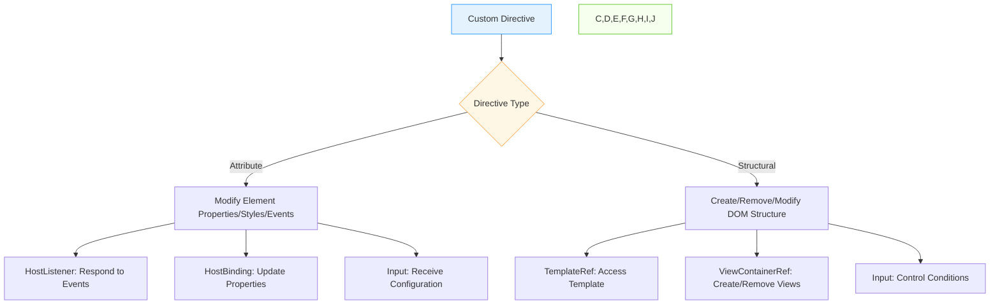

## Introduction
While Angular provides many built-in directives like *ngIf, *ngFor, ngClass, and ngStyle, there are times when you need to create custom directives to encapsulate reusable DOM manipulation logic that isn't covered by the built-in directives. Custom directives allow you to extend Angular's template syntax with your own reusable components.

## Why do we need this?
Built-in directives cover common use cases, but every application has unique requirements. Custom directives enable you to:
- Encapsulate complex DOM manipulation logic
- Create reusable behavior that can be applied across multiple components
- Keep components focused on data and presentation logic rather than DOM manipulation
- Share common UI patterns across your application without duplicating code

## Real-world analogy
Think of custom directives as creating specialized tools for a workshop. While a standard toolset (built-in directives) covers most needs, sometimes you need a specialized jig or fixture (custom directive) for a specific task that you'll use repeatedly across different projects. Once created, this tool can be shared with other craftsmen (developers) and applied to various workpieces (elements) as needed.

## Visual Explanation


## Mermaid Diagram


### HostListener and HostBinding in Action
```mermaid
flowchart LR
    A[HostListener: mouseenter] --> B[Directive Method: onMouseEnter()]
    B --> C[Change Background Color]
    C --> D[Update UI]
    
    E[HostBinding: isHighlighted] --> F[Property Binding]
    F --> G[Element Property: class.highlighted]
    G --> H[Update CSS Class]
    
    I[Input: highlightColor] --> J[Directive Property]
    J --> K[Used in HostListener]
```

### TemplateRef and ViewContainerRef in Structural Directives
```mermaid
flowchart TD
    A[Structural Directive: *appUnless] --> B[Input: Condition]
    B -->|False| C[ViewContainerRef.createEmbeddedView()]
    C --> D[TemplateRef: Create Embedded View]
    D --> E[Render Template in DOM]
    
    B -->|True| F[ViewContainerRef.clear()]
    F --> G[Remove View from Container]
    G --> H[Remove Template from DOM]
    
    I[ng-template #loadingTemplate] --> D
    I --> J[Template Reference]
```

## Code Example
```typescript
// custom-directives-example.component.ts
import { Component } from '@angular/core';

@Component({
  selector: 'app-custom-directives-example',
  template: `
    <div class="directives-demo">
      <h2>Custom Directives Demo</h2>
      
      <!-- Custom Attribute Directives -->
      <section>
        <h3>Custom Attribute Directives</h3>
        
        <!-- Tooltip Directive -->
        <div class="directive-section">
          <h4>Tooltip Directive</h4>
          <button appTooltip="This is a tooltip message!" 
                  tooltipPosition="top"
                  tooltipClass="custom-tooltip">
            Hover over me
          </button>
          <button appTooltip="Another tooltip" 
                  tooltipPosition="right">
            Tooltip on the right
          </button>
        </div>
        
        <!-- Highlight Directive -->
        <div class="directive-section">
          <h4>Enhanced Highlight Directive</h4>
          <input type="color" [(ngModel)]="highlightColor" placeholder="Highlight color">
          <input type="color" [(ngModel)]="defaultColor" placeholder="Default color">
          <p [appBetterHighlight]="highlightColor" 
             [defaultColor]="defaultColor"
             (mouseEnter)="onMouseEnter()"
             (mouseLeave)="onMouseLeave()">
            Enhanced Highlight - Hover over me!
          </p>
          <p>Mouse enter count: {{ mouseEnterCount }}</p>
          <p>Mouse leave count: {{ mouseLeaveCount }}</p>
        </div>
        
        <!-- Scroll Spy Directive -->
        <div class="directive-section">
          <h4>Scroll Spy Directive</h4>
          <div appScrollSpy 
               (scrollEvent)="onScroll($event)"
               [threshold]="200">
            <div class="scroll-content">
              <div *ngFor="let item of items" [class.active]="isActive(item.id)" 
                   class="scroll-item" [id]="'item-' + item.id">
                <h3>Item {{ item.id }}</h3>
                <p>{{ item.content }}</p>
              </div>
            </div>
          </div>
          <div class="scroll-status">
            <p>Last scroll position: {{ scrollPosition }}px</p>
            <p>Currently viewing: {{ activeItem }}</p>
          </div>
        </div>
      </section>
      
      <!-- Custom Structural Directives -->
      <section>
        <h3>Custom Structural Directives</h3>
        
        <!-- Unless Directive -->
        <div class="directive-section">
          <h4>Unless Directive (opposite of *ngIf)</h4>
          <label>
            <input type="checkbox" [(ngModel)]="isLoading">
            Show Loading State
          </label>
          
          <p *appUnless="isLoading">
            Content is visible when NOT loading
          </p>
          
          <div *appUnless="isLoading; else loadingTemplate">
            <p>This content shows when isLoading is false</p>
            <button (click)="isLoading = true">Start Loading</button>
          </div>
          
          <ng-template #loadingTemplate>
            <div class="loading-indicator">
              <div class="spinner"></div>
              <p>Loading...</p>
            </div>
          </ng-template>
        </div>
        
        <!-- Repeat Directive -->
        <div class="directive-section">
          <h4>Repeat Directive</h4>
          <label>
            Repeat count:
            <input type="number" [(ngModel)]="repeatCount" min="1" max="10">
          </label>
          
          <div *appRepeat="repeatCount; let i = index">
            <div class="repeat-item">
              Item {{ i + 1 }} of {{ repeatCount }}
            </div>
          </div>
        </div>
        
        <!-- Unless with then/else -->
        <div class="directive-section">
          <h4>Unless with Then/Else Template</h4>
          <label>
            <input type="checkbox" [(ngModel)]="showError">
            Simulate Error State
          </label>
          
          <div *appUnless="showError; then successBlock else errorBlock"></div>
          
          <ng-template #successBlock>
            <div class="success-box">
              <h3>Success!</h3>
              <p>Everything is working correctly.</p>
            </div>
          </ng-template>
          
          <ng-template #errorBlock>
            <div class="error-box">
              <h3>Error Occurred</h3>
              <p>Something went wrong. Please try again later.</p>
              <button (click)="showError = false">Try Again</button>
            </div>
          </ng-template>
        </div>
      </section>
    </div>
  `,
  styles: [`
    .directives-demo { max-width: 800px; margin: 0 auto; padding: 20px; }
    .directive-section { margin: 30px 0; padding: 20px; border: 1px solid #eee; border-radius: 4px; }
    .directive-section h4 { margin-top: 0; color: #1890ff; }
    
    /* Tooltip Directive Styles */
    .tooltip {
      position: absolute;
      background: #333;
      color: white;
      padding: 5px 10px;
      border-radius: 3px;
      font-size: 12px;
      white-space: nowrap;
      z-index: 1000;
      pointer-events: none;
    }
    .tooltip-top { bottom: 125%; left: 50%; transform: translateX(-50%); }
    .tooltip-right { top: 50%; left: 125%; transform: translateY(-50%); }
    .tooltip-bottom { top: 125%; left: 50%; transform: translateX(-50%); }
    .tooltip-left { top: 50%; left: -125%; transform: translateY(-50%); }
    
    /* Tooltip Container */
    .tooltip-wrapper {
      position: relative;
      display: inline-block;
    }
    
    /* Highlight Directive */
    .highlight-box {
      padding: 15px;
      margin: 10px 0;
      min-height: 40px;
      transition: background-color 0.3s ease;
      text-align: center;
    }
    
    /* Scroll Spy */
    .scroll-spy-container {
      position: relative;
      height: 200px;
      overflow-y: auto;
      border: 1px solid #ddd;
      margin: 10px 0;
    }
    .scroll-content {
      padding: 10px;
    }
    .scroll-item {
      padding: 15px;
      margin: 10px 0;
      border-radius: 4px;
      transition: background-color 0.3s ease;
    }
    .scroll-item.active {
      background-color: #e3f2fd;
      border-left: 4px solid #1890ff;
    }
    .scroll-status {
      margin-top: 10px;
      padding: 10px;
      background-color: #f5f5f5;
      border-radius: 4px;
    }
    
    /* Unless Directive */
    .loading-indicator {
      text-align: center;
      padding: 20px;
    }
    .spinner {
      border: 4px solid #f3f3f3;
      border-top: 4px solid #1890ff;
      border-radius: 50%;
      width: 30px;
      height: 30px;
      animation: spin 1s linear infinite;
      margin: 0 auto 10px;
    }
    @keyframes spin {
      0% { transform: rotate(0deg); }
      100% { transform: rotate(360deg); }
    }
    
    /* Repeat Directive */
    .repeat-item {
      background-color: #f5f5f5;
      margin: 5px 0;
      padding: 10px;
      border-radius: 4px;
    }
    
    /* Unless with then/else */
    .success-box, .error-box {
      padding: 20px;
      border-radius: 4px;
      margin: 10px 0;
    }
    .success-box { background-color: #e8f5e8; border: 1px solid #4caf50; }
    .error-box { background-color: #fdecea; border: 1px solid #f44336; }
  `]
})
export class CustomDirectivesExampleComponent {
  // Tooltip demo
  // (no specific properties needed for basic tooltip)
  
  // Enhanced Highlight demo
  highlightColor = '#ffeb3b';
  defaultColor = '#f5f5f5';
  mouseEnterCount = 0;
  mouseLeaveCount = 0;
  
  onMouseEnter() {
    this.mouseEnterCount++;
  }
  
  onMouseLeave() {
    this.mouseLeaveCount++;
  }
  
  // Scroll Spy demo
  items = [
    { id: 1, content: 'First item content - Lorem ipsum dolor sit amet' },
    { id: 2, content: 'Second item content - Consectetur adipiscing elit' },
    { id: 3, content: 'Third item content - Sed do eiusmod tempor incididunt' },
    { id: 4, content: 'Fourth item content - Ut labore et dolore magna aliqua' },
    { id: 5, content: 'Fifth item content - Ut enim ad minim veniam' }
  ];
  
  scrollPosition = 0;
  activeItem = 'None';
  
  onScroll(event: any) {
    this.scrollPosition = event.scrollTop;
    // Determine which item is currently visible based on scroll position
    const itemIndex = Math.floor(event.scrollTop / 60); // Assuming 60px per item
    if (itemIndex >= 0 && itemIndex < this.items.length) {
      this.activeItem = `Item ${this.items[itemIndex].id}`;
    } else {
      this.activeItem = 'None';
    }
  }
  
  // Unless demo
  isLoading = false;
  showError = false;
  
  // Repeat demo
  repeatCount = 3;
}

// Tooltip Directive
import { Directive, ElementRef, HostListener, Input, OnInit, Renderer2 } from '@angular/core';

@Directive({
  selector: '[appTooltip]'
})
export class TooltipDirective implements OnInit {
  @Input() appTooltip: string = '';
  @Input() tooltipPosition: 'top' | 'right' | 'bottom' | 'left' = 'top';
  @Input() tooltipClass: string = '';
  
  private tooltipElement: any = null;
  
  constructor(private el: ElementRef, private renderer: Renderer2) {}
  
  ngOnInit(): void {
    if (!this.appTooltip) return;
  }
  
  @HostListener('mouseenter')
  onMouseEnter(): void {
    if (!this.appTooltip) return;
    this.showTooltip();
  }
  
  @HostListener('mouseleave')
  onMouseLeave(): void {
    this.hideTooltip();
  }
  
  private showTooltip(): void {
    this.tooltipElement = this.renderer.createElement('div');
    this.renderer.appendChild(this.tooltipElement, this.renderer.createText(this.appTooltip));
    
    // Add classes
    this.renderer.addClass(this.tooltipElement, 'tooltip');
    this.renderer.addClass(this.tooltipElement, `tooltip-${this.tooltipPosition}`);
    if (this.tooltipClass) {
      this.renderer.addClass(this.tooltipElement, this.tooltipClass);
    }
    
    // Append to body
    this.renderer.appendChild(document.body, this.tooltipElement);
    
    // Position tooltip
    this.positionTooltip();
  }
  
  private hideTooltip(): void {
    if (this.tooltipElement) {
      this.renderer.removeChild(document.body, this.tooltipElement);
      this.tooltipElement = null;
    }
  }
  
  private positionTooltip(): void {
    if (!this.tooltipElement) return;
    
    const hostElement = this.el.nativeElement;
    const hostRect = hostElement.getBoundingClientRect();
    const tooltipRect = this.tooltipElement.getBoundingClientRect();
    
    let top = 0;
    let left = 0;
    
    switch (this.tooltipPosition) {
      case 'top':
        top = hostRect.top - tooltipRect.height - 10;
        left = hostRect.left + (hostRect.width - tooltipRect.width) / 2;
        break;
      case 'right':
        top = hostRect.top + (hostRect.height - tooltipRect.height) / 2;
        left = hostRect.right + 10;
        break;
      case 'bottom':
        top = hostRect.bottom + 10;
        left = hostRect.left + (hostRect.width - tooltipRect.width) / 2;
        break;
      case 'left':
        top = hostRect.top + (hostRect.height - tooltipRect.height) / 2;
        left = hostRect.left - tooltipRect.width - 10;
        break;
    }
    
    // Adjust for scroll
    top += window.pageYOffset;
    left += window.pageXOffset;
    
    this.renderer.setStyle(this.tooltipElement, 'top', `${top}px`);
    this.renderer.setStyle(this.tooltipElement, 'left', `${left}px`);
  }
}

// Enhanced Highlight Directive
import { Directive, ElementRef, HostListener, Input, OnInit, Output, EventEmitter } from '@angular/core';

@Directive({
  selector: '[appBetterHighlight]'
})
export class BetterHighlightDirective implements OnInit {
  @Input() appBetterHighlight: string = 'yellow';
  @Input() defaultColor: string = 'transparent';
  @Output() mouseEnter = new EventEmitter<void>();
  @Output() mouseLeave = new EventEmitter<void>();
  
  constructor(private el: ElementRef) {}
  
  ngOnInit(): void {
    this.setBackground(this.defaultColor);
  }
  
  @HostListener('mouseenter')
  onMouseEnter(): void {
    this.mouseEnter.emit();
    this.setBackground(this.appBetterHighlight || 'yellow');
  }
  
  @HostListener('mouseleave')
  onMouseLeave(): void {
    this.mouseLeave.emit();
    this.setBackground(this.defaultColor);
  }
  
  private setBackground(color: string): void {
    this.el.nativeElement.style.backgroundColor = color;
  }
}

// Scroll Spy Directive
import { Directive, ElementRef, HostListener, Input, Output, EventEmitter } from '@angular/core';

@Directive({
  selector: '[appScrollSpy]'
})
export class ScrollSpyDirective {
  @Input() threshold: number = 0;
  @Output() scrollEvent = new EventEmitter<any>();
  
  constructor(private el: ElementRef) {}
  
  @HostListener('scroll', ['$event'])
  onScroll(event: any): void {
    this.scrollEvent.emit({
      scrollTop: event.target.scrollTop,
      scrollLeft: event.target.scrollLeft,
      scrollWidth: event.target.scrollWidth,
      scrollHeight: event.target.scrollHeight,
      target: event.target
    });
  }
}

// Unless Directive (opposite of *ngIf)
import { Directive, Input, TemplateRef, ViewContainerRef } from '@angular/core';

@Directive({
  selector: '[appUnless]'
})
export class UnlessDirective {
  @Input() set appUnless(condition: boolean) {
    if (!condition) {
      this.vcRef.createEmbeddedView(this.templateRef);
    } else {
      this.vcRef.clear();
    }
  }
  
  constructor(
    private templateRef: TemplateRef<any>,
    private vcRef: ViewContainerRef
  ) {}
}

// Repeat Directive
import { Directive, Input, TemplateRef, ViewContainerRef } from '@angular/core';

@Directive({
  selector: '[appRepeat]'
})
export class RepeatDirective {
  @Input() set appRepeat(count: number) {
    this.vcRef.clear();
    for (let i = 0; i < count; i++) {
      this.vcRef.createEmbeddedView(this.templateRef, {
        $implicit: i + 1,
        index: i
      });
    }
  }
  
  constructor(
    private templateRef: TemplateRef<any>,
    private vcRef: ViewContainerRef
  ) {}
}
```