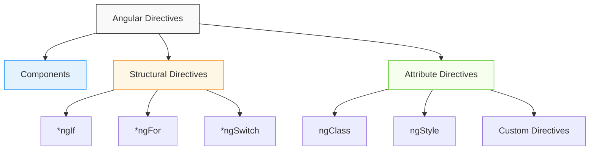

## Introduction
Directives are classes that add additional behavior to elements in your Angular applications. They allow you to manipulate the DOM, respond to events, and modify element appearance and behavior. There are three types of directives in Angular:
1. **Components** - Directives with templates (covered separately)
2. **Structural Directives** - Change the DOM structure by adding or removing elements
3. **Attribute Directives** - Change the appearance or behavior of existing elements

## Why do we need this?
Directives extend HTML's capabilities, allowing you to create rich, interactive user interfaces without manually manipulating the DOM. They encapsulate complex DOM manipulation logic into reusable units, making your templates cleaner and your application more maintainable.

## Real-world analogy
Think of directives as specialized tools in a craftsman's workshop. Just as a carpenter uses different tools (saw, hammer, drill) to shape wood, Angular developers use different directives to shape and manipulate the user interface. Each tool (directive) has a specific purpose but works together to create the final product.

## Visual Explanation


## Mermaid Diagram


## Key Concepts
- **Structural Directives**: Prefixed with `*` (e.g., `*ngIf`, `*ngFor`) and modify the DOM layout
- **Attribute Directives**: Applied as attributes (e.g., `[ngClass]`, `[ngStyle]`) and modify element appearance/behavior
- **Components**: Special directives with templates that control a portion of the screen
- **Custom Directives**: User-created directives that encapsulate specific DOM manipulation logic

## Code Structure Overview
```typescript
// Structural Directive Example (@ngIf)
*ngIf="condition"

// Attribute Directive Example ([ngClass])
[ngClass]="{'active': isActive}"

// Custom Directive Example (selector: [appHighlight])
<p appHighlight [appHighlight]="'yellow'">Highlighted Text</p>
```

## Best Practices
- Use structural predicates (*ngIf, *ngFor) to modify DOM structure
- Use attribute directives ([ngClass], [ngStyle]) for appearance changes
- Create custom directives for reusable DOM manipulation logic
- Always provide trackBy function with *ngFor for performance
- Remember that structural directives cannot be used on the same element
- Use ng-container when you need to apply multiple structural directives without adding extra DOM elements

## When to Use What
- **Structural Directives**: When you need to add, remove, or modify elements in the DOM
- **Attribute Directives**: When you need to change how an element looks or behaves
- **Components**: When you need a self-contained unit with its own template, styles, and logic
- **Custom Directives**: When you have reusable DOM manipulation logic that doesn't fit into a component

## Structural Directives
Learn about directives that change the DOM structure:
- [*ngIf*](#) - Conditionally include or exclude elements
- [*ngFor*](#) - Repeat elements for each item in a collection
- [*ngSwitch*](#) - Display different elements based on a condition

**See:** [Structural Directives](./structural-directives.md)

## Attribute Directives
Learn about directives that change element appearance or behavior:
- [ngClass](#) - Dynamically set CSS classes
- [ngStyle](#) - Dynamically set inline styles
- [Custom Attribute Directives](#) - Create your own attribute directives

**See:** [Attribute Directives](./attribute-directives.md)

## Custom Directives
Learn how to create your own directives:
- Attribute Directives (modify appearance/behavior)
- Structural Directives (modify DOM structure)
- HostListener and HostBinding decorators
- Input and Output properties for communication

**See:** [Custom Directives](./custom-directives.md)

## Summary
Directives are a powerful feature of Angular that allow you to extend HTML and create dynamic user interfaces. By understanding the three types of directives (components, structural, and attribute) and how to create custom directives, you can build more maintainable and reusable Angular applications. Structural directives change the DOM layout, attribute directives modify element appearance/behavior, and components are special directives with templates. Mastering directives is essential for becoming proficient in Angular development.