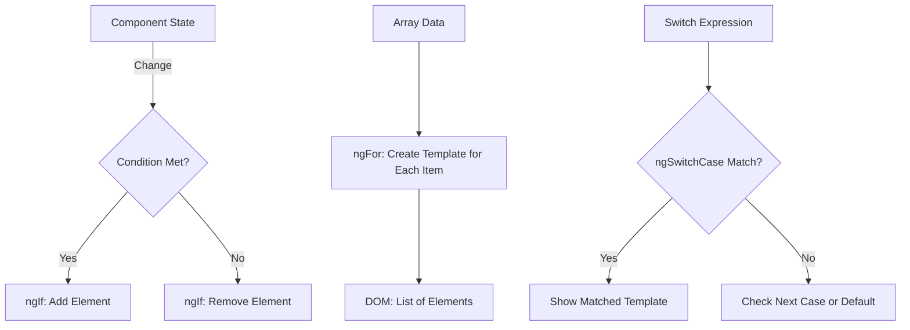
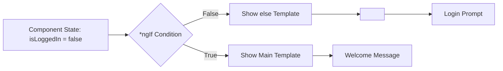

## Introduction
Structural directives are responsible for HTML layout. They shape or reshape the DOM's structure, typically by adding, removing, or manipulating elements. They are easily recognizable by the asterisk (*) prefix in their syntax, such as *ngIf, *ngFor, and *ngSwitch.

## Why do we need this?
Manually manipulating the DOM to add or remove elements is error-prone and inefficient. Structural directives provide a declarative way to modify the DOM based on application state, leading to cleaner, more maintainable code that integrates seamlessly with Angular's change detection.

## Real-world analogy
Think of structural directives as a theater director managing the stage. Based on the script (application state), the director decides which actors (DOM elements) should be on stage (visible), which should exit (removed), and when they should enter (added). The audience (user) sees a coherent performance without seeing the complex stage management behind the scenes.

## Visual Explanation


## Mermaid Diagram


### *ngIf with Else Template


### *ngFor with trackBy Function
```mermaid
flowchart LR
    A[User Array: [{id:1,name:'Alice'},{id:2,name:'Bob'}]] --> B[*ngFor Loop]
    B --> C{TrackBy Function}
    C -->|Returns user.id| D[Track by ID]
    D --> E[DOM Elements Mapped by ID]
    F[User Object Changed: {id:1,name:'Alice'}] --> C
    F -->|Same ID: 1| G[Reuse Existing DOM Element]
    H[New Array Item: {id:3,name:'Charlie'}] --> C
    H -->|New ID: 3| I[Create New DOM Element]
```

## Code Example
```typescript
// structural-directives-example.component.ts
import { Component } from '@angular/core';

@Component({
  selector: 'app-structural-directives-example',
  template: `
    <div class="directives-demo">
      <h2>Structural Directives Demo</h2>
      
      <!-- ngIf Examples -->
      <section>
        <h3>*ngIf Examples</h3>
        <div class="control-panel">
          <button (click)="toggleLoggedIn()">
            {{ isLoggedIn ? 'Logout' : 'Login' }}
          </button>
        </div>
        
        <div *ngIf="isLoggedIn; else loggedOutTemplate">
          <p>Welcome back, {{ userName }}!</p>
          <button (click)="showProfile = !showProfile">
            {{ showProfile ? 'Hide' : 'Show' }} Profile
          </button>
          
          <div *ngIf="showProfile">
            <p>Email: {{ userEmail }}</p>
            <p>Role: {{ userRole }}</p>
          </div>
        </div>
        
        <ng-template #loggedOutTemplate>
          <p>Please log in to continue.</p>
          <button (click)="toggleLoggedIn()">Login</button>
        </ng-template>
      </section>
      
      <!-- ngFor Examples -->
      <section>
        <h3>*ngFor Examples</h3>
        <div>
          <label>
            Filter by role:
            <select [(ngModel)]="selectedRole">
              <option value="">All Roles</option>
              <option value="admin">Admin</option>
              <option value="user">User</option>
              <option value="moderator">Moderator</option>
            </select>
          </label>
        </div>
        
        <ul>
          <li *ngFor="let user of filteredUsers; let i = index; trackBy: trackById"
              [class.active]="selectedUser === user">
            {{ i + 1 }}. {{ user.name }} - {{ user.role }}
            <button (click)="selectUser(user)" 
                    [class.selected]="selectedUser === user">
              {{ selectedUser === user ? 'Deselect' : 'Select' }}
            </button>
          </li>
        </ul>
        
        <div *ngIf="selectedUser">
          <h4>Selected User:</h4>
          <p>{{ selectedUser.name }} ({{ selectedUser.role }})</p>
        </div>
      </section>
      
      <!-- ngSwitch Examples -->
      <section>
        <h3>*ngSwitch Examples</h3>
        <div>
          <label>
            Status:
            <select [(ngModel)]="status">
              <option value="active">Active</option>
              <option value="pending">Pending</option>
              <option value="inactive">Inactive</option>
              <option value="banned">Banned</option>
            </select>
          </label>
        </div>
        
        <div [ngSwitch]="status">
          <div *ngSwitchCase="'active'">
            <p class="status-active">✅ Account is Active</p>
          </div>
          <div *ngSwitchCase="'pending'">
            <p class="status-pending">⏳ Account is Pending Verification</p>
          </div>
          <div *ngSwitchCase="'inactive'">
            <p class="status-inactive">😴 Account is Inactive</p>
          </div>
          <div *ngSwitchCase="'banned'">
            <p class="status-banned">🚫 Account has been Banned</p>
          </div>
          <div *ngSwitchDefault>
            <p class="status-unknown">❓ Unknown Status: {{ status }}</p>
          </div>
        </div>
      </section>
    </div>
  `,
  styles: [`
    .directives-demo { max-width: 800px; margin: 0 auto; padding: 20px; }
    .control-panel { margin: 20px 0; text-align: center; }
    button { margin: 0 10px; padding: 8px 16px; cursor: pointer; }
    .active { background-color: #e3f2fd; }
    .selected { font-weight: bold; color: #1976d2; }
    .status-active { color: green; }
    .status-pending { color: orange; }
    .status-inactive { color: gray; }
    .status-banned { color: red; }
    .status-unknown { color: #9e9e9e; font-style: italic; }
  `]
})
export class StructuralDirectivesExampleComponent {
  isLoggedIn = false;
  userName = 'Alice';
  userEmail = 'alice@example.com';
  userRole = 'Admin';
  
  showProfile = false;
  
  users = [
    { id: 1, name: 'Alice', role: 'Admin', active: true },
    { id: 2, name: 'Bob', role: 'User', active: false },
    { id: 3, name: 'Carol', role: 'User', active: true },
    { id: 4, name: 'Dave', role: 'Moderator', active: true }
  ];
  
  selectedRole = '';
  selectedUser: any = null;
  
  get filteredUsers() {
    if (!this.selectedRole) return this.users;
    return this.users.filter(user => user.role === this.selectedRole);
  }
  
  trackById(index: number, user: any): number {
    return user.id;
  }
  
  toggleLoggedIn() {
    this.isLoggedIn = !this.isLoggedIn;
    if (!this.isLoggedIn) {
      this.showProfile = false;
    }
  }
  
  selectUser(user: any) {
    this.selectedUser = this.selectedUser === user ? null : user;
  }
  
  status: string = 'active';
}
```

## Best Practices
- Use *ngIf to conditionally create or destroy elements, not just to hide them (use [hidden] attribute for visibility toggling)
- Always provide a trackBy function with *ngFor for performance optimization, especially with large lists
- Keep template expressions simple; move complex logic to component methods
- Use ng-container with structural directives when you don't want to add extra DOM elements
- Remember that structural directives cannot be used on the same element (use ng-container to wrap multiple structural directives)
- Prefer *ngIf over [hidden] when you want to completely remove elements from the DOM
- Use trackBy with *ngFor to maintain DOM element state and improve performance
- Keep ngSwitch cases mutually exclusive for clarity

## Common Mistakes
- Using *ngIf with a semicolon instead of a semicolon for else clause: *ngIf="condition; else templateName" (correct) vs *ngIf="condition; else=templateName" (incorrect)
- Forgetting to import CommonModule when using structural directives in standalone components or feature modules
- Misunderstanding that *ngIf removes elements from DOM entirely, not just hiding them
- Not providing trackBy function with *ngFor when dealing with object arrays, causing unnecessary DOM recreation
- Trying to use multiple structural directives on the same element (e.g., *ngIf *ngFor on same element)
- Forgetting to import FormsModule when using ngModel in templates
- Misusing ng-switch attributes: [ngSwitch] on container, *ngSwitchCase on items

## Interview Questions
1. What is the difference between *ngIf and [hidden] attribute?
2. How does *ngFor track items by default, and why should you use trackBy?
3. Can you use multiple structural directives on the same element? If not, how do you work around this limitation?
4. What happens to event listeners and component state when an element is removed by *ngIf?
5. How does ngSwitch differ from using multiple *ngIf statements?
6. What is the purpose of ng-container when used with structural directives?
7. How would you create a custom structural directive?
8. What performance considerations should you keep in mind when using *ngFor with large lists?
9. Explain the difference between *ngIf="true" and *ngIf="false" in terms of DOM manipulation.
10. How would you handle asynchronous data with *ngIf (e.g., data from an Observable)?

## Summary
Structural directives (*ngIf, *ngFor, *ngSwitch) are essential tools for dynamically shaping the DOM in Angular applications. They allow you to conditionally display elements, render lists, and switch between multiple views based on conditions. By understanding how these directives work under the hood and following best practices like using trackBy with *ngFor and avoiding multiple structural directives on the same element, you can build efficient and maintainable Angular applications. Remember that structural directives fundamentally alter the DOM structure, unlike attribute directives which only modify the appearance or behavior of existing elements.