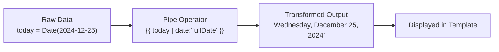
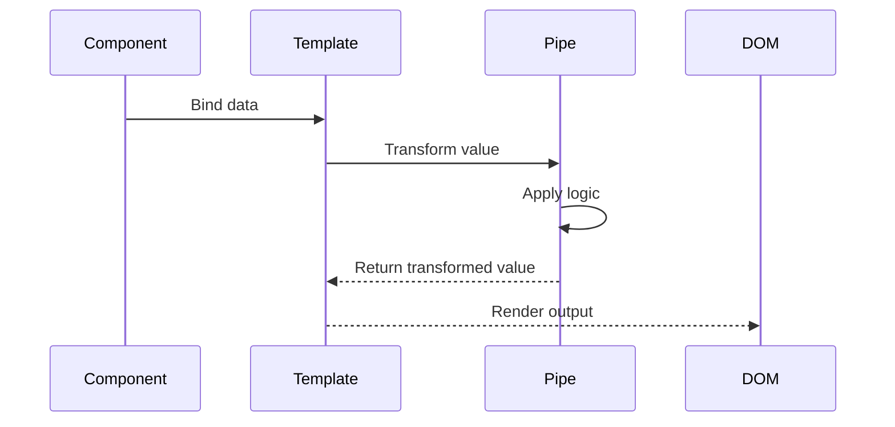
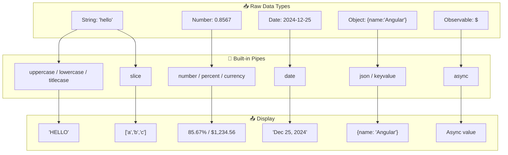

## Introduction
Pipes are template operators that transform data for display. Built-in pipes handle formatting dates, currencies, percentages, text, and more — keeping templates clean and logic reusable.

## Why do we need this?
Raw data from APIs and services rarely matches what you want to show users. A date like `2024-12-25T10:30:00Z` should display as "December 25, 2024" or "25/12/2024" depending on locale. Writing formatting logic in every component is repetitive and error-prone — pipes encapsulate this cleanly.

## Real-world analogy
Think of pipes like a **coffee machine with different attachments**. You put in the same coffee (raw data) and choose your attachment: espresso (date pipe), latte (currency pipe), or cappuccino (uppercase pipe). The machine transforms the input into exactly what you want, consistently every time.

## How Pipes Work







## Common Built-in Pipes

### Date Pipe
Formats dates using Angular's predefined formats or custom patterns:

```typescript
@Component({
  template: `
    <p>{{ today | date }}</p>                    <!-- Dec 25, 2024 -->
    <p>{{ today | date:'fullDate' }}</p>        <!-- Wednesday, December 25, 2024 -->
    <p>{{ today | date:'dd/MM/yyyy' }}</p>      <!-- 25/12/2024 -->
    <p>{{ today | date:'shortTime' }}</p>       <!-- 10:30 AM -->
  `
})
export class DateDemoComponent {
  today = new Date();
}
```

### Currency Pipe
Formats numbers as currency with locale-aware symbols:

```typescript
<p>{{ price | currency }}</p>                     <!-- $1,234.56 -->
<p>{{ price | currency:'EUR' }}</p>              <!-- €1,234.56 -->
<p>{{ price | currency:'INR':'symbol':'4.2-2' }}</p> <!-- ₹1,234.56 -->
```

### Text Transformation Pipes
```html
<p>{{ message | uppercase }}</p>    <!-- HELLO WORLD -->
<p>{{ message | lowercase }}</p>    <!-- hello world -->
<p>{{ message | titlecase }}</p>    <!-- Hello World -->
```

### Number & Percent Pipes
```html
<p>{{ decimalValue | number:'1.2-2' }}</p>  <!-- 0.86 -->
<p>{{ decimalValue | percent }}</p>          <!-- 86% -->
```

### Async Pipe
Automatically subscribes to Observables/Promises and unsubscribes on destroy:

```html
<p>{{ observable$ | async }}</p>
<p *ngIf="users$ | async as users">{{ users.length }} users</p>
```

### JSON Pipe
Useful for debugging — renders objects as formatted JSON:

```html
<pre>{{ object | json }}</pre>
```

### Slice Pipe
Creates a sub-array or substring:

```html
<p>{{ items | slice:0:3 }}</p>  <!-- ['a','b','c'] -->
```

## Pipe Parameters

Many pipes accept parameters separated by colons:
- `date:'shortDate'` — format string
- `currency:'EUR':'symbol':'4.2-2'` — currency code, display, digits info
- `number:'1.0-2'` — minimum integer digits, min/max fraction digits
- `slice:0:3` — start and end indices

## Chaining Pipes

```html
<!-- Output: 'WEDNESDAY, DECEMBER 25, 2024' -->
<p>{{ birthday | date:'fullDate' | uppercase }}</p>
```

Pipes execute left-to-right: first `date` transforms the date, then `uppercase` transforms the resulting string.

## Best Practices
- Use pipes instead of method calls in templates for better performance (methods re-run on every CD cycle)
- Prefer pure pipes (default) for better performance — they only re-run when input references change
- Use the `async` pipe instead of manual subscriptions — it handles unsubscribe automatically
- Avoid chaining too many pipes — consider a custom pipe for complex transformations
- Use the `json` pipe for debugging only, not in production templates
- Pass locale configuration via `LOCALE_ID` for internationalized formatting

## Common Mistakes
- Using `{{ object | json }}` in production templates (adds overhead, exposes data)
- Calling methods in templates instead of using pipes — methods re-run on every CD cycle
- Forgetting to import `CommonModule` (standalone) for built-in pipes
- Chaining too many pipes — harder to read and debug
- Using `async` pipe multiple times on the same Observable (creates multiple subscriptions)
- Not providing locale configuration — dates and currencies default to en-US

## Interview Questions
1. What are pipes and why are they used in Angular?
2. How do you pass parameters to a pipe?
3. What is the difference between pure and impure pipes?
4. How does the `async` pipe work and what problem does it solve?
5. Can you chain pipes? What is the execution order?
6. How do you configure locale for pipes?

## Summary
Built-in pipes handle most common formatting needs — dates, currencies, text transforms, numbers, and async values. Use them to keep templates clean, avoid redundant formatting code, and leverage Angular's locale-aware internationalization.
