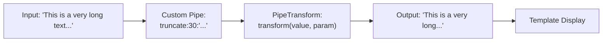
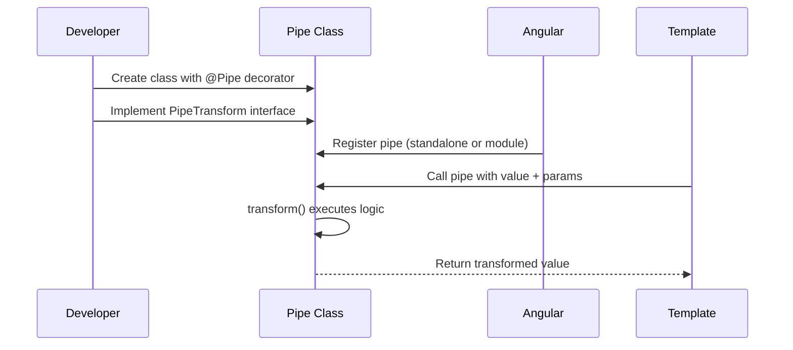
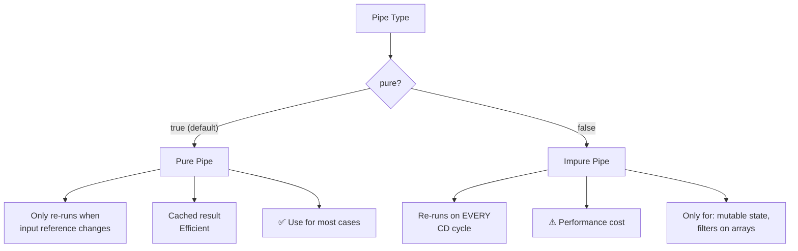

## Introduction
When built-in pipes don't meet your needs, create custom pipes. Custom pipes encapsulate transformation logic into reusable, testable units — keeping templates clean and logic DRY.

## Why do we need this?
Built-in pipes cover common cases (dates, currency, text), but real apps always have domain-specific formatting needs — truncating text, filtering arrays, formatting phone numbers, masking credit cards. Writing this logic in every component duplicates code. Custom pipes solve this once and reuse everywhere.

## Real-world analogy
A custom pipe is like a **custom die-cast mold** in a factory. The built-in tools make standard shapes (circles, squares), but when you need a specific star-shaped part for your product, you create a custom mold. Once made, it stamps out that shape consistently forever.

## Creating a Custom Pipe





## Implementation

### Step 1: Create the Pipe Class

```typescript
import { Pipe, PipeTransform } from '@angular/core';

@Pipe({
  name: 'truncate',
  standalone: true  // ✅ Standalone — import directly
})
export class TruncatePipe implements PipeTransform {
  transform(value: string, maxLength: number = 50, suffix: string = '...'): string {
    if (!value) return '';
    return value.length > maxLength
      ? value.substring(0, maxLength) + suffix
      : value;
  }
}
```

### Step 2: Use in Template

```html
<!-- Custom pipe in action -->
<p>{{ longText | truncate:30:'...' }}</p>
<p>{{ title | truncate:20 }}</p>        <!-- Uses default suffix '...' -->
<p>{{ description | truncate:100:'…' }}</p>  <!-- Custom ellipsis -->
```

### Step 3: Register the Pipe

```typescript
// Standalone component — import directly
@Component({
  standalone: true,
  imports: [TruncatePipe],  // ✅ Import the pipe
  template: `<p>{{ text | truncate:50 }}</p>`
})
export class MyComponent { }

// NgModule — add to declarations
@NgModule({
  declarations: [TruncatePipe],
  exports: [TruncatePipe]
})
export class SharedModule { }
```

## Pure vs Impure Pipes



```typescript
// Pure pipe (default) — only recalculates when input reference changes
@Pipe({ name: 'filter', pure: true })
export class FilterPipe implements PipeTransform { }

// Impure pipe — recalculates on every change detection cycle
@Pipe({ name: 'filter', pure: false })
export class FilterPipe implements PipeTransform { }
```

## Advanced Example: Filter Pipe

```typescript
@Pipe({
  name: 'filter',
  pure: false,  // Impure — re-runs when array contents change (not just reference)
  standalone: true
})
export class FilterPipe implements PipeTransform {
  transform<T>(items: T[], searchTerm: string, key?: keyof T): T[] {
    if (!items || !searchTerm) return items || [];
    const term = searchTerm.toLowerCase();
    return items.filter(item => {
      if (key) {
        return String(item[key]).toLowerCase().includes(term);
      }
      return JSON.stringify(item).toLowerCase().includes(term);
    });
  }
}

// Usage
// <li *ngFor="let user of users | filter:searchTerm:'name'">
//   {{ user.name }}
// </li>
```

## Best Practices
- Keep pipes **pure** (`pure: true`) for better performance — use only when the pipe only depends on its inputs
- Use pipes for **display logic** only, component methods for business logic
- Make pipes **standalone** (`standalone: true`) for easy reuse across modules
- Test pipes as **pure functions** — no TestBed needed, just instantiate and call `transform()`
- Name pipes with **descriptive, kebab-case** names
- Handle **null/undefined inputs** gracefully — return a safe default
- Avoid **side effects** in pipes — they should be pure transformations

## Common Mistakes
- Making a pipe **impure** when a pure one would work — kills performance
- Modifying the input value **in place** instead of returning a new value
- Putting **async logic** (HTTP calls) in pipes — pipes must be synchronous
- Forgetting to **register** the pipe in standalone imports or module declarations
- Using pipes for **business logic** instead of display transformations
- Not handling **edge cases** (null, undefined, empty string)

## Interview Questions
1. How do you create a custom pipe in Angular?
2. What is the difference between pure and impure pipes?
3. When would you use an impure pipe?
4. How do you pass multiple parameters to a custom pipe?
5. How do you test a custom pipe?
6. Why shouldn't you make HTTP calls inside a pipe?

## Summary
Custom pipes encapsulate domain-specific display transformations into reusable, testable units. Keep them pure for performance, handle edge cases gracefully, and register them properly in standalone imports or module declarations.
