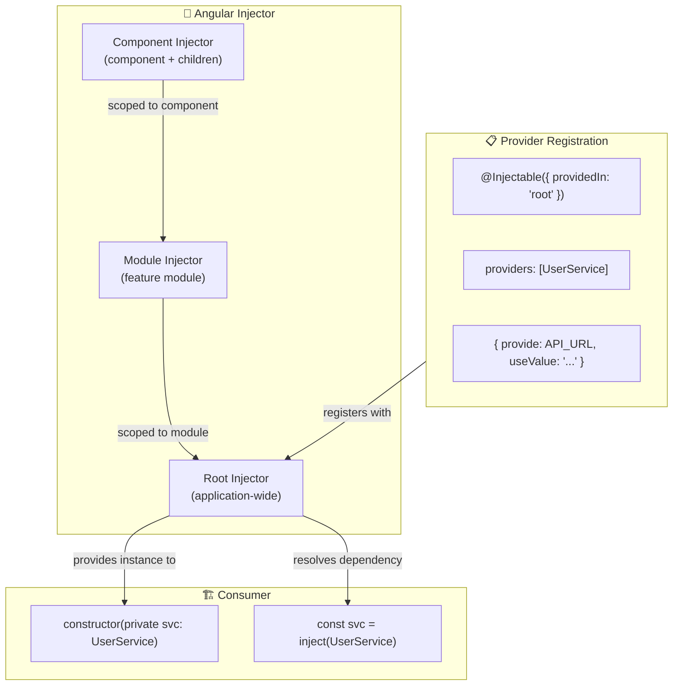
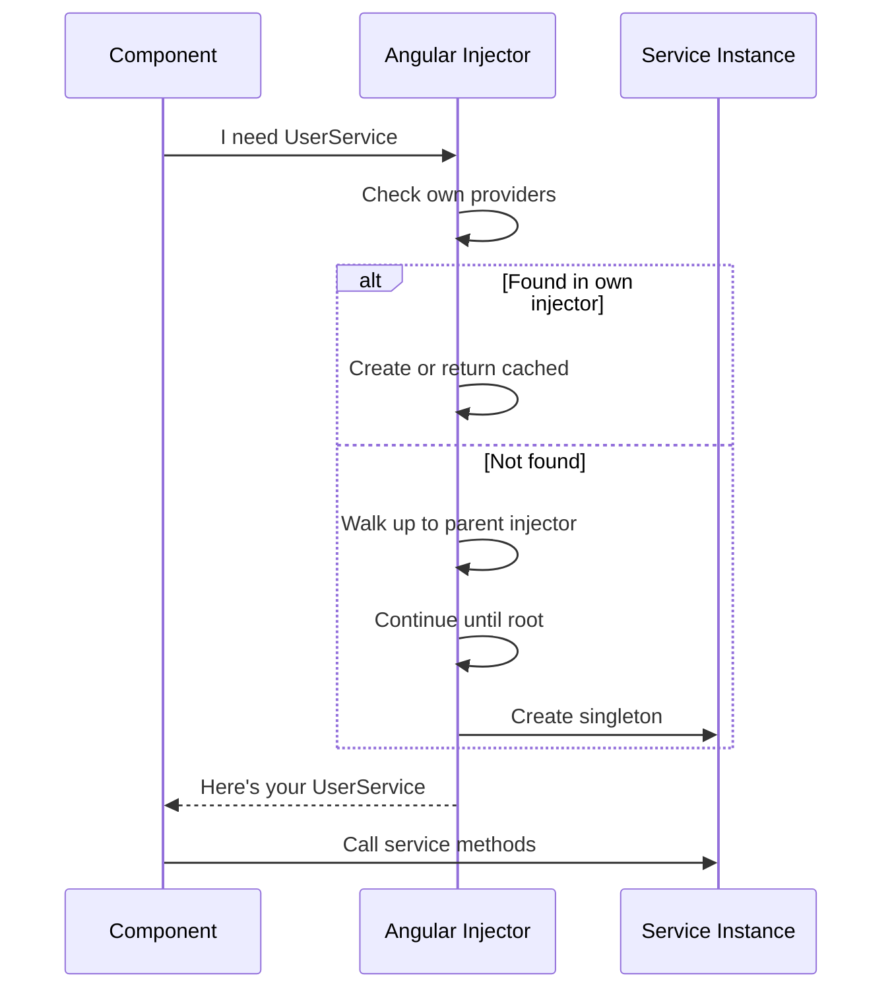

## Introduction
Dependency Injection (DI) is a design pattern where a class receives its dependencies from an external source rather than creating them itself. Angular's DI system is built into the framework — it creates and delivers services to components, directives, and other services automatically.

## Why do we need this?
Without DI, each component would need to create its own service instances (`new UserService(http)`), manage their lifecycle, and handle configuration. This leads to tight coupling, code duplication, and impossible-to-test components. DI decouples creation from usage, letting Angular handle the plumbing.

## Real-world analogy
Imagine a **restaurant kitchen**. The chef (component) doesn't grow vegetables, raise cattle, or weave baskets. Suppliers (DI system) deliver ingredients (dependencies) to the kitchen. The chef says "I need tomatoes" and they appear — no need to know about farms, trucks, or delivery schedules. If the tomato supplier changes, the chef doesn't care.

## How DI Works





## How to Use DI in Angular

### 1. Constructor Injection (Traditional)

```typescript
@Component({ ... })
export class ProductListComponent {
  constructor(
    private productService: ProductService,  // ✅ DI provides this
    private route: ActivatedRoute,           // ✅ DI provides this
    @Inject(API_URL) private apiUrl: string  // ✅ InjectionToken
  ) {}
}
```

### 2. inject() Function (Modern Angular 14+)

```typescript
@Component({ ... })
export class ProductListComponent {
  private productService = inject(ProductService);
  private route = inject(ActivatedRoute);
  private apiUrl = inject(API_URL);

  // ✅ Works in field initializers — no constructor needed
  products$ = this.productService.getAll();
}
```

### 3. Functional Guards & Resolvers

```typescript
// inject() works in functions — constructor injection doesn't
export const authGuard: CanActivateFn = () => {
  const auth = inject(AuthService);
  const router = inject(Router);
  return auth.isLoggedIn() ? true : router.createUrlTree(['/login']);
};
```

## Provider Types

| Provider | Purpose | Example |
|----------|---------|---------|
| `useClass` | Swap implementation | `{ provide: Logger, useClass: FileLogger }` |
| `useExisting` | Alias | `{ provide: Logger, useExisting: FileLogger }` |
| `useValue` | Object/value | `{ provide: API_URL, useValue: 'https://api.example.com' }` |
| `useFactory` | Dynamic creation | `{ provide: Logger, useFactory: () => isDev ? new ConsoleLogger() : new FileLogger() }` |

## Best Practices
- Prefer `inject()` over constructor injection for modern Angular apps — works in functions and field initializers
- Use `providedIn: 'root'` for app-wide singletons — enables tree-shaking
- Use `@Inject()` and `InjectionToken` for non-class dependencies (config, API URLs)
- Use `@Optional()` when a dependency might not be provided
- Use `@Host()` to limit resolution to the current element's injector
- Keep providers at the narrowest scope — component providers for scoped state, root for singletons

## Common Mistakes
- **Manually creating** service instances with `new` instead of letting DI handle it
- **Over-providing** — registering services in multiple places creates multiple instances
- Forgetting that **lazy-loaded modules** get their own injector — services provided there are not singletons
- Using a class directly as a token when you need an **abstract contract** (use `InjectionToken` or abstract class)
- **Circular dependencies** — Service A depends on Service B which depends on Service A
- Not understanding the **injector hierarchy** — component providers shadow parent providers

## Interview Questions
1. What is Dependency Injection and why is it used in Angular?
2. What is the difference between `providedIn: 'root'` and module-level providers?
3. How does Angular's injector hierarchy work?
4. What is the `inject()` function and when should you use it?
5. How do you provide a non-class dependency (like a config object)?
6. What happens if a dependency is not found in the injector tree?

## Summary
Dependency Injection is Angular's mechanism for providing dependencies to components, directives, and services. Angular's hierarchical injector resolves dependencies by walking up the injector tree. Use `providedIn: 'root'` for singletons, `inject()` for modern code, and understand the injector hierarchy to control service scope.
