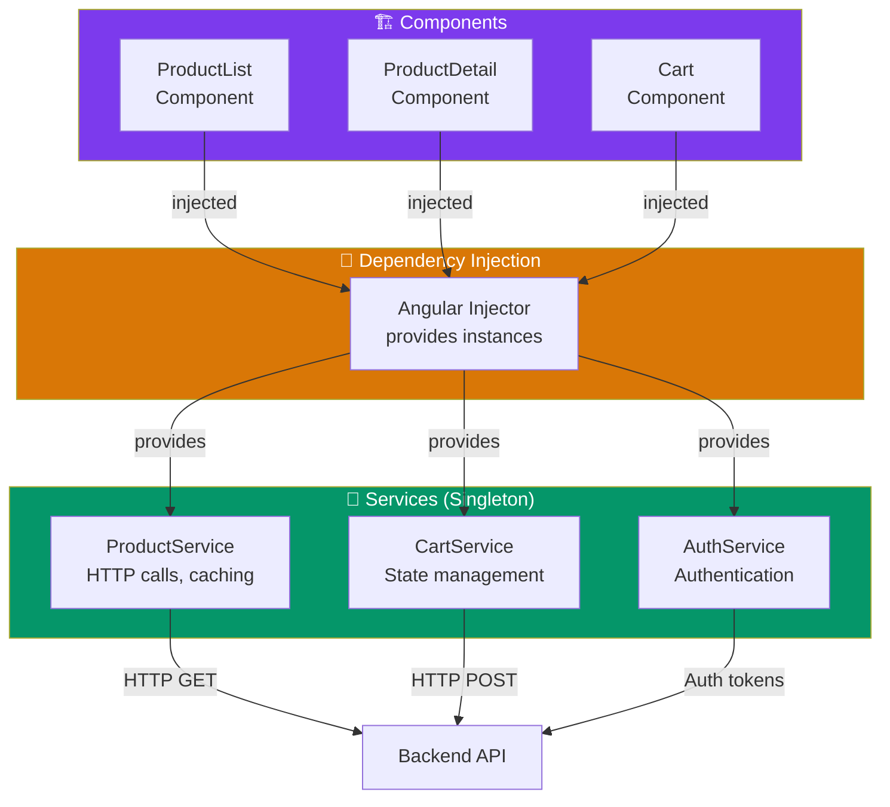
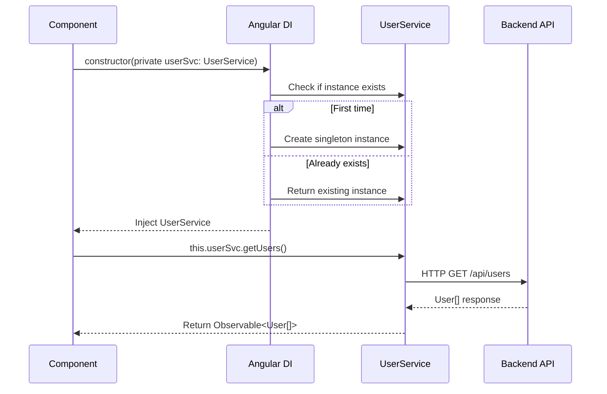

## Introduction
Services are singleton classes that provide functionality across your application — data operations, business logic, HTTP calls, and shared state. They keep components lean and focused on presentation.

## Why do we need this?
Without services, components would duplicate data-fetching logic, share state through complex @Input/@Output chains, and become impossible to test. Services centralize shared logic, making code DRY, testable, and maintainable.

## Real-world analogy
Think of services like **utility companies** in a city. Each house (component) doesn't generate its own electricity or water — it connects to the municipal supply (service). When a service needs upgrading, you change the utility company, not every house individually.

## How Services Work





## Creating a Service

```typescript
import { Injectable } from '@angular/core';
import { HttpClient } from '@angular/common/http';
import { Observable } from 'rxjs';

@Injectable({
  providedIn: 'root'  // ✅ Singleton — available everywhere, tree-shakable
})
export class UserService {
  private apiUrl = '/api/users';

  constructor(private http: HttpClient) {}

  getUsers(): Observable<User[]> {
    return this.http.get<User[]>(this.apiUrl);
  }

  getUserById(id: number): Observable<User> {
    return this.http.get<User>(`${this.apiUrl}/${id}`);
  }

  createUser(user: Omit<User, 'id'>): Observable<User> {
    return this.http.post<User>(this.apiUrl, user);
  }
}
```

## Using a Service in a Component

```typescript
@Component({
  selector: 'app-user-list',
  template: `
    <div *ngFor="let user of users$ | async">
      {{ user.name }}
    </div>
  `
})
export class UserListComponent {
  users$ = this.userService.getUsers();  // ✅ async pipe — no manual subscribe

  constructor(private userService: UserService) {}  // DI injects the singleton
}
```

## Service Patterns

| Pattern | Description | Example |
|---------|-------------|---------|
| **Data Service** | HTTP calls, caching, data transformation | `ProductService`, `OrderService` |
| **State Service** | Shared state via BehaviorSubject/Signals | `CartService`, `AuthService` |
| **Utility Service** | Logging, formatting, validation | `LoggerService`, `DateFormatter` |
| **Configuration** | App settings, feature flags | `AppConfigService` |
| **Auth Service** | Login/logout, token management | `AuthService` |

## Best Practices
- Use `providedIn: 'root'` for app-wide singletons — it's tree-shakable
- Keep services focused on a **single responsibility** — one service per domain
- Use **interfaces** for service method parameters and return types
- Prefer **async pipe** in templates instead of manual `.subscribe()`
- Use `BehaviorSubject` or **Signals** for shared state instead of plain properties
- Make services **stateless** where possible — delegate persistence to dedicated state services
- Use `takeUntilDestroyed()` or the `destroy$` pattern to prevent memory leaks

## Common Mistakes
- Putting **business logic in components** instead of services
- Creating a new service instance manually (`new ProductService()`) — let DI handle it
- Using `providedIn: 'root'` when the service should be scoped to a feature module
- **Mutating state** directly in components instead of through service methods
- Forgetting to **unsubscribe** from service Observables in components
- Making services too large — the "god service" anti-pattern
- Not handling **HTTP errors** in services — let callers know when things fail

## Interview Questions
1. What is a service in Angular and why is it used?
2. How does `providedIn: 'root'` differ from module-level providers?
3. How do you share data between components using a service?
4. What is the difference between a service and a component in terms of responsibilities?
5. How do you test a service that depends on HttpClient?
6. How do you prevent multiple instances of a service in lazy-loaded modules?

## Summary
Services are the backbone of Angular applications — they encapsulate data access, business logic, and shared state. Use `providedIn: 'root'` for singletons, keep them focused, and let components delegate to them for clean, testable code.
