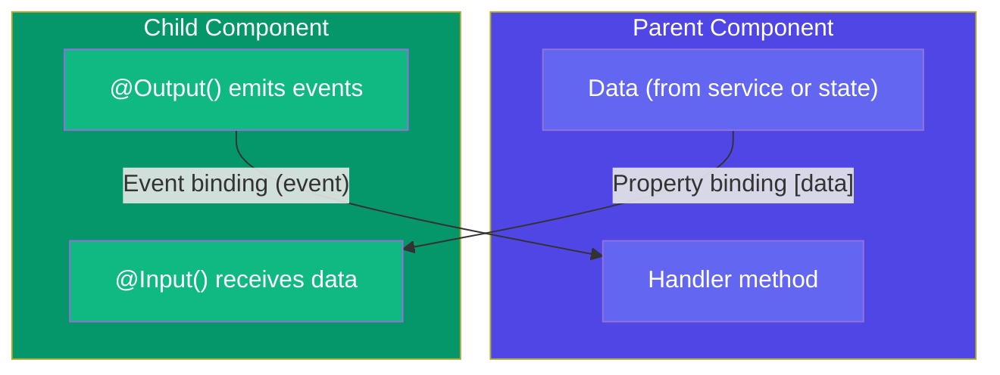

## 7. Components & Communication

### Simple Words First 🟡
Think of components as **people in an office**. Each person (component) has their own desk and files. But they need to talk to each other to get work done. Some talk by passing papers down the chain (parent → child). Others talk by raising their hand (events, child → parent). And some just peek over someone's shoulder (ViewChild).

Angular gives you clear ways for components to talk to each other.

### Component Communication Flow



---

### `@Input` — Parent → Child

Pass data DOWN from a parent component to a child component.

```typescript
// child.component.ts
import { Component, Input } from '@angular/core';

@Component({
  selector: 'app-user-card',
  template: `
    <div class="card">
      <h3>{{ userName }}</h3>
      <p>Age: {{ userAge }}</p>
      <span [class.active]="isActive">{{ isActive ? 'Online' : 'Offline' }}</span>
    </div>
  `
})
export class UserCardComponent {
  @Input() userName: string = '';       // Required: parent MUST pass this
  @Input() userAge: number = 0;          // Optional with default
  @Input({ required: true }) isActive: boolean = false; // Required input
}

// parent.component.html — Using the child component
<app-user-card
  [userName]="'Alice'"
  [userAge]="28"
  [isActive]="true"
></app-user-card>
```

**Renaming input properties:**

```typescript
@Component({ ... })
export class ProductPriceComponent {
  @Input('product-price') price: number = 0; // Parent uses [product-price]
}

// parent.html
<app-product-price [product-price]="99.99"></app-product-price>
```

### `@Output` + `EventEmitter` — Child → Parent

Child TELLS the parent something happened by emitting an event.

```typescript
// child.component.ts
import { Component, Input, Output, EventEmitter } from '@angular/core';

@Component({
  selector: 'app-star-rating',
  template: `
    <div class="stars">
      <button *ngFor="let star of [1,2,3,4,5]"
              (click)="rateProduct(star)"
              [class.filled]="star <= currentRating">
        {{ star <= currentRating ? '★' : '☆' }}
      </button>
      <p>Your rating: {{ currentRating }} / 5</p>
    </div>
  `
})
export class StarRatingComponent {
  @Input() currentRating: number = 0;

  @Output() ratingChange = new EventEmitter<number>(); // Child fires this

  rateProduct(star: number): void {
    this.currentRating = star;
    this.ratingChange.emit(this.currentRating); // 👈 Send data UP to parent
  }
}

// parent.component.ts — Listening to the child's event
@Component({
  selector: 'app-product',
  template: `
    <app-star-rating
      [currentRating]="productRating"
      (ratingChange)="onRatingChanged($event)"
    ></app-star-rating>
    <p *ngIf="lastRating">User rated: {{ lastRating }} stars</p>
  `
})
export class ProductComponent {
  productRating = 3;
  lastRating: number | null = null;

  onRatingChanged(newRating: number): void {
    this.lastRating = newRating;
    console.log('New rating from child:', newRating);
  }
}
```

**Two-way binding with banana-in-a-box `[( )]`:**

```typescript
@Component({ ... })
export class RatingComponent {
  @Input() value: number = 0;
  @Output() valueChange = new EventEmitter<number>();
  // Name MUST be "valueChange" for "value" property

  setRating(r: number): void {
    this.value = r;
    this.valueChange.emit(r);
  }
}

// Parent can now use two-way binding!
<app-rating [(value)]="productRating"></app-rating>
```

### `@ViewChild` — Parent Reads Child Directly

Sometimes a parent needs to CALL a method on a child or read its properties directly.

```typescript
// child.component.ts
@Component({
  selector: 'app-timer',
  template: `<p>{{ seconds }}s</p>`
})
export class TimerComponent {
  seconds = 0;
  private intervalId: any;

  start(): void {
    this.intervalId = setInterval(() => this.seconds++, 1000);
  }

  stop(): void {
    clearInterval(this.intervalId);
  }

  reset(): void {
    this.seconds = 0;
  }
}

// parent.component.ts
import { Component, ViewChild } from '@angular/core';

@Component({
  selector: 'app-stopwatch',
  template: `
    <app-timer></app-timer>   <!-- 👈 The child -->
    <button (click)="start()">Start</button>
    <button (click)="stop()">Stop</button>
    <button (click)="reset()">Reset</button>
  `
})
export class StopwatchComponent {
  @ViewChild(TimerComponent) timer!: TimerComponent;
  //           👆 Angular finds the <app-timer> in the template

  start(): void { this.timer.start(); }
  stop(): void { this.timer.stop(); }
  reset(): void { this.timer.reset(); }
}
```

### Content Projection (`ng-content`)

Put a **hole** in your component where the parent can inject custom content.

```typescript
// card.component.ts
@Component({
  selector: 'app-card',
  template: `
    <div class="card">
      <div class="card-header">
        <ng-content select="[card-title]"></ng-content>
        <!-- Parent's content with card-title attribute goes here -->
      </div>
      <div class="card-body">
        <ng-content></ng-content>
        <!-- Default: parent content without a select goes here -->
      </div>
      <div class="card-footer">
        <ng-content select="[card-actions]"></ng-content>
        <!-- Parent's content with card-actions attribute goes here -->
      </div>
    </div>
  `
})
export class CardComponent { }

// parent.html — Using the card
<app-card>
  <span card-title>User Profile</span>
  <p>This is the main content of the card!</p>
  <button card-actions>Save</button>
</app-card>
```

### `@ContentChild` — Access Projected Content

```typescript
@Component({ ... })
export class TabComponent {
  @ContentChild('tabContent') content!: ElementRef;
  // Access the projected element that has #tabContent

  ngAfterContentInit(): void {
    console.log('Projected content:', this.content.nativeElement);
  }
}
```

### 🚨 Common Gotchas

```typescript
// ❌ Trying to use @ViewChild before view is ready
@Component({ ... })
export class BadComponent implements OnInit {
  @ViewChild(TimerComponent) timer!: TimerComponent;

  ngOnInit(): void {
    this.timer.start(); // ❌ Undefined! View not ready yet!
  }
}

// ✅ Use ngAfterViewInit instead
export class GoodComponent implements AfterViewInit {
  @ViewChild(TimerComponent) timer!: TimerComponent;

  ngAfterViewInit(): void {
    this.timer.start(); // ✅ View is ready now
  }
}

// ❌ Forgetting that @Input() required:true (Angular 16+)
@Input({ required: true }) name!: string; // Parent MUST pass this
```

### In Simple Words 🧠

- **`@Input`** — Parent passes data DOWN to child. Like giving a note to someone.
- **`@Output`** — Child sends event UP to parent. Like raising your hand.
- **`@ViewChild`** — Parent reaches INTO child to call methods. Like tapping someone's shoulder.
- **`ng-content`** — Creates a hole for parent to inject custom HTML. Like a picture frame.
- **`@ContentChild`** — Access the injected content from inside the component.
- Always use `ngAfterViewInit` (not `ngOnInit`) to access `@ViewChild` — the view isn't ready yet!
