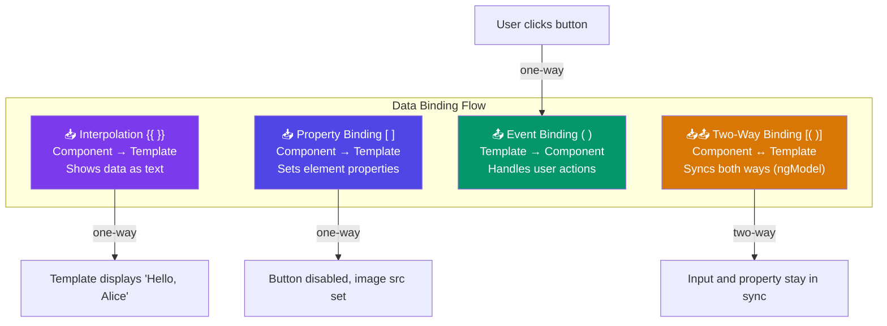

## 5. Data Binding

#### Simple Words First 🟡
Data binding is the **bridge** between your component (where data lives) and the template (where data is displayed). Think of it like a **TV remote connected to a TV** — when you press a button on the remote (component), the TV screen (template) changes.

Angular has **4 types** of data binding.

### The 4 Data-Binding Types



---

### 5.1 Interpolation `{{ }}`

**Direction:** Component → Template (ONE-WAY)
**Purpose:** Display component data as text in the template

```typescript
// component.ts
export class GreetingComponent {
  firstName: string = "Ananya";
  lastName: string = "Sharma";
  age: number = 25;
  score: number = 8.567;
  items: string[] = ["a", "b", "c"];
  today: Date = new Date();
  isAdmin: boolean = true;
}
```

```html
<!-- component.html -->

<!-- Basic property display -->
<h1>Hello, {{ firstName }}!</h1>
<!-- Output: Hello, Ananya! -->

<!-- Expression: full name -->
<p>Full Name: {{ firstName + ' ' + lastName }}</p>
<!-- Output: Full Name: Ananya Sharma -->

<!-- Math expression -->
<p>Next year age: {{ age + 1 }}</p>
<!-- Output: Next year age: 26 -->

<!-- Method call -->
<p>Today: {{ today.toLocaleDateString() }}</p>

<!-- Ternary operator -->
<p>Role: {{ isAdmin ? 'Administrator' : 'Regular User' }}</p>

<!-- Array length -->
<p>Total items: {{ items.length }}</p>

<!-- ❌ What you CANNOT do in interpolation: -->
<!-- No assignments: {{ age = 30 }} -->
<!-- No new keyword: {{ new Date() }} -->
<!-- No statements: {{ if(isAdmin) {} }} -->
```

---

### 5.2 Property Binding `[ ]`

**Direction:** Component → Template (ONE-WAY)
**Purpose:** Bind a component property to an **HTML element property** (not attribute!)

```typescript
export class PropertyBindingComponent {
  imageUrl: string = "https://example.com/photo.jpg";
  imageAlt: string = "User Photo";
  isButtonDisabled: boolean = false;
  inputPlaceholder: string = "Enter your name...";
  linkUrl: string = "https://angular.io";
  dynamicClass: string = "highlight";
  dynamicStyle: string = "red";
}
```

```html
<!-- Property Binding uses square brackets [ ] -->

<!-- Bind 'src' property of  element -->


<!-- Bind 'disabled' property of <button> -->
<button [disabled]="isButtonDisabled">Submit</button>
<!-- When isButtonDisabled = true → button is disabled -->

<!-- Bind 'placeholder' property of <input> -->
<input [placeholder]="inputPlaceholder">

<!-- Bind 'href' property of <a> tag -->
<a [href]="linkUrl">Angular Website</a>

<!-- Class binding -->
<div [class]="dynamicClass">Styled text</div>

<!-- Style binding -->
<p [style.color]="dynamicStyle">This text is red</p>

<!-- ⚠️ Interpolation vs Property Binding -->
    <!-- Interpolation: Works for src -->
       <!-- Property binding: Preferred! -->

<!-- When MUST you use Property Binding (not interpolation)? -->
<button [disabled]="isButtonDisabled">  <!-- disabled is boolean -->
<!-- <button disabled="{{ isButtonDisabled }}">  ← WRONG! -->
<!-- This would set disabled="false" as a STRING, and the button stays disabled! -->
```

---

### 5.3 Event Binding `( )`

**Direction:** Template → Component (ONE-WAY)
**Purpose:** Listen to user actions (clicks, key presses, mouse events) and call component methods

```typescript
export class EventBindingComponent {
  clickCount: number = 0;
  lastKey: string = '';
  mousePosition: string = '';

  // Method called when button is clicked
  handleClick(): void {
    this.clickCount++;
    console.log("Button clicked! Count:", this.clickCount);
  }

  // $event contains the actual DOM event object
  handleKeyUp(event: KeyboardEvent): void {
    this.lastKey = event.key;
    console.log("Key pressed:", event.key);
  }

  handleMouseMove(event: MouseEvent): void {
    this.mousePosition = `X: ${event.clientX}, Y: ${event.clientY}`;
  }

  // Template reference variable (#inputRef) to access input value
  submitForm(value: string): void {
    console.log("Submitted:", value);
  }
}
```

```html
<!-- Event binding uses parentheses ( ) -->

<!-- Click event -->
<button (click)="handleClick()">
  Clicked {{ clickCount }} times
</button>

<!-- Keyboard events — $event is the browser event object -->
<input (keyup)="handleKeyUp($event)"
       (keydown)="handleKeyDown($event)"
       placeholder="Type here">
<p>Last key: {{ lastKey }}</p>

<!-- Mouse events -->
<div (mousemove)="handleMouseMove($event)" class="mouse-area">
  Move mouse here: {{ mousePosition }}
</div>

<!-- Using template reference variable (#) to get input value -->
<input #nameInput placeholder="Enter name">
<button (click)="submitForm(nameInput.value)">Submit</button>
<!-- #nameInput gives us a reference to the input element -->

<!-- Focus / Blur events -->
<input (focus)="onFocus()" (blur)="onBlur()" placeholder="Focus me">

<!-- Input change -->
<select (change)="onSelectChange($event)">
  <option value="a">Option A</option>
  <option value="b">Option B</option>
</select>
```

---

### 5.4 Two-Way Binding `[( )]`

**Direction:** Component ↔ Template (BI-DIRECTIONAL)
**Purpose:** Keep component property and input field in sync — when either changes, the other updates automatically

The `[()]` syntax is called "banana in a box" 🍌📦

```typescript
// In app.module.ts, you MUST import FormsModule for ngModel
import { FormsModule } from '@angular/forms';

@NgModule({
  imports: [BrowserModule, FormsModule]  // ← Add FormsModule
})
export class AppModule { }
```

```typescript
// component.ts
export class TwoWayBindingComponent {
  // These properties stay in sync with the input fields
  username: string = '';
  email: string = '';
  selectedCountry: string = 'India';
  isSubscribed: boolean = false;
  rating: number = 5;
}
```

```html
<!-- [(ngModel)] is two-way binding -->
<!-- It READS from and WRITES to the component property -->

<!-- Text input -->
<input [(ngModel)]="username" placeholder="Enter username">
<p>Hello, {{ username }}!</p>
<!-- Type in the input → username property updates → paragraph updates instantly -->

<!-- Email input -->
<input type="email" [(ngModel)]="email" placeholder="Enter email">
<p>Your email: {{ email }}</p>

<!-- Dropdown -->
<select [(ngModel)]="selectedCountry">
  <option value="India">India</option>
  <option value="USA">USA</option>
  <option value="UK">UK</option>
</select>
<p>Selected: {{ selectedCountry }}</p>

<!-- Checkbox -->
<input type="checkbox" [(ngModel)]="isSubscribed">
<label>Subscribe to newsletter</label>
<p>Subscribed: {{ isSubscribed }}</p>

<!-- Range slider -->
<input type="range" [(ngModel)]="rating" min="1" max="10">
<p>Rating: {{ rating }}/10</p>

<!-- ── Under the hood, [(ngModel)] expands to: ── -->
<!-- [ngModel]="username" (ngModelChange)="username = $event" -->
<!-- Property binding (reads) + Event binding (writes) -->
```

---
