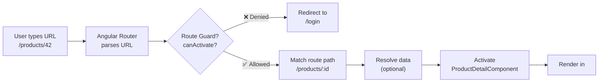
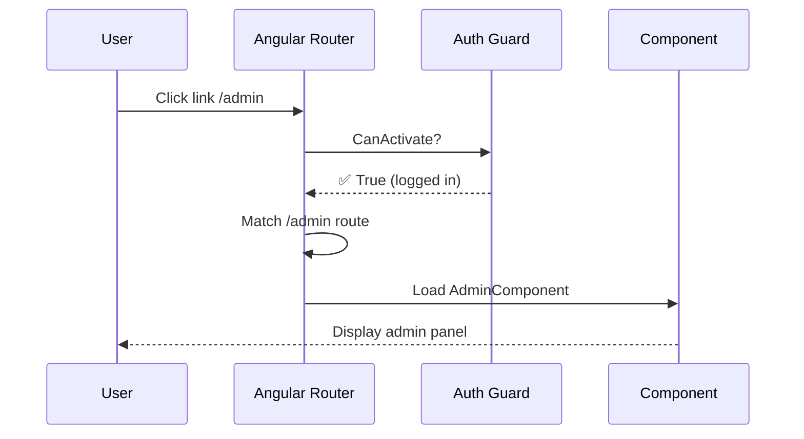
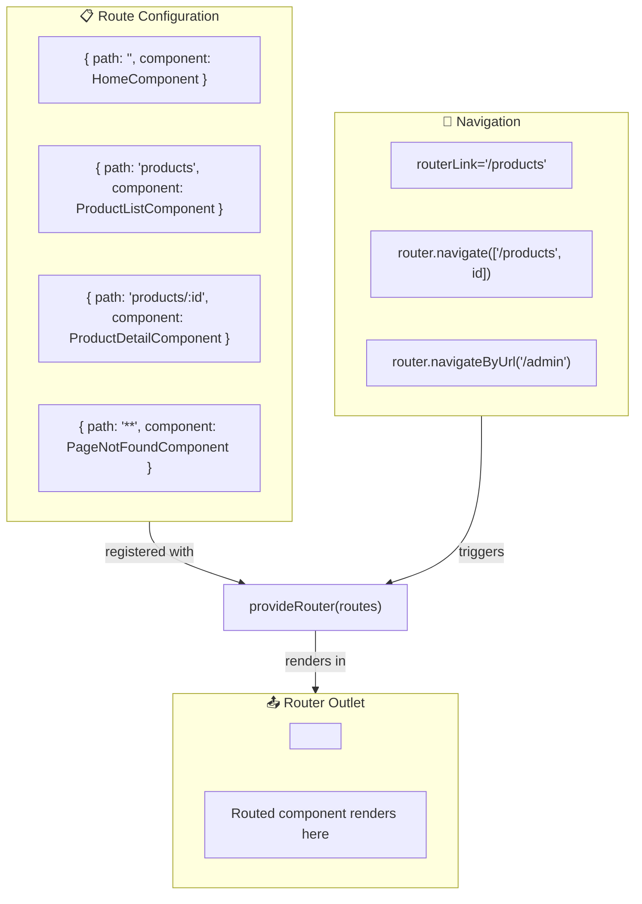

## Introduction
The Angular Router maps URLs to components, enabling navigation without page reloads. It is the foundation of Single Page Applications (SPAs) — the browser URL changes, but the page never refreshes.

## Why do we need this?
Traditional websites reload the entire page on every navigation — losing state, showing a white flash, and wasting bandwidth. The Angular Router updates only the portion of the page that changes, preserving state and delivering a native-app-like experience.

## Real-world analogy
Think of the Router as a **GPS navigation system** in a car. You type a destination (URL), the GPS plots the route (route matching), checks for traffic (guards), and guides you turn by turn (navigation). The car engine never turns off — just like the app never reloads.

## Router Architecture







## Setup

```typescript
// app.routes.ts
import { Routes } from '@angular/router';
import { HomeComponent } from './home/home.component';
import { ProductListComponent } from './products/product-list.component';
import { ProductDetailComponent } from './products/product-detail.component';
import { PageNotFoundComponent } from './not-found/not-found.component';

export const routes: Routes = [
  { path: '', component: HomeComponent },                        // Default route
  { path: 'products', component: ProductListComponent },         // List page
  { path: 'products/:id', component: ProductDetailComponent },   // Dynamic param
  { path: '**', component: PageNotFoundComponent }               // Wildcard (404)
];
```

```typescript
// main.ts — Standalone approach (Angular 14+)
import { bootstrapApplication } from '@angular/platform-browser';
import { provideRouter } from '@angular/router';
import { AppComponent } from './app/app.component';
import { routes } from './app/app.routes';

bootstrapApplication(AppComponent, {
  providers: [provideRouter(routes)]
});
```

## Router Outlet & Links

```html
<!-- app.component.html -->
<nav>
  <a routerLink="/">Home</a>
  <a routerLink="/products" routerLinkActive="active">Products</a>
  <a [routerLink]="['/products', productId]">Product Detail</a>
</nav>

<!-- Routed components render here -->
<router-outlet></router-outlet>
```

### routerLink vs href

| Feature | `routerLink` | `href` |
|---------|-------------|--------|
| Page reload | ❌ No | ✅ Yes |
| Preserves state | ✅ Yes | ❌ No |
| SPA navigation | ✅ Yes | ❌ No |
| Works with guards | ✅ Yes | ❌ No |

### routerLinkActive

```html
<a routerLink="/products" routerLinkActive="active">Products</a>
<!-- Adds CSS class 'active' when route matches /products -->
```

## Navigation Methods

```typescript
@Component({ ... })
export class NavigationComponent {
  constructor(private router: Router) {}

  goToProduct(id: string) {
    // Imperative navigation
    this.router.navigate(['/products', id]);
    this.router.navigate(['/products', id], { queryParams: { tab: 'details' } });

    // Navigate relative to current route
    this.router.navigate(['../', 'reviews'], { relativeTo: this.route });

    // Navigate by URL string
    this.router.navigateByUrl('/products/42?tab=details');
  }
}
```

## Best Practices
- Use `provideRouter(routes)` for standalone apps — it's tree-shakable
- Always include a `**` wildcard route for 404 pages
- Use `routerLinkActive="active"` for styling active navigation links
- Prefer `router.navigate()` with commands over `navigateByUrl()` for type safety
- Use `ActivatedRoute` for accessing route params, not the Router
- Enable `withComponentInputBinding()` to bind route params directly to @Input()

## Common Mistakes
- Using `href` instead of `routerLink` — causes full page reloads
- Forgetting the wildcard route `**` — causes blank screen for unknown URLs
- Accessing route params with `route.snapshot.paramMap` when the component should react to param changes (use the Observable form)
- Not importing `RouterModule` or providing `provideRouter()` — router directives won't work
- Using `routerLink` without the leading slash for absolute paths — relative paths behave differently

## Interview Questions
1. How does the Angular Router differ from traditional page navigation?
2. What is `<router-outlet>` and how does it work?
3. How do you pass parameters to a route?
4. What is the difference between `router.navigate()` and `router.navigateByUrl()`?
5. How do you handle 404 pages in Angular routing?

## Summary
The Router is the foundation of Angular SPA navigation. Master `router-outlet` for rendering routed components, `routerLink` for navigation without page reloads, `routerLinkActive` for active link styling, and route configuration for defining URL-to-component mappings.
