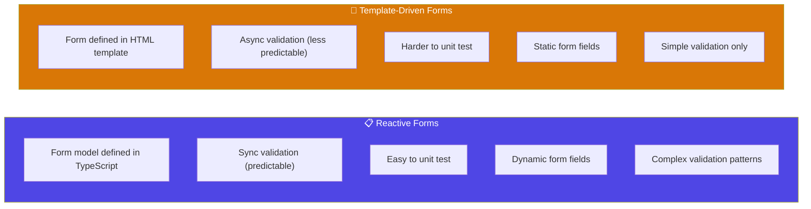
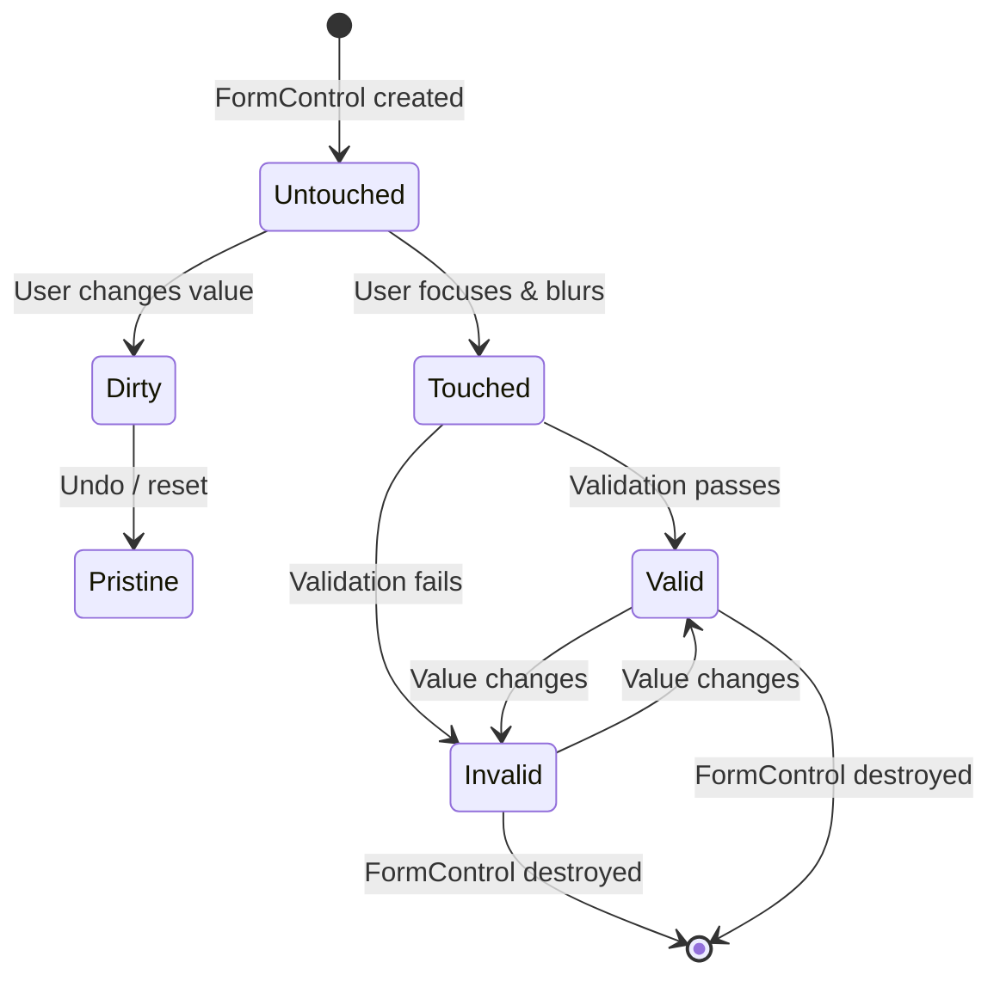
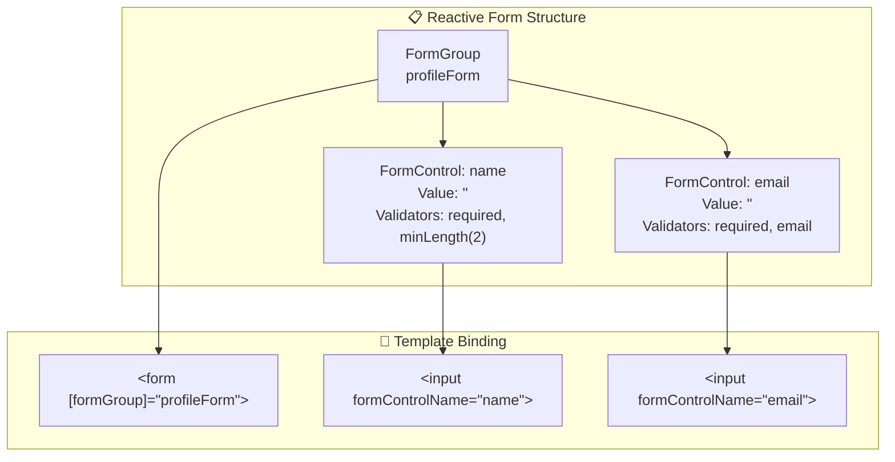

## Introduction
Reactive forms provide a **model-driven** approach where you create the form structure in TypeScript. This gives more control, better testing, and support for dynamic forms compared to template-driven forms.

## Why do we need this?
Template-driven forms work well for simple forms but fall short with complex validation, dynamic fields, and programmatic control. Reactive forms give you full control over form state, validation, and data flow — making them the professional choice for enterprise applications.

## Real-world analogy
Reactive forms are like **building with blueprints** (TypeScript model) before pouring concrete (rendering the template). Template-driven forms are like a **freehand sketch** — faster for simple shapes, but for a skyscraper (complex form), you need precise blueprints.

## Reactive vs Template-Driven



## FormControl Lifecycle





## Setup

```typescript
import { ReactiveFormsModule } from '@angular/forms';

// Standalone component
@Component({
  standalone: true,
  imports: [ReactiveFormsModule],
  // ...
})
export class MyFormComponent { }
```

## Basic Example

```typescript
import { FormBuilder, Validators } from '@angular/forms';

@Component({
  selector: 'app-profile-form',
  template: `
    <form [formGroup]="profileForm" (ngSubmit)="onSubmit()">
      <label>
        Name:
        <input formControlName="name">
        @if (nameControl.invalid && nameControl.touched) {
          <span class="error">Name is required</span>
        }
      </label>

      <label>
        Email:
        <input formControlName="email" type="email">
        @if (emailControl.invalid && emailControl.touched) {
          <span class="error">Valid email required</span>
        }
      </label>

      <button type="submit" [disabled]="profileForm.invalid">Submit</button>
    </form>

    <p>Form valid: {{ profileForm.valid }}</p>
    <p>Form value: {{ profileForm.value | json }}</p>
  `
})
export class ProfileFormComponent {
  profileForm = this.fb.group({
    name: ['', [Validators.required, Validators.minLength(2)]],
    email: ['', [Validators.required, Validators.email]],
  });

  constructor(private fb: FormBuilder) {}

  get nameControl() { return this.profileForm.get('name')!; }
  get emailControl() { return this.profileForm.get('email')!; }

  onSubmit() {
    if (this.profileForm.valid) {
      console.log('Form submitted:', this.profileForm.value);
    }
  }
}
```

## Key Classes

| Class | Purpose | Example |
|-------|---------|---------|
| `FormControl` | Tracks value + validation of a single field | `new FormControl('')` |
| `FormGroup` | Groups related controls | `new FormGroup({ name: ... })` |
| `FormArray` | Dynamic list of controls | `new FormArray([...])` |
| `FormBuilder` | Shorthand syntax for creating forms | `this.fb.group({...})` |

## Best Practices
- Use `FormBuilder` for cleaner syntax over `new FormGroup()`/`new FormControl()`
- Always provide **initial values** to FormControls — `new FormControl('')`, not `new FormControl(null)`
- Keep form logic in the **component class**, not the template
- Use **getter properties** for accessing individual controls in templates
- Use `formGroup.get('control')` for safe access instead of `formGroup.controls.control`
- Handle form submission with `(ngSubmit)` — listens to both button click and Enter key

## Common Mistakes
- Forgetting to import `ReactiveFormsModule` — formGroup directive won't work
- Using `formControlName` **without** `formGroup` on the parent element
- Accessing control value directly instead of watching `valueChanges` for reactivity
- Not providing **initial values** — controls can be null unexpectedly
- **Nesting forms** — forms can't be nested in HTML; use separate FormGroups instead
- Mutating `formGroup.controls` directly instead of using `addControl`/`removeControl`

## Interview Questions
1. What is the difference between reactive and template-driven forms?
2. How do you set up a reactive form in a standalone component?
3. What is `FormBuilder` and why would you use it?
4. How do you access the value of a specific FormControl in a FormGroup?
5. How do you handle form submission in reactive forms?

## Summary
Reactive forms are the professional choice for complex, dynamic, or heavily validated forms. Build the form model in TypeScript using `FormBuilder`, bind it to the template with `formGroup` and `formControlName`, and access control state through getter properties.
