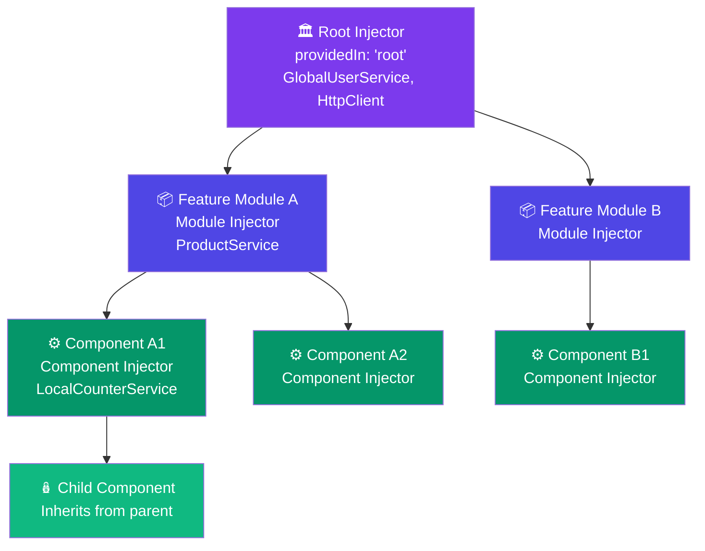

## 2. Dependency Injection

### What Problem Does DI Solve?

**Without DI** (bad way):

```typescript
// Every component creates its own service — wasteful and untestable!
export class ProductComponent {
  private productService: ProductService;
  
  constructor() {
    // 🔴 Problem 1: Hard to test (can't mock this)
    // 🔴 Problem 2: Multiple instances waste memory
    // 🔴 Problem 3: Tightly coupled — ProductService changes break this
    this.productService = new ProductService(
      new HttpClient(new HttpXhrBackend()),  // Need dependencies of dependencies!
      new LogService(),
      new CacheService()
    );
  }
}
```

**With DI** (Angular's way):

```typescript
export class ProductComponent {
  // Angular creates and provides the service — we just declare what we need!
  constructor(private productService: ProductService) {}
  //           ^ Angular resolves and injects this automatically
}
```

---

### Hierarchical DI Tree



---

### How Injectors Work Internally

Angular uses a **hierarchical injector tree** that mirrors your component tree.

```
Root Injector (app-level)
├── LazyModule Injector (lazy-loaded features)
│   └── Component Injector (if component has its own providers)
│       └── Child Component Injector
└── EagerModule Injector
```

**Token Resolution Algorithm:**
1. Look in the current component's injector
2. If not found, go to parent component's injector
3. Keep going up until Root Injector
4. If not found at root → throw error: `NullInjectorError`

---

### Providers — Registering Services

```typescript
// Method 1: The Modern Way (recommended)
@Injectable({
  providedIn: 'root'  // Available everywhere, tree-shakeable
})
export class GlobalUserService {}

// Method 2: Component-level (new instance per component)
@Component({
  selector: 'app-product',
  providers: [ProductService]  // Each ProductComponent gets its OWN instance
})
export class ProductComponent {}

// Method 3: Module-level
@NgModule({
  providers: [ProductService]  // All components in this module share one instance
})
export class ProductModule {}

// Method 4: Feature-level (Angular 14+)
@Injectable({
  providedIn: 'platform'  // Shared across multiple Angular apps on same page
})
export class SharedPlatformService {}
```

---

### Advanced DI Patterns

#### Custom Tokens (for non-class values)

```typescript
import { InjectionToken } from '@angular/core';

// Define a token for a configuration object
export const APP_CONFIG = new InjectionToken<AppConfig>('app.config');

export interface AppConfig {
  apiUrl: string;
  maxRetries: number;
  theme: 'light' | 'dark';
}

// Register in providers
const appConfig: AppConfig = {
  apiUrl: 'https://api.myapp.com',
  maxRetries: 3,
  theme: 'dark'
};

// In app.module.ts or bootstrapApplication
providers: [
  { provide: APP_CONFIG, useValue: appConfig }
]

// Inject it
@Injectable({ providedIn: 'root' })
export class ApiService {
  constructor(@Inject(APP_CONFIG) private config: AppConfig) {
    console.log('API URL:', this.config.apiUrl);
  }
}
```

#### Provider Types

```typescript
// useClass — substitute one class for another (great for testing!)
{ provide: AuthService, useClass: MockAuthService }

// useValue — inject a plain value or object
{ provide: WINDOW, useValue: window }

// useFactory — compute the value at runtime
{
  provide: LogLevel,
  useFactory: () => environment.production ? 'error' : 'debug'
}

// useExisting — alias one token to another
{ provide: NewUserService, useExisting: LegacyUserService }
```

---
