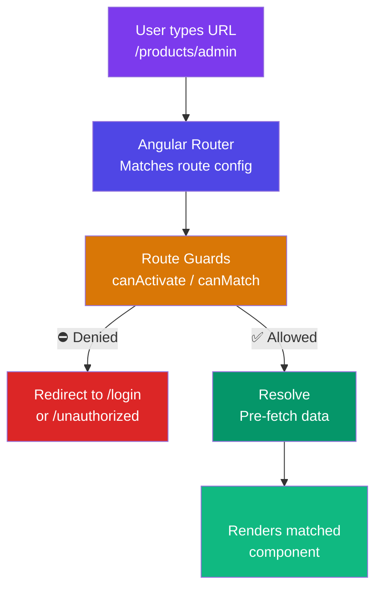

## 3. Routing

### What is Routing?

A web app has many "pages" (components). Routing is the system that decides **which component to show** based on the URL.

```
URL: /products        → Show ProductListComponent
URL: /products/42     → Show ProductDetailComponent (id=42)
URL: /admin/users     → Show UsersComponent (if user is admin)
URL: /login           → Show LoginComponent
```

---

### Routing Navigation + Guard Flow



### Routing Flow Diagram


> 🔍 See the dedicated **[Route Guards & Resolvers](/DSA-Notes-Problems/angular/phase-4/phase-4-route-guards-and-resolvers)** page for a deeper dive into guards and data resolvers.

---

### Setting Up Routes

```typescript
// app.routes.ts (Angular 17+ standalone approach)
import { Routes } from '@angular/router';

export const routes: Routes = [
  // Basic route
  { path: '', component: HomeComponent },

  // Route with URL parameter (:id is a variable)
  { path: 'products/:id', component: ProductDetailComponent },

  // Nested (child) routes
  {
    path: 'admin',
    component: AdminLayoutComponent,
    children: [
      { path: '', redirectTo: 'dashboard', pathMatch: 'full' },
      { path: 'dashboard', component: AdminDashboardComponent },
      { path: 'users', component: UsersComponent },
      { path: 'users/:id', component: UserDetailComponent }
    ]
  },

  // Lazy loaded module (only loads JavaScript when user navigates here)
  {
    path: 'shop',
    loadChildren: () => import('./shop/shop.routes').then(r => r.shopRoutes)
  },

  // Route with guard
  {
    path: 'settings',
    component: SettingsComponent,
    canActivate: [authGuard]
  },

  // Wildcard — catches any unmatched URL
  { path: '**', component: PageNotFoundComponent }
];
```

```typescript
// main.ts — bootstrap with routes
import { bootstrapApplication } from '@angular/platform-browser';
import { provideRouter } from '@angular/router';

bootstrapApplication(AppComponent, {
  providers: [
    provideRouter(routes)
  ]
});
```

---

### `router-outlet` — The Display Window

Think of `<router-outlet>` as a **screen** where Angular projects the active component.

```html
<!-- app.component.html -->
<nav>
  <!-- routerLink is like href but handled by Angular (no page reload) -->
  <a routerLink="/">Home</a>
  <a routerLink="/products">Products</a>
  <a routerLink="/admin">Admin</a>
  
  <!-- routerLinkActive adds a class when this route is active -->
  <a routerLink="/profile" routerLinkActive="active-link">Profile</a>
</nav>

<!-- The matched component renders here -->
<router-outlet></router-outlet>

<footer>© 2024 MyApp</footer>
```

---

### Reading Route Parameters

```typescript
// product-detail.component.ts
import { Component, OnInit } from '@angular/core';
import { ActivatedRoute, Router } from '@angular/router';

@Component({
  selector: 'app-product-detail',
  template: `
    <h1>Product #{{ productId }}</h1>
    <p>Category: {{ category }}</p>
    <button (click)="goBack()">Go Back</button>
  `
})
export class ProductDetailComponent implements OnInit {

  productId: string = '';
  category: string = '';

  constructor(
    private route: ActivatedRoute,  // Current route info
    private router: Router          // For programmatic navigation
  ) {}

  ngOnInit(): void {
    // Method 1: Snapshot (one-time read, doesn't update if URL changes)
    this.productId = this.route.snapshot.paramMap.get('id') ?? '';

    // Method 2: Observable (reacts to URL changes, e.g., prev/next navigation)
    this.route.paramMap.subscribe(params => {
      this.productId = params.get('id') ?? '';
      this.loadProduct(this.productId);
    });

    // Read query parameters: /products/42?category=electronics&sort=price
    this.route.queryParamMap.subscribe(queryParams => {
      this.category = queryParams.get('category') ?? 'all';
    });
  }

  goBack(): void {
    this.router.navigate(['/products']);
    // Or with parameters:
    // this.router.navigate(['/products'], { queryParams: { page: 1 } });
  }

  private loadProduct(id: string): void {
    this.productService.getProduct(id).subscribe(/* ... */);
  }
}
```

---

### Route Guards

Guards are functions that decide if navigation should proceed.

#### CanActivate — Protect Routes

```typescript
// auth.guard.ts (Functional guard — Angular 15+)
import { inject } from '@angular/core';
import { CanActivateFn, Router } from '@angular/router';
import { AuthService } from './auth.service';

export const authGuard: CanActivateFn = (route, state) => {
  const authService = inject(AuthService);
  const router = inject(Router);

  if (authService.isLoggedIn()) {
    return true;  // Proceed with navigation
  }

  // Save the URL they were trying to reach
  router.navigate(['/login'], {
    queryParams: { returnUrl: state.url }
  });
  
  return false;  // Block navigation
};

// Role-based guard
export const adminGuard: CanActivateFn = () => {
  const authService = inject(AuthService);
  
  if (authService.hasRole('admin')) {
    return true;
  }
  
  return inject(Router).createUrlTree(['/unauthorized']);
};
```

#### CanDeactivate — Prevent Leaving with Unsaved Changes

```typescript
// unsaved-changes.guard.ts
export interface CanComponentDeactivate {
  canDeactivate: () => boolean | Observable<boolean>;
}

export const unsavedChangesGuard: CanDeactivateFn<CanComponentDeactivate> = (component) => {
  if (component.canDeactivate) {
    return component.canDeactivate();
  }
  return true;
};

// In the component:
export class EditProductComponent implements CanComponentDeactivate {
  isDirty = false;  // Track if form has unsaved changes
  
  canDeactivate(): boolean {
    if (this.isDirty) {
      return confirm('You have unsaved changes. Leave anyway?');
    }
    return true;
  }
}
```

#### Resolve — Pre-fetch Data

```typescript
// product.resolver.ts
import { ResolveFn } from '@angular/router';
import { inject } from '@angular/core';

export const productResolver: ResolveFn<Product> = (route) => {
  const productId = route.paramMap.get('id')!;
  return inject(ProductService).getProduct(productId);
  // Angular waits for this Observable to complete before activating the route
};

// Route config:
{
  path: 'products/:id',
  component: ProductDetailComponent,
  resolve: { product: productResolver }
}

// Component reads resolved data:
export class ProductDetailComponent implements OnInit {
  constructor(private route: ActivatedRoute) {}

  ngOnInit(): void {
    const product = this.route.snapshot.data['product'];
    // Data is already loaded! No loading spinner needed.
  }
}
```

---

### Lazy Loading

Without lazy loading, Angular loads ALL your code upfront — even pages the user may never visit.

With lazy loading, each feature loads its code only when needed.

```typescript
// app.routes.ts
{
  path: 'admin',
  loadChildren: () => import('./admin/admin.routes').then(r => r.adminRoutes)
  // ↑ This import() creates a separate JavaScript bundle
  // The browser only downloads admin code when user goes to /admin
}

// Even single components can be lazy loaded (Angular 14+):
{
  path: 'about',
  loadComponent: () => import('./about/about.component').then(c => c.AboutComponent)
}
```

---
