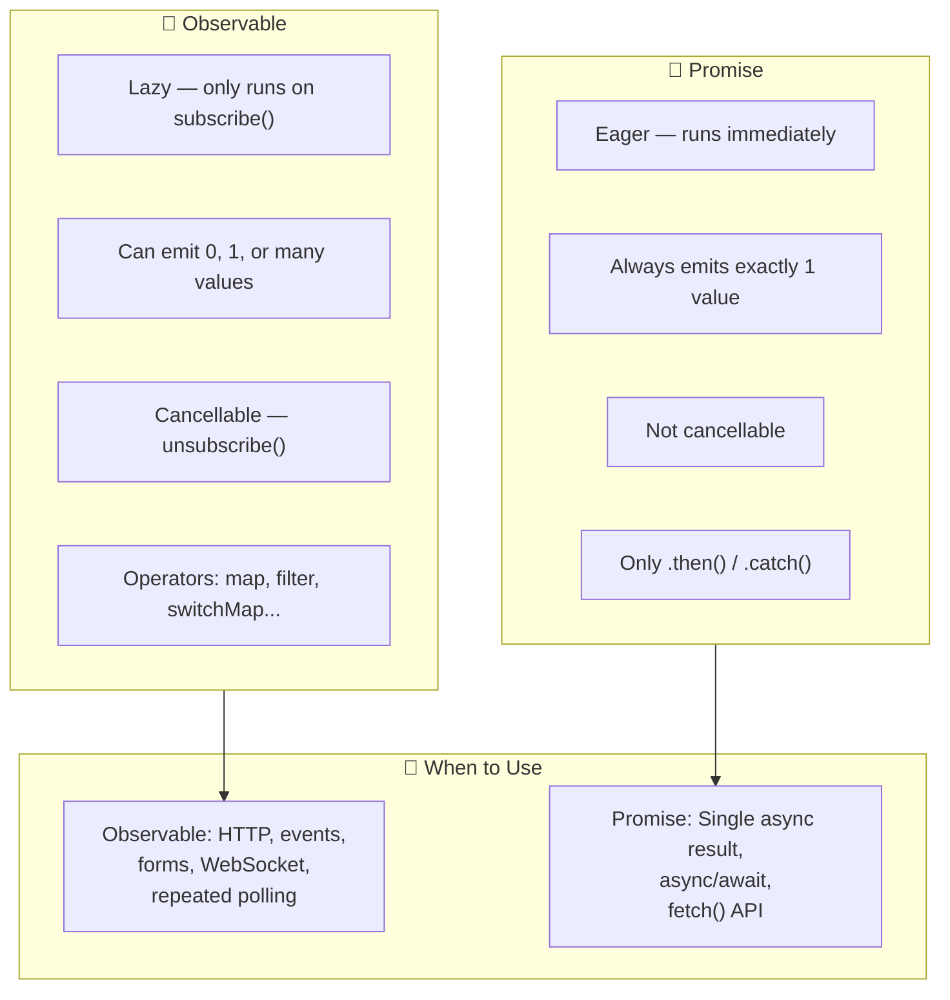
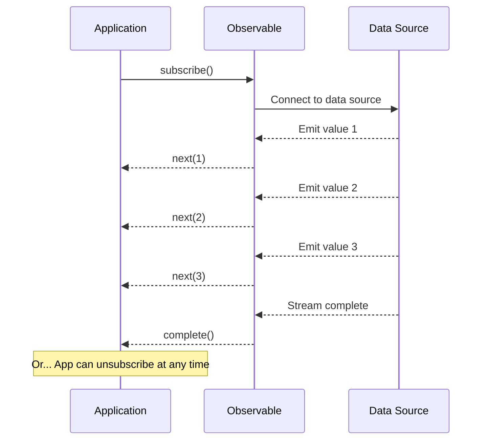

## Introduction
An Observable represents a stream of values over time. Unlike Promises (which handle a single value eagerly), Observables are **lazy**, **cancellable**, and can **emit multiple values** — making them the foundation of reactive programming in Angular.

## Why do we need this?
Web applications are inherently asynchronous — HTTP requests, user clicks, WebSocket messages, timer intervals. Managing async operations without Observables leads to nested callbacks, race conditions, and hard-to-cancel streams. Observables provide a unified model for all async data.

## Real-world analogy
An Observable is like a **water faucet**. You turn the handle (subscribe) and water flows. You can turn it off (unsubscribe) anytime. Multiple glasses can fill from the same faucet (multicast), or each glass can get its own faucet (unicast). The city water supply (source) doesn't start pumping until someone opens a faucet — Observables are lazy.

## Observable vs Promise





## Creating Observables

```typescript
import { Observable } from 'rxjs';

// Create an Observable that emits 1, 2, 3 synchronously
const obs$ = new Observable<number>(subscriber => {
  subscriber.next(1);
  subscriber.next(2);
  subscriber.next(3);
  subscriber.complete();
  
  // Teardown — called on unsubscribe or error
  return () => console.log('Subscription cleaned up!');
});

// Subscribe to receive values
obs$.subscribe({
  next: v => console.log(v),       // 1, 2, 3
  error: e => console.error(e),
  complete: () => console.log('Done')  // Will fire
});
```

## Observable Lifecycle

```typescript
const observable$ = new Observable<string>(subscriber => {
  // 1. Setup — runs when subscribed
  console.log('Observable executing');
  
  subscriber.next('Hello');
  subscriber.next('World');
  
  // 2. Teardown — runs on unsubscribe or complete
  return () => {
    console.log('Teardown: cleaning up');
  };
});

const subscription = observable$.subscribe(value => console.log(value));

// Later...
subscription.unsubscribe(); // Triggers teardown
```

## Observable Contract

| Method | Purpose | When |
|--------|---------|------|
| `next(value)` | Emit a value | 0 or more times |
| `error(err)` | Signal failure | At most once, ends stream |
| `complete()` | Signal success | At most once, ends stream |

```typescript
// After complete() or error(), the Observable can no longer emit
const obs$ = new Observable<number>(sub => {
  sub.next(1);
  sub.complete();
  sub.next(2); // ❌ Will not be delivered — already completed
});
```

## Common Creation Functions

```typescript
import { of, from, interval, fromEvent } from 'rxjs';

// Emit values synchronously
of(1, 2, 3).subscribe(v => console.log(v));           // 1, 2, 3

// Convert array/promise to Observable
from([10, 20, 30]).subscribe(v => console.log(v));    // 10, 20, 30

// Emit incrementing numbers every 1 second
interval(1000).subscribe(v => console.log(v));        // 0, 1, 2, 3...

// Listen to DOM events
fromEvent(document, 'click').subscribe(e => console.log(e));
```

## Observable vs Promise

| Feature | Observable | Promise |
|---------|------------|---------|
| Values | Multiple (stream) | Single |
| Execution | Lazy (only runs on subscribe) | Eager (runs immediately) |
| Cancellable | Yes (`unsubscribe()`) | No |
| Operators | Rich RxJS pipe-able operators | `.then()/.catch()` only |
| Async/await | Needs `firstValueFrom()` | Native support |

## Best Practices
- Always **unsubscribe** from infinite Observables (interval, fromEvent, Subjects) — use `takeUntilDestroyed()` or the `takeUntil` pattern
- Use the **async pipe** in templates instead of manual `.subscribe()` — Angular handles unsubscribe
- Prefer `of()`, `from()`, `interval()` over creating `new Observable()` directly
- Use **operators** (map, filter, switchMap) instead of imperative logic in subscribe
- Never subscribe inside another subscribe — use higher-order operators (switchMap, mergeMap)

## Common Mistakes
- **Not unsubscribing** — causes memory leaks, the biggest Angular RxJS mistake
- **Nested subscribes** — subscribing inside a subscribe callback instead of using operators
- **Sharing mutable state** between subscribers — each subscriber gets its own stream by default
- **Forgetting** that Observables are **lazy** — nothing happens until `.subscribe()` is called
- **Using `.toPromise()`** — deprecated; use `firstValueFrom()` or `lastValueFrom()` instead

## Interview Questions
1. What is an Observable and how does it differ from a Promise?
2. What are the three types of notifications an Observable can emit?
3. How do you unsubscribe from an Observable to prevent memory leaks?
4. What does it mean that Observables are "lazy"?
5. How do you convert an Observable to a Promise?
6. What is the difference between `of()` and `from()`?

## Summary
Observables are lazy, cancellable streams of values over time — the foundation of Angular's reactive programming. They can emit 0, 1, or many values, support rich operators via `pipe()`, and must be unsubscribed to prevent memory leaks. Use the `async` pipe in templates for automatic subscription management.
