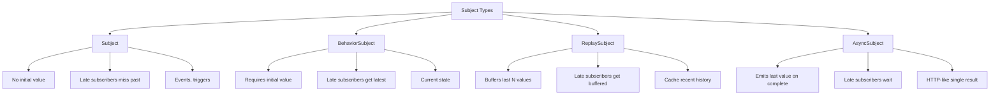
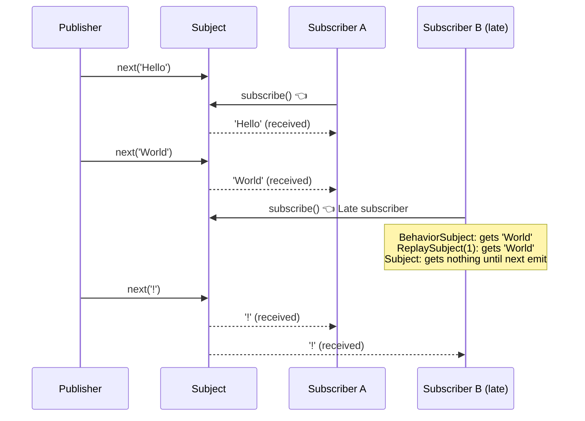

## Introduction
A Subject is both an **Observable** (you can subscribe to it) and an **Observer** (you can call `next()`, `error()`, `complete()` on it). It **multicasts** values to all subscribers — unlike plain Observables which are unicast (each subscriber gets its own execution).

## Why do we need this?
Plain Observables create a new execution context for each subscriber — if you have 3 subscribers, your HTTP call runs 3 times. Subjects share a single execution, making them perfect for **shared state, events, and broadcasting** to multiple consumers.

## Real-world analogy
A Subject is like a **town square bulletin board**. Anyone can post a notice (`next(value)`), and anyone who's subscribed to the board (subscribed) sees all notices from the moment they start watching. If you check the board late, you miss old notices — unless it's a BehaviorSubject (which always shows the latest notice).

## Subject Types





## Types of Subjects

### Subject — No initial value, no replay

```typescript
const subject = new Subject<string>();

subject.subscribe(v => console.log('A:', v)); // Subscribes now

subject.next('Hello');  // A: Hello
subject.next('World');  // A: World

subject.subscribe(v => console.log('B:', v)); // Late subscriber — misses 'Hello' and 'World'

subject.next('!');      // A: !, B: !
// B never receives 'Hello' or 'World'
```

### BehaviorSubject — Has initial value, replays latest

```typescript
const state = new BehaviorSubject<string>('initial'); // Requires initial value

state.subscribe(v => console.log('A:', v)); // A: initial

state.next('loading');  // A: loading
state.next('loaded');   // A: loaded

state.subscribe(v => console.log('B:', v)); // B: loaded ✅ Gets latest!
// B instantly receives 'loaded' on subscribe

state.getValue(); // 'loaded' — synchronous read
```

### ReplaySubject(n) — Buffers last N values

```typescript
const replay = new ReplaySubject<string>(2); // Buffer last 2 values

replay.next('msg1');
replay.next('msg2');
replay.next('msg3');

replay.subscribe(v => console.log(v));
// ✅ 'msg2', 'msg3' — gets the last 2 buffered values

// Use case: caching API responses
const cache = new ReplaySubject<User>(1);
http.get<User>('/api/user').subscribe(u => cache.next(u));
// Any late subscriber instantly gets the cached user
```

### AsyncSubject — Emits only on complete

```typescript
const asyncSub = new AsyncSubject<number>();

asyncSub.subscribe(v => console.log(v)); // Nothing yet

asyncSub.next(1);
asyncSub.next(2);
asyncSub.next(3);
// Still nothing — hasn't completed

asyncSub.complete(); // ✅ 3 — only the LAST value
// AsyncSubject is like a Promise — waits for completion, emits last value
```

## Common Use Cases

```typescript
// Event bus — service-wide events
@Injectable({ providedIn: 'root' })
export class EventBusService {
  private events = new Subject<AppEvent>();

  emit(event: AppEvent) { this.events.next(event); }
  on<T>(type: string): Observable<T> {
    return this.events.pipe(
      filter(e => e.type === type),
      map(e => e.payload as T)
    );
  }
}

// State management — share current state
@Injectable({ providedIn: 'root' })
export class CartService {
  private items = new BehaviorSubject<CartItem[]>([]);
  items$ = this.items.asObservable(); // Expose as Observable (read-only)

  addItem(item: CartItem) {
    this.items.next([...this.items.getValue(), item]);
  }
}
```

## Best Practices
- Use `BehaviorSubject` for **shared state** — new subscribers always get the current value
- Expose Subjects as **read-only Observables** using `.asObservable()` — prevent external `.next()` calls
- Always **complete** Subjects in `ngOnDestroy` to prevent memory leaks
- Use `ReplaySubject(1)` for **caching** HTTP responses
- Use `AsyncSubject` when you need "Promise-like" Observable behavior
- Prefer **Signals** over `BehaviorSubject` in Angular 17+ for simpler state management

## Common Mistakes
- **Forgetting to complete Subjects** — causes memory leaks from stuck subscriptions
- Exposing the Subject directly instead of `.asObservable()` — callers can emit values
- Using `Subject` when `BehaviorSubject` is needed — late subscribers miss the current state
- Using `ReplaySubject` without a buffer limit — memory grows unbounded
- Calling `subject.next()` after `subject.complete()` — silently ignored
- Creating a **new Subject** for every component instead of sharing a singleton in a service

## Interview Questions
1. What is a Subject and how does it differ from a plain Observable?
2. What is the difference between Subject, BehaviorSubject, and ReplaySubject?
3. When would you use BehaviorSubject over Subject?
4. Why expose a Subject as `.asObservable()`?
5. How do you prevent memory leaks when using Subjects?

## Summary
Choose the right Subject type based on your multicasting needs: `Subject` for events, `BehaviorSubject` for state (with initial value + latest replay), `ReplaySubject` for caching, and `AsyncSubject` for Promise-like behavior. Always expose as `.asObservable()` and clean up in `ngOnDestroy`.
