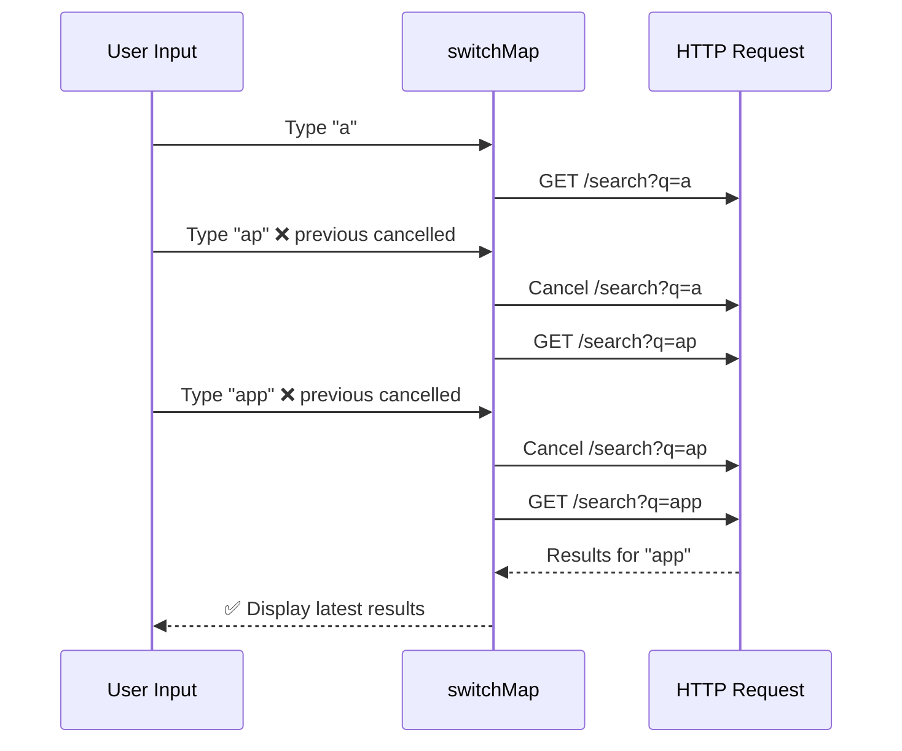
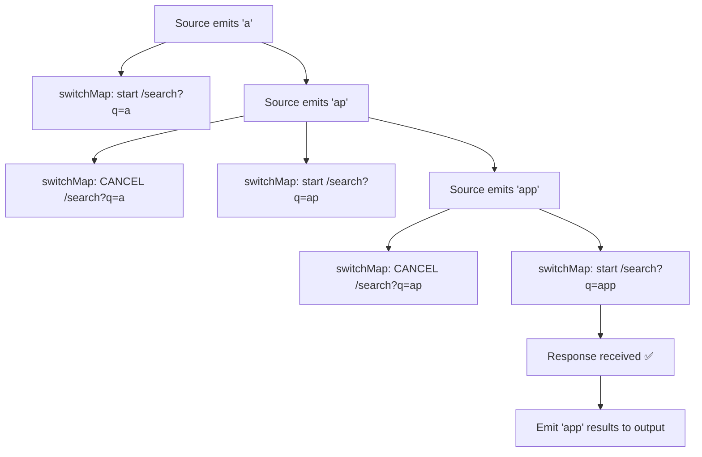

## Introduction
`switchMap` maps each emission from a source Observable to an inner Observable, **cancelling the previous inner Observable** when a new source value arrives. It is the go-to operator for scenarios where only the latest result matters.

## Why do we need this?
When a user types in a search box, you don't want to send an HTTP request for every keystroke — and more importantly, you must **cancel the previous request** if a new keystroke arrives before the old one completes. Without `switchMap`, you'd get stale results and race conditions.

## Real-world analogy
Think of `switchMap` like a **TV remote with Netflix**. You browse shows (source emissions). Each time you press "up" or "down", the previous show preview cancels and the new one starts loading. You only care about the **latest** show you selected — the previous previews are irrelevant.

## switchMap Execution





## Usage

### Search Autocomplete (The Classic Use Case)

```typescript
@Component({ ... })
export class SearchComponent {
  searchControl = new FormControl('');

  results$ = this.searchControl.valueChanges.pipe(
    debounceTime(300),              // Wait 300ms pause between keystrokes
    distinctUntilChanged(),          // Only emit when value actually changes
    switchMap(term => this.apiService.search(term))  // Cancel previous, start new
  );
}
```

### Route Params (Cancel Previous Request)

```typescript
@Component({ ... })
export class ProductDetailComponent {
  product$ = this.route.paramMap.pipe(
    switchMap(params => {
      const id = params.get('id')!;
      return this.productService.getProduct(id);  // Cancels previous fetch
    })
  );
}
```

## switchMap vs Other Higher-Order Operators

| Operator | Behavior | Use Case |
|----------|----------|----------|
| `switchMap` | Cancels previous inner Observable | Search, route params |
| `mergeMap` | Runs all inner Observables in parallel | Multiple independent requests |
| `concatMap` | Queues — waits for each to complete | Order-dependent requests |
| `exhaustMap` | Ignores new emissions while inner is running | Submit button (prevent double-click) |

## Best Practices
- Use `switchMap` when only the **latest result** matters — search, route params, autocomplete
- Always combine with `debounceTime` and `distinctUntilChanged` for user input
- Return the inner Observable directly from the projection function — handle errors inside the inner stream
- Avoid using `switchMap` for **fire-and-forget** operations (use `mergeMap` or `concatMap`)
- Use `switchMap` with `HttpClient` — it cancels the pending HTTP request via `AbortController`

## Common Mistakes
- Using `switchMap` for **order-dependent** operations — the previous gets cancelled, breaking the sequence
- Forgetting that `switchMap` **cancels** — if you need all results (e.g., audit logging), use `mergeMap`
- **Nesting `switchMap`** calls instead of chaining them — use `pipe()` for multiple operators
- Not handling **errors** inside the inner Observable — the error will kill the outer stream
- Using `switchMap` when a simple `map` would suffice (no inner Observable needed)

## Interview Questions
1. What does `switchMap` do and when would you use it?
2. How does `switchMap` differ from `mergeMap` and `concatMap`?
3. Why is `switchMap` preferred for search autocomplete?
4. What happens to the previous inner Observable when a new value arrives?
5. How do you handle errors inside a `switchMap` without killing the outer stream?

## Summary
`switchMap` cancels the previous inner Observable when a new source value arrives — essential for search autocomplete, route parameter changes, and any scenario where only the latest result matters. Always combine with `debounceTime` for user input.
