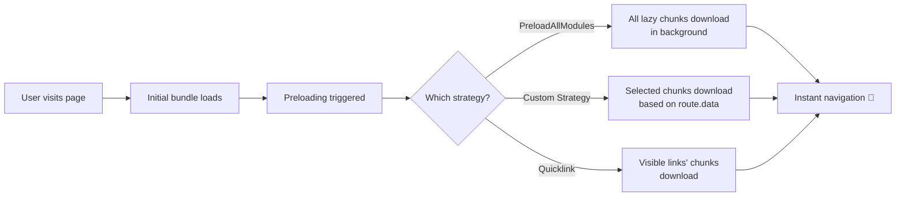
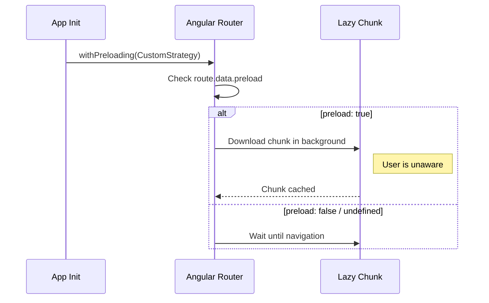

## Introduction
Preloading downloads lazy-loaded chunks in the background after the initial bundle loads — giving users instant navigation without the wait.

## Why do we need this?
Without preloading, each lazy-loaded route triggers a visible loading delay as the user navigates. Preloading eliminates this delay by fetching resources before they're needed.

## Preloading Strategies



Angular provides several preloading strategies:

### PreloadAllModules

Downloads ALL lazy-loaded modules immediately after initial render.

```typescript
// app.config.ts
provideRouter(routes, withPreloading(PreloadAllModules))

// NgModule approach
RouterModule.forRoot(routes, { preloadingStrategy: PreloadAllModules })
```

Best for small-to-medium apps where all modules are small enough to load in the background.

### NoPreloading (Default)

No preloading — modules load only when navigated to. Use for large apps where loading everything would waste bandwidth.

### Custom Preloading Strategy



```typescript
// Selective preloading based on custom data
import { PreloadingStrategy, Route } from '@angular/router';
import { Observable, of, timer } from 'rxjs';
import { switchMap } from 'rxjs/operators';

@Injectable({ providedIn: 'root' })
export class SelectivePreloadingStrategy implements PreloadingStrategy {
  preload(route: Route, load: () => Observable<any>): Observable<any> {
    if (route.data?.['preload']) {
      return route.data?.['preloadDelay']
        ? timer(route.data['preloadDelay']).pipe(switchMap(() => load()))
        : load();
    }
    return of(null); // skip preloading
  }
}

// Route config
{
  path: 'admin',
  loadChildren: () => import('./admin/admin.module').then(m => m.AdminModule),
  data: { preload: true, preloadDelay: 5000 }
}
```

### Quicklink Strategy

Uses the `ngx-quicklink` library to automatically preload routes linked on the current page:

```bash
npm install ngx-quicklink
```

```typescript
import { QuicklinkStrategy } from 'ngx-quicklink';

provideRouter(routes, withPreloading(QuicklinkStrategy))
```

This combines bandwidth and UX smartly — only preloads routes the user can navigate to from the current page.

## Best Practices
- Use `PreloadAllModules` for small apps (< 10 lazy chunks)
- Use custom strategy with `data: { preload: true }` for medium apps
- Use QuicklinkStrategy for large apps with many routes
- Delay preloading of non-critical modules with `timer()`
- Avoid preloading heavy admin modules on public pages
- Monitor network usage — preloading too much burns mobile data

## Common Mistakes
- Using `PreloadAllModules` in large enterprise apps (wastes bandwidth)
- Preloading authenticated modules before login (pointless)
- Not adding preloading to the most common user paths
- Confusing preloading with lazy loading — they work together, not as alternatives

## Interview Questions
1. What is the difference between lazy loading and preloading?
2. How do you implement a custom preloading strategy?
3. When would you choose `PreloadAllModules` vs a selective strategy?
4. How does QuicklinkStrategy determine which routes to preload?
5. Can preloading cause performance issues? How do you mitigate them?

## Summary
Preloading strategies balance initial load time against navigation speed. Choose the right strategy based on your app size and user behavior patterns.
