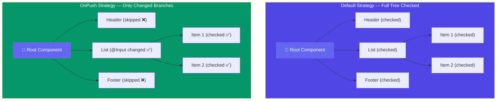

## 1. Change Detection

### Why Angular Needs Change Detection

Angular maintains a **component tree** that mirrors your DOM. When data changes (user clicks, HTTP responses, timers), Angular must know *which* components to re-render. Change detection is the mechanism that answers: "Has the model changed? If so, update the view."

Angular's change detection is **pull-based** — Angular *asks* "has anything changed?" rather than waiting to be told. This is different from React (virtual DOM diffing) or Vue (reactive proxies).

---

### Zone.js — The Change Detection Trigger

#### What Is Zone.js?

Zone.js is a **monkey-patching library** that intercepts all asynchronous browser APIs. It wraps every async operation in a "zone" — a persistent execution context that Angular can hook into.

#### What Zone.js Patches

Zone.js overrides (monkey-patches) the following APIs at application bootstrap:

```
setTimeout / setInterval / clearTimeout / clearInterval
Promise.then / Promise.catch / Promise.finally
XMLHttpRequest.open / XMLHttpRequest.send
addEventListener / removeEventListener
requestAnimationFrame
MutationObserver
```

#### Internal Mechanism

When your Angular app bootstraps (`platformBrowserDynamic().bootstrapModule(AppModule)`), Angular creates a special zone called **NgZone**. Every async operation your app runs lives inside this zone.

```typescript
// Simplified internal representation of NgZone
class NgZone {
  private _inner: Zone;      // The Angular zone
  private _outer: Zone;      // The parent (browser) zone

  constructor() {
    // Zone.js onMicrotaskEmpty hook
    this._inner = Zone.current.fork({
      name: 'angular',
      onHasTask: (delegate, current, target, hasTaskState) => {
        // When task queue empties → trigger change detection
        if (!hasTaskState.microTask && !hasTaskState.macroTask) {
          this.onMicrotaskEmpty.emit(null); // <-- triggers ApplicationRef.tick()
        }
      }
    });
  }

  run<T>(fn: () => T): T {
    return this._inner.run(fn); // Execute inside Angular zone
  }

  runOutsideAngular<T>(fn: () => T): T {
    return this._outer.run(fn); // Bypass Angular zone (no CD triggered)
  }
}
```

**Flow:**

1. User clicks a button → Zone.js intercepts the event listener call
2. The callback runs *inside* the Angular zone
3. When the microtask queue empties, Zone.js fires `onMicrotaskEmpty`
4. Angular's `ApplicationRef.tick()` is called → full change detection cycle begins

```typescript
// Internal ApplicationRef.tick() — simplified
class ApplicationRef {
  tick(): void {
    for (const view of this._views) {
      view.detectChanges(); // Walk every component tree
    }
  }
}
```

---

### Change Detection Tree + OnPush



---

### Default Change Detection Strategy

```typescript
@Component({
  selector: 'app-user',
  template: `<h1>{{ user.name }}</h1>`,
  // changeDetection: ChangeDetectionStrategy.Default  ← implicit
})
export class UserComponent {
  @Input() user: { name: string };
}
```

#### Internal Behavior

Angular uses **LView** (Logical View) — an internal data structure representing each component's state. In Default strategy, Angular walks the entire component tree on every CD cycle and re-evaluates **every bound expression** using dirty-checking.

```
Root
├── AppComponent       ← always checked
│   ├── HeaderComponent   ← always checked
│   ├── UserListComponent ← always checked
│   │   ├── UserComponent ← always checked
│   │   └── UserComponent ← always checked
│   └── FooterComponent   ← always checked
```

Even if only `HeaderComponent` changed, **all** components are checked. This is **O(n)** per CD cycle.

---

### OnPush Change Detection Strategy

```typescript
@Component({
  selector: 'app-user',
  template: `<h1>{{ user.name }}</h1>`,
  changeDetection: ChangeDetectionStrategy.OnPush
})
export class UserComponent {
  @Input() user: { name: string };
}
```

#### What Triggers OnPush

Angular marks a component **dirty** (needs checking) only when:

1. **`@Input` reference changes** — object identity (`===`) changes, not deep equality
2. **An event originates inside the component** — DOM event in the component's template
3. **An `async` pipe emits a new value** — Angular calls `markForCheck()` internally
4. **`ChangeDetectorRef.markForCheck()`** is explicitly called

```typescript
// Correct: new reference triggers OnPush
this.user = { ...this.user, name: 'Alice' };  // ✅ new object ref

// Wrong: mutating object does NOT trigger OnPush
this.user.name = 'Alice';  // ❌ same object ref, CD skipped
```

#### Internal: markForCheck() vs detectChanges()

```typescript
@Component({ changeDetection: ChangeDetectionStrategy.OnPush })
export class MyComponent {
  constructor(private cdr: ChangeDetectorRef) {}

  // Marks this + all ancestors as dirty.
  // CD will check them on the NEXT cycle.
  triggerFromParent(): void {
    this.cdr.markForCheck();
  }

  // Synchronously runs CD for THIS subtree immediately.
  // Useful for running outside NgZone.
  triggerImmediately(): void {
    this.cdr.detectChanges();
  }
}
```

#### Detached View

```typescript
// Completely opt out of automatic CD
this.cdr.detach();

// Manually trigger when needed
setInterval(() => {
  this.data = fetchData();
  this.cdr.detectChanges();
}, 5000);
```

---

### Running Code Outside NgZone

```typescript
@Component({ ... })
export class HeavyAnimationComponent implements OnInit {
  constructor(private ngZone: NgZone, private cdr: ChangeDetectorRef) {}

  ngOnInit(): void {
    // Heavy RAF loop — don't trigger CD on every frame
    this.ngZone.runOutsideAngular(() => {
      const animate = () => {
        this.updateCanvas(); // DOM manipulation, no Angular bindings
        requestAnimationFrame(animate);
      };
      animate();
    });

    // When you DO need Angular to know about a change:
    this.ngZone.run(() => {
      this.someAngularProperty = 'updated';
      // Now CD will pick this up
    });
  }
}
```

---
