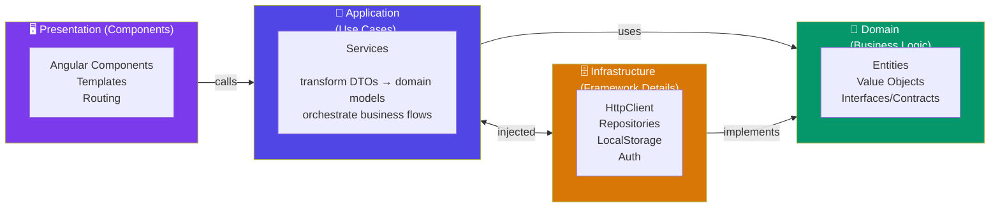

## Introduction
Clean Architecture (by Robert C. Martin) separates software into concentric layers — each with a specific responsibility — making the system independent of frameworks, databases, and UI.

## Why do we need this?
Enterprise Angular apps that mix business logic with framework code become hard to test, migrate, and reason about. Clean Architecture keeps business rules framework-agnostic and independently testable.

## Architecture Layers



## Implementation in Angular

### Domain Layer (Pure TypeScript — no Angular imports)

```typescript
// Domain entity — zero Angular dependencies
export interface User {
  id: string;
  email: Email; // Value Object
}

// Value Object
export class Email {
  constructor(private readonly value: string) {
    if (!value.includes('@')) throw new Error('Invalid email');
  }
  toString(): string { return this.value; }
}

// Repository contract (interface)
export abstract class UserRepository {
  abstract findById(id: string): Observable<User>;
  abstract save(user: User): Observable<void>;
}
```

### Application Layer (Angular Services — orchestrates use cases)

```typescript
@Injectable({ providedIn: 'root' })
export class GetUserProfileUseCase {
  constructor(private userRepo: UserRepository) {} // depends on abstraction

  execute(id: string): Observable<User> {
    return this.userRepo.findById(id);
  }
}
```

### Infrastructure Layer (implements contracts)

```typescript
@Injectable({ providedIn: 'root' })
export class ApiUserRepository implements UserRepository {
  constructor(private http: HttpClient) {}

  findById(id: string): Observable<User> {
    return this.http.get<ApiUser>(`/api/users/${id}`).pipe(
      map(apiUser => new User(apiUser.id, new Email(apiUser.email)))
    );
  }
  // ...
}
```

### Presentation Layer (Components — thin, no business logic)

```typescript
@Component({ ... })
export class UserProfileComponent {
  user$ = this.getProfile.execute(this.userId());
  constructor(private getProfile: GetUserProfileUseCase) {}
}
```

## Best Practices
- Domain layer must have zero framework imports — pure TypeScript only
- Dependencies point INWARD: UI → Application → Domain (Infrastructure is outer)
- Use Dependency Injection to invert dependencies at runtime
- Keep entities small — focus on one business concept each
- Value Objects validate themselves on construction

## Common Mistakes
- Importing Angular decorators (`@Injectable`) in domain entities
- Making HTTP calls directly from components
- Putting business logic in infrastructure classes
- Skipping the application layer — components calling repositories directly
- Over-engineering small apps with full Clean Architecture (start simple, refactor to clean when complexity grows)

## Interview Questions
1. What problem does Clean Architecture solve in Angular?
2. What belongs in each layer of Clean Architecture?
3. How does dependency inversion work in Angular's Clean Architecture?
4. What is the difference between an Entity and a Value Object?
5. When is Clean Architecture overkill for an Angular app?

## Summary
Clean Architecture in Angular separates business rules from framework details, making the system testable, framework-independent, and adaptable to change.
