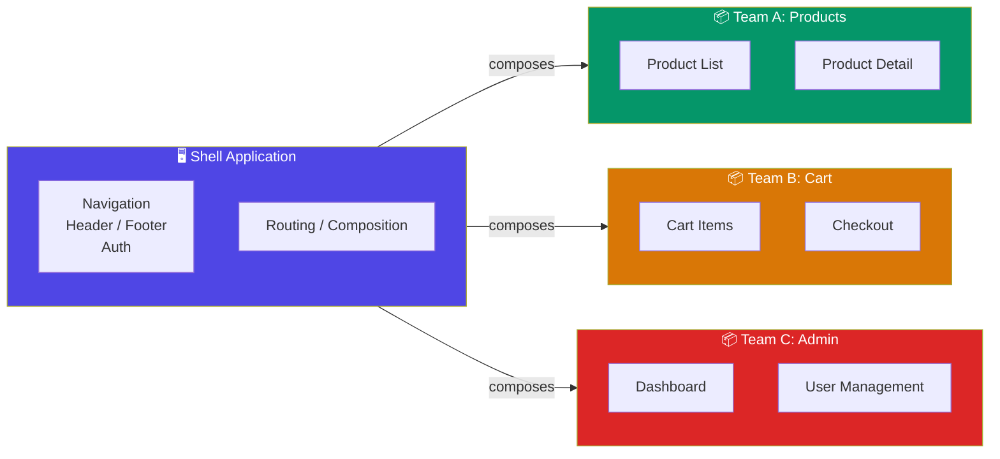

## Introduction
Micro-frontends decompose a monolithic frontend into independently deployable, team-owned applications that compose together into a single user experience.

## Why do we need this?
As Angular monoliths grow, teams step on each other — merge conflicts, coupled deployments, and scaling bottlenecks. Micro-frontends let teams work independently on their business domain.

## Architecture



## Implementation with Module Federation

### Setup

```bash
npm install @angular-architects/module-federation
ng add @angular-architects/module-federation --project shell --type host
ng add @angular-architects/module-federation --project mfe-products --type remote
```

### Remote App (exposes components)

```typescript
// webpack.config.js (remote)
module.exports = {
  name: 'mfeProducts',
  exposes: {
    './Module': './src/app/products/products.module.ts',
    './Component': './src/app/product-card/product-card.component.ts',
  },
  shared: share({
    '@angular/core': { singleton: true, strictVersion: true },
    '@angular/common': { singleton: true, strictVersion: true },
    '@angular/router': { singleton: true, strictVersion: true },
  })
};
```

### Host App (consumes remotes)

```typescript
// webpack.config.js (host)
module.exports = {
  name: 'shell',
  remotes: {
    'mfeProducts': 'mfeProducts@http://localhost:4201/remoteEntry.js',
  },
};

// Route definition
import { loadRemoteModule } from '@angular-architects/module-federation';

const routes: Routes = [
  {
    path: 'products',
    loadChildren: () =>
      loadRemoteModule({
        type: 'module',
        remoteEntry: 'http://localhost:4201/remoteEntry.js',
        exposedModule: './Module',
      }).then(m => m.ProductsModule),
  },
];
```

## Communication Between Micro-Frontends

### Shared Service (via singleton)

```typescript
// Shared library — published as npm package
@Injectable({ providedIn: 'root' })
export class SharedEventBus {
  private events = new Subject<AppEvent>();
  emit(event: AppEvent) { this.events.next(event); }
  on<T>(type: string): Observable<T> {
    return this.events.pipe(
      filter(e => e.type === type),
      map(e => e.payload as T)
    );
  }
}
```

### Custom Events (browser-native)

```typescript
// Broadcast across micro-frontends
window.dispatchEvent(new CustomEvent('product:added', { detail: { id: '123' } }));

// Listen
window.addEventListener('product:added', (event: CustomEvent) => {
  console.log('Product added:', event.detail);
});
```

## Best Practices
- Share only the Angular framework and a minimal shared lib — not UI components
- Use versioned npm packages for shared contracts/interfaces
- Each micro-frontend deploys independently with its own CI/CD
- The shell handles auth, layout, and cross-cutting concerns
- Prefer URL-based routing (each MF owns its route segment)
- Use Integration Testing for cross-MF scenarios

## Common Mistakes
- Sharing too much code between micro-frontends (increases coupling)
- Inconsistent design systems across MFs (use a shared design token library)
- Version conflicts with Angular and shared dependencies
- Over-complicating communication — prefer URL params for simple data passing
- Every MF having its own auth — centralize auth in the shell

## Interview Questions
1. What problem do micro-frontends solve?
2. How does Module Federation enable micro-frontends in Angular?
3. How do micro-frontends communicate with each other?
4. What are the challenges of sharing state across micro-frontends?
5. When is a micro-frontend architecture NOT appropriate?

## Summary
Micro-frontends enable independent team ownership and deployments at the cost of increased infrastructure complexity. Use Module Federation for Angular-based micro-frontends.
