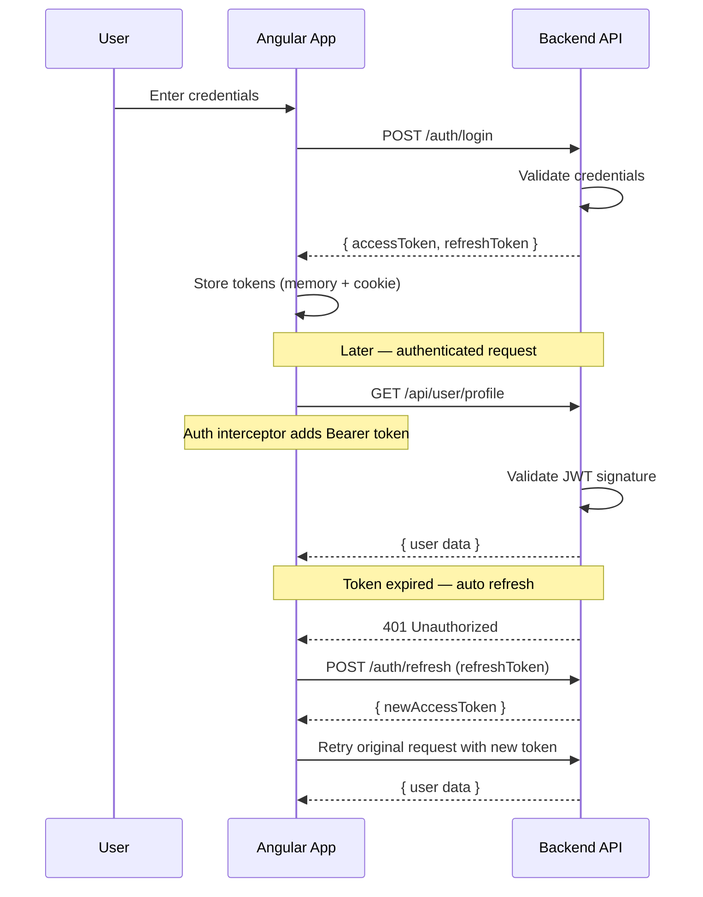
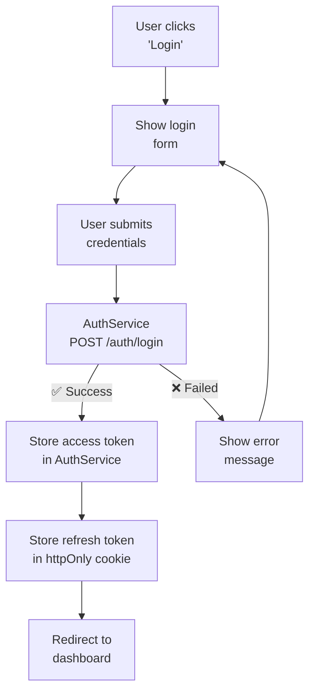
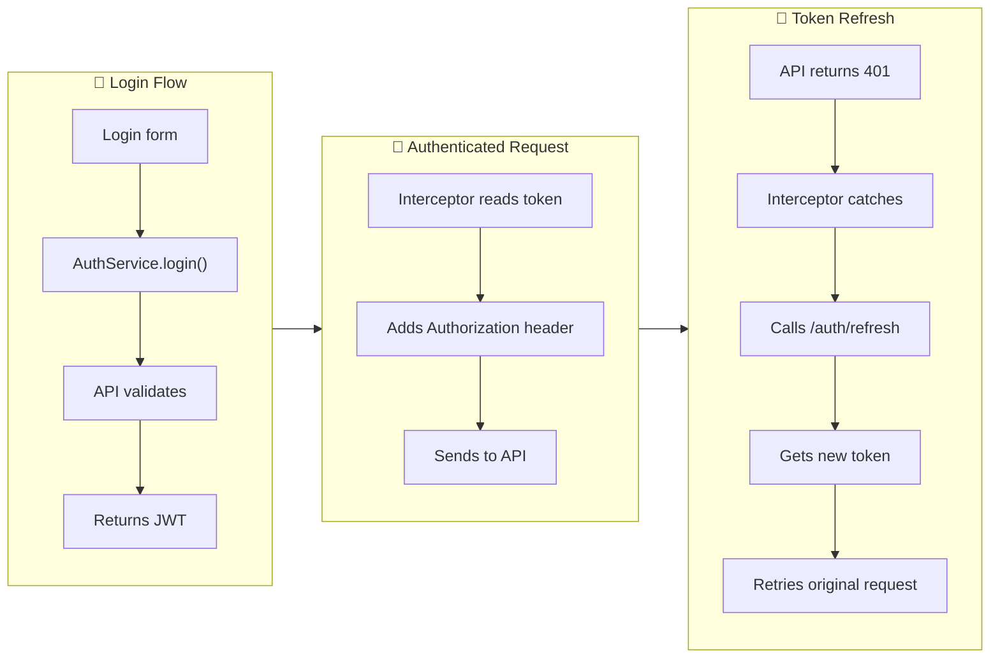

## Introduction
Authentication verifies who a user is. Angular SPAs typically use JWT (JSON Web Tokens) for stateless authentication — the server issues a signed token that the client sends with every request.

## Why do we need this?
Web applications need to restrict access to user-specific data and actions. Without authentication, anyone could access any user's data. Angular provides the tools to implement secure authentication flows — login forms, token storage, HTTP interceptors, and route guards.

## Real-world analogy
Authentication is like a **concert wristband**. You show your ticket (login credentials) at the gate, get a unique wristband (JWT token), and show that wristband every time you want to enter a section (make an API request). The wristband is tamper-proof — if it's fake, security (the server) rejects you.

## Auth Flow







## Implementation

### Auth Service

```typescript
@Injectable({ providedIn: 'root' })
export class AuthService {
  private readonly TOKEN_KEY = 'access_token';
  private userSubject = new BehaviorSubject<User | null>(null);
  user$ = this.userSubject.asObservable();

  constructor(private http: HttpClient) {
    // Check if user is already logged in on app start
    const token = this.getToken();
    if (token) this.fetchCurrentUser();
  }

  login(credentials: { email: string; password: string }): Observable<AuthResponse> {
    return this.http.post<AuthResponse>('/api/auth/login', credentials).pipe(
      tap(response => {
        localStorage.setItem(this.TOKEN_KEY, response.accessToken);
        this.userSubject.next(response.user);
      })
    );
  }

  logout(): void {
    localStorage.removeItem(this.TOKEN_KEY);
    this.userSubject.next(null);
    this.router.navigate(['/login']);
  }

  getToken(): string | null {
    return localStorage.getItem(this.TOKEN_KEY);
  }

  isLoggedIn(): boolean {
    return !!this.getToken();
  }
}
```

### Auth Interceptor

```typescript
export const authInterceptor: HttpInterceptorFn = (req, next) => {
  const authService = inject(AuthService);
  const token = authService.getToken();

  if (token) {
    const cloned = req.clone({
      setHeaders: { Authorization: `Bearer ${token}` }
    });
    return next(cloned).pipe(
      catchError(error => {
        if (error.status === 401) {
          authService.logout(); // Token expired — redirect to login
        }
        return throwError(() => error);
      })
    );
  }
  return next(req);
};
```

### Route Guard

```typescript
export const authGuard: CanActivateFn = (route, state) => {
  const auth = inject(AuthService);
  const router = inject(Router);

  if (auth.isLoggedIn()) return true;

  // Store attempted URL to redirect after login
  router.navigate(['/login'], { queryParams: { returnUrl: state.url } });
  return false;
};
```

## Best Practices
- **Never store tokens in localStorage** for sensitive apps — use httpOnly cookies for refresh tokens
- Keep access tokens **short-lived** (15 minutes) — reduces risk if stolen
- Use **refresh tokens** for automatic silent re-authentication
- Implement an **HTTP interceptor** to attach tokens to all requests automatically
- Use **route guards** (`canActivate`) to protect routes from unauthorized access
- Show the **login page** immediately when a 401 occurs — don't let the user see partial content
- Implement a **loading state** during login — disable the submit button to prevent double-submit

## Common Mistakes
- Storing **refresh tokens in localStorage** — they should be in httpOnly cookies
- Not handling **token expiration gracefully** — user gets a blank error instead of a redirect
- **Hardcoding API URLs** — use environment variables and an interceptor for base URLs
- Forgetting to **clear tokens on logout** — next user sees the previous user's data
- Not using **route guards** — protected routes are accessible without authentication
- Showing **sensitive data** before checking authentication status
- **Storing the token** in `sessionStorage` — lost on tab close, bad UX

## Interview Questions
1. How does JWT-based authentication work in Angular SPAs?
2. How do you automatically attach auth tokens to HTTP requests?
3. How do you protect routes from unauthenticated users?
4. How do you handle token expiration and refresh automatically?
5. What are the security considerations for storing tokens in the browser?

## Summary
JWT-based authentication with automatic token refresh is the standard pattern. Use an auth service for login/logout/token management, an HTTP interceptor for attaching tokens, and route guards for protecting routes.
