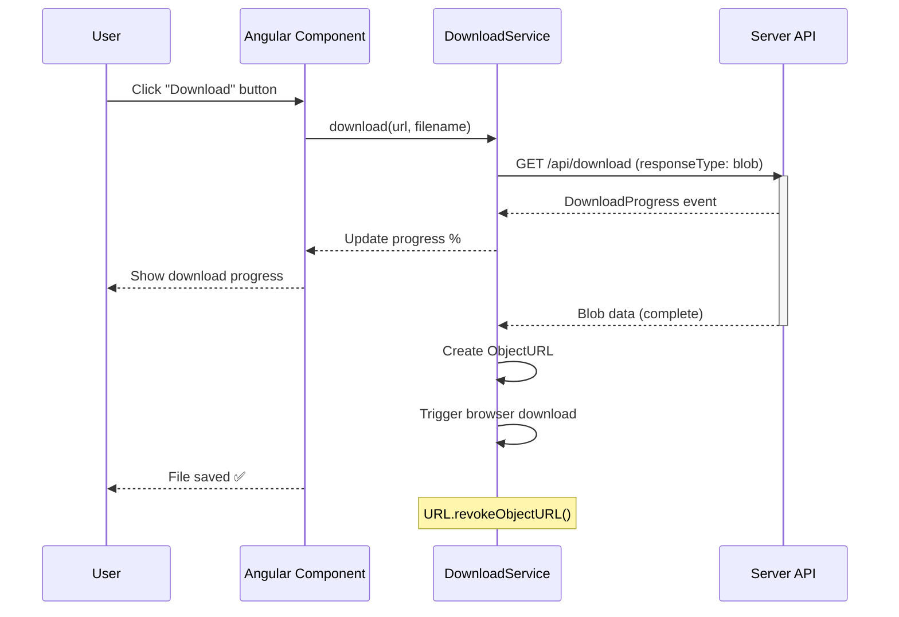
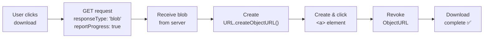
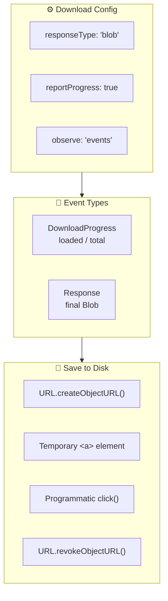

## Introduction
File download enables users to export data, download reports, save documents, and retrieve generated files from the server.

## Why do we need this?
Modern applications need to download various file types — PDFs, CSVs, images, ZIP archives — with progress indication and proper error handling.

## Download Flow







## Basic File Download

### Download as Blob

```typescript
@Injectable({ providedIn: 'root' })
export class FileDownloadService {
  constructor(private http: HttpClient) {}

  download(url: string, filename: string): Observable<HttpEvent<Blob>> {
    return this.http.get(url, {
      responseType: 'blob',
      reportProgress: true,
      observe: 'events',
    }).pipe(tap(event => {
      if (event.type === HttpEventType.DownloadProgress) {
        const progress = Math.round(100 * event.loaded / event.total!);
        console.log(`Download progress: ${progress}%`);
      }
    }));
  }

  saveBlob(blob: Blob, filename: string) {
    const link = document.createElement('a');
    link.href = URL.createObjectURL(blob);
    link.download = filename;
    link.click();
    URL.revokeObjectURL(link.href); // clean up memory
  }
}
```

### Component Usage

```typescript
@Component({ ... })
export class ExportComponent {
  downloading = signal(false);

  downloadReport() {
    this.downloading.set(true);
    this.fileService.download('/api/reports/summary', 'summary.pdf')
      .pipe(finalize(() => this.downloading.set(false)))
      .subscribe({
        next: (event) => {
          if (event.type === HttpEventType.Response) {
            this.fileService.saveBlob(event.body!, 'summary.pdf');
          }
        },
        error: (err) => console.error('Download failed', err),
      });
  }
}
```

## Download with Progress

```html
<button (click)="downloadReport()" [disabled]="downloading()">
  @if (downloading()) {
    <span>Downloading...</span>
  } @else {
    <span>Download Report</span>
  }
</button>
```

## Streaming Large Files

For very large files, use `responseType: 'blob'` with chunked transfer encoding on the server side. Consider using Service Workers to cache partial downloads on unreliable connections.

## PDF and Binary Downloads

```typescript
// Download PDF with specific headers
downloadPdf(id: string): Observable<Blob> {
  return this.http.get(`/api/documents/${id}/pdf`, {
    responseType: 'blob',
    headers: new HttpHeaders({ Accept: 'application/pdf' }),
  }).pipe(
    map(blob => {
      this.fileService.saveBlob(blob, `document-${id}.pdf`);
      return blob;
    })
  );
}
```

## Best Practices
- Always use `responseType: 'blob'` for binary file downloads
- Use `URL.createObjectURL()` to generate downloadable URLs in memory
- Call `URL.revokeObjectURL()` after download to prevent memory leaks
- Show download progress for large files (>10MB)
- Handle download failures gracefully — retry with exponential backoff
- Check Content-Type header to ensure expected file type
- Use `finalize` operator to reset loading states
- Consider streaming for very large files (>100MB)

## Common Mistakes
- Using `responseType: 'json'` for binary files (corrupts data)
- Forgetting to revoke `ObjectURL` (memory leak)
- Not handling network interruptions during large downloads
- Blocking the UI during download — keep it responsive
- Not checking Content-Disposition header for server-suggested filenames

## Interview Questions
1. How do you download a file using HttpClient?
2. What is `responseType: 'blob'` and when do you use it?
3. How do you track download progress?
4. How do you trigger a file download in the browser (save-as dialog)?
5. What are the memory considerations for large file downloads?

## Summary
File download uses `responseType: 'blob'` and `URL.createObjectURL()` for saving files. Track progress with `reportProgress`, handle errors gracefully, and always clean up memory with `revokeObjectURL()`.
