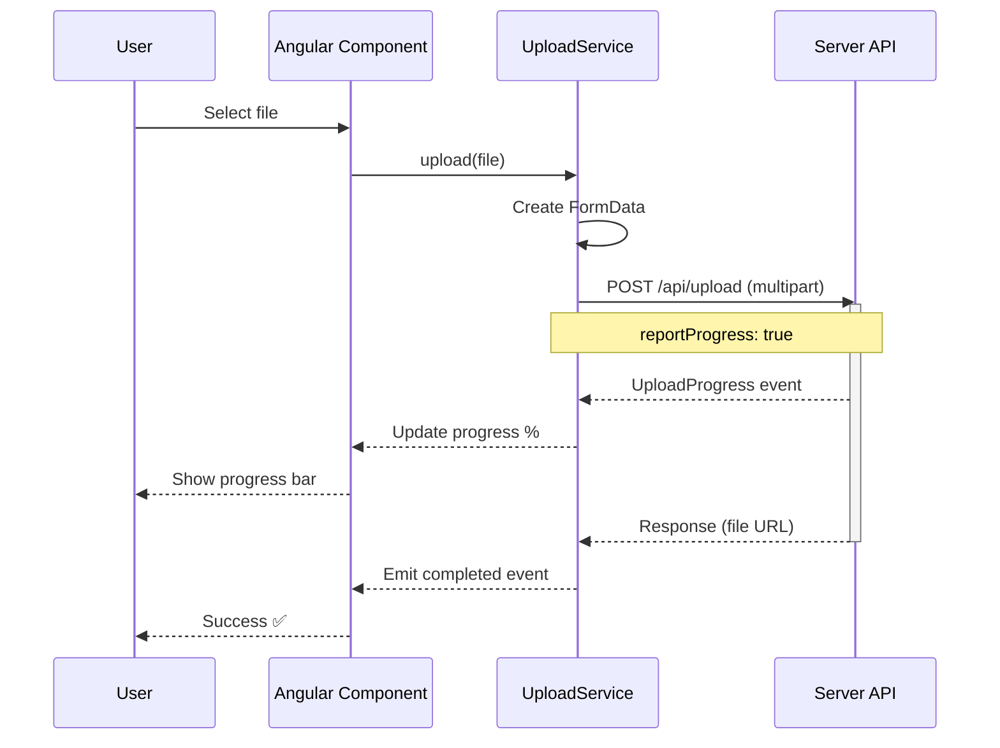
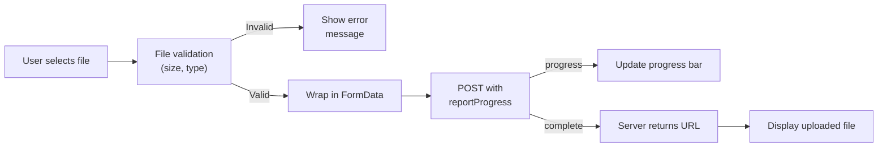
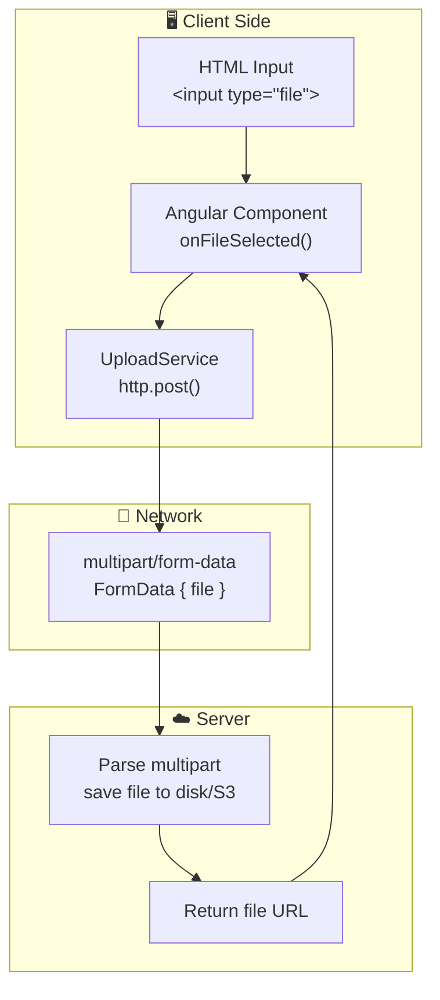

## Introduction
File upload is a common requirement in web applications — user avatars, document attachments, images, and bulk data imports.

## Why do we need this?
Modern apps need to handle file uploads efficiently with progress tracking, multiple files, and proper error handling.

## Upload Flow







## Basic File Upload

### Single File Upload

```typescript
@Injectable({ providedIn: 'root' })
export class FileUploadService {
  constructor(private http: HttpClient) {}

  upload(file: File): Observable<HttpEvent<{ url: string }>> {
    const formData = new FormData();
    formData.append('file', file, file.name);

    return this.http.post<{ url: string }>('/api/upload', formData, {
      reportProgress: true,
      observe: 'events',
    });
  }
}

// Component
@Component({ ... })
export class UploadComponent {
  uploadProgress = signal(0);

  onFileSelected(event: Event) {
    const file = (event.target as HTMLInputElement).files?.[0];
    if (!file) return;

    this.uploadService.upload(file).pipe(
      filter(event => event.type === HttpEventType.UploadProgress),
      map(event => ({ progress: Math.round(100 * event.loaded / event.total!) })),
      catchError(err => {
        console.error('Upload failed', err);
        return throwError(() => err);
      })
    ).subscribe(({ progress }) => this.uploadProgress.set(progress));
  }
}
```

### Template

```html
<div class="upload-area">
  <input type="file" (change)="onFileSelected($event)" accept="image/*" />

  @if (uploadProgress() > 0) {
    <div class="progress-bar">
      <div class="progress-fill" [style.width.%]="uploadProgress()">
        {{ uploadProgress() }}%
      </div>
    </div>
  }
</div>
```

## Multiple File Upload

```typescript
uploadMultiple(files: FileList): Observable<HttpEvent<{ files: string[] }>> {
  const formData = new FormData();
  Array.from(files).forEach(file => formData.append('files', file));
  return this.http.post<{ files: string[] }>('/api/upload/multiple', formData, {
    reportProgress: true,
    observe: 'events',
  });
}
```

## Drag-and-Drop Upload

```typescript
@HostListener('dragover', ['$event'])
onDragOver(event: DragEvent) {
  event.preventDefault();
  this.isDragging = true;
}

@HostListener('dragleave')
onDragLeave() {
  this.isDragging = false;
}

@HostListener('drop', ['$event'])
onDrop(event: DragEvent) {
  event.preventDefault();
  this.isDragging = false;
  const files = event.dataTransfer?.files;
  if (files?.length) this.uploadMultiple(files);
}
```

## Best Practices
- Always use `FormData` for file uploads (never JSON-encode the file)
- Enable `reportProgress: true` and `observe: 'events'` for progress tracking
- Set `accept` attribute on `<input type="file">` for file type filtering
- Validate file size on the client before uploading
- Limit file types and sizes on both client and server
- Show upload progress to users — large files take time
- Use `cancel()` on the subscription to abort uploads
- Handle errors gracefully — retry is harder with uploads

## Common Mistakes
- Forgetting `multipart/form-data` — Content-Type is set automatically with FormData
- Not validating file size before upload (wastes bandwidth)
- Blocking the UI during upload — keep it responsive with async progress
- Not handling upload abortion when user navigates away
- Uploading files one-by-one instead of batching when possible

## Interview Questions
1. How do you track file upload progress with HttpClient?
2. What is the difference between `observe: 'events'` and `observe: 'response'`?
3. How do you upload multiple files at once?
4. How do you implement drag-and-drop file upload in Angular?
5. How do you abort an in-progress file upload?

## Summary
File upload in Angular uses `FormData`, `reportProgress`, and `observe: 'events'` for progress tracking. Always validate file types and sizes, and provide a responsive user experience.
