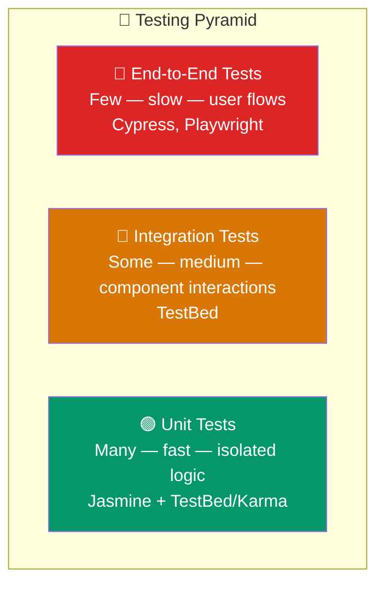
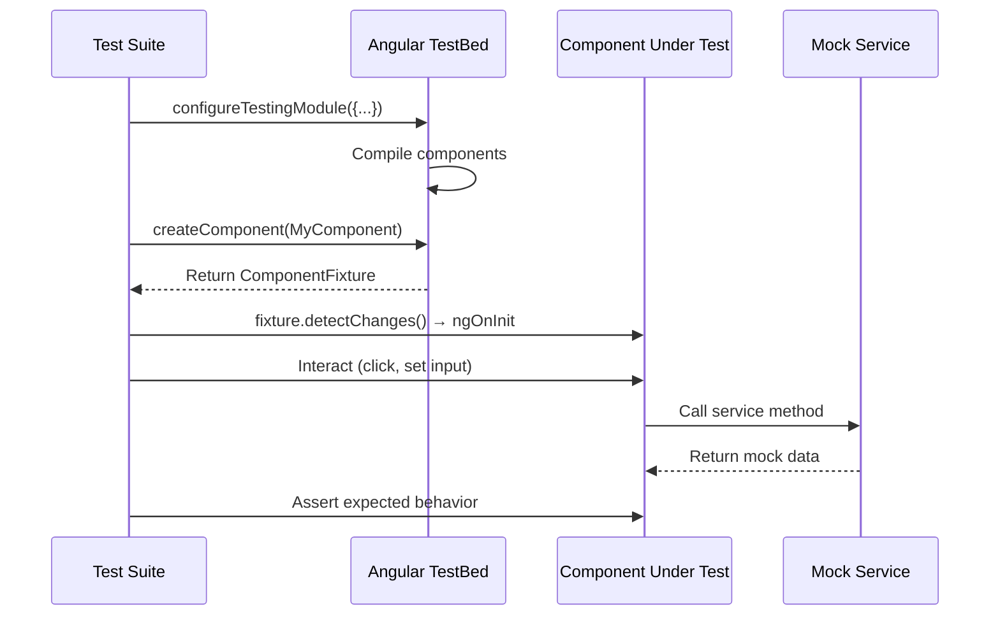

## Introduction
Unit tests verify individual units of code (components, services, pipes) in isolation. They are fast, reliable, and catch regressions before they reach production.

## Why do we need this?
Without tests, every code change risks breaking existing functionality. Manual testing is slow, inconsistent, and doesn't scale. Unit tests give you confidence to refactor, add features, and ship faster.

## Real-world analogy
Unit tests are like **checking each part of a car engine individually** before assembling it. Test the spark plug, test the fuel injector, test the piston — each in isolation. If each part works on its own, the assembled engine is much more likely to work correctly.

## Testing Pyramid





## Service Testing

```typescript
import { TestBed } from '@angular/core/testing';
import { HttpTestingController, provideHttpClientTesting } from '@angular/common/http/testing';
import { provideHttpClient } from '@angular/common/http';

describe('ProductService', () => {
  let service: ProductService;
  let httpController: HttpTestingController;

  beforeEach(() => {
    TestBed.configureTestingModule({
      providers: [
        provideHttpClient(),
        provideHttpClientTesting(),
        ProductService,
      ],
    });
    service = TestBed.inject(ProductService);
    httpController = TestBed.inject(HttpTestingController);
  });

  it('should fetch products', () => {
    const mockProducts = [{ id: '1', name: 'Test Product' }];

    service.getAll().subscribe(products => {
      expect(products.length).toBe(1);
      expect(products[0].name).toBe('Test Product');
    });

    const req = httpController.expectOne('/api/products');
    expect(req.request.method).toBe('GET');
    req.flush(mockProducts);
  });

  afterEach(() => {
    httpController.verify(); // No outstanding requests
  });
});
```

## Component Testing

```typescript
import { ComponentFixture, TestBed } from '@angular/core/testing';

describe('CounterComponent', () => {
  let fixture: ComponentFixture<CounterComponent>;
  let component: CounterComponent;

  beforeEach(async () => {
    await TestBed.configureTestingModule({
      imports: [CounterComponent], // Standalone component
    }).compileComponents();

    fixture = TestBed.createComponent(CounterComponent);
    component = fixture.componentInstance;
    fixture.detectChanges(); // Trigger ngOnInit
  });

  it('should increment count when button clicked', () => {
    // Find button and click it
    const button = fixture.nativeElement.querySelector('.increment-btn');
    button.click();
    fixture.detectChanges();

    // Verify template updated
    const display = fixture.nativeElement.querySelector('.count');
    expect(display.textContent).toContain('1');
  });
});
```

## Pipe Testing (No TestBed Needed)

```typescript
describe('TruncatePipe', () => {
  const pipe = new TruncatePipe(); // Direct instantiation — no TestBed!

  it('should truncate long strings', () => {
    expect(pipe.transform('Hello World', 5)).toBe('Hello...');
  });

  it('should not truncate short strings', () => {
    expect(pipe.transform('Hi', 5)).toBe('Hi');
  });

  it('should handle null values', () => {
    expect(pipe.transform(null as any, 5)).toBe('');
  });
});
```

## Best Practices
- Test **behavior, not implementation** — assert on rendered output, not internal state
- Use **`fixture.detectChanges()`** to trigger change detection after each interaction
- Use `HttpTestingController` for HTTP — verify requests were made and flush mock responses
- Test **edge cases** — null inputs, empty arrays, error states, boundary values
- Keep tests **fast** — avoid TestBed for pure functions (pipes, services without deps)
- Use **`async`/`fakeAsync`** for async tests — control time and flush microtasks
- Write tests **before fixing bugs** — reproduce the bug, fix it, verify the test passes

## Common Mistakes
- **Not calling** `fixture.detectChanges()` — the template won't update
- Testing **too much** in one test — each test should verify one behavior
- Using `async` when `fakeAsync` + `tick()` gives better control
- **Not cleaning up** — `HttpTestingController.verify()` catches untested requests
- Testing **private methods** — test the public API, not implementation details
- **Flaky tests** from shared mutable state — use `beforeEach` for fresh setup
- **Not testing error states** — test what happens when HTTP fails or data is empty

## Interview Questions
1. What is TestBed and why do we use it in Angular testing?
2. How do you test an HTTP call in Angular without hitting the real API?
3. What is the difference between `ComponentFixture.detectChanges()` and `autoDetectChanges()`?
4. How do you test a custom pipe?
5. Why should you use `HttpTestingController.verify()`?

## Summary
Unit tests provide fast feedback and catch regressions early. Use `TestBed` for component/service testing with `HttpTestingController` for mocking HTTP, test pipes as pure functions without TestBed, and always clean up after test suites.
