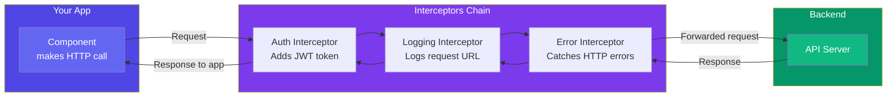

## 5. HTTP Interceptors

### Simple Words First 🟡
Think of an interceptor like a **security checkpoint** at an airport. Every package (HTTP request) passes through the checkpoint before leaving, and every incoming package (HTTP response) passes through again coming back. You can inspect, modify, or block packages at these checkpoints.

An HTTP interceptor sits between your app and the backend server. It can:
- Add an auth token to every request
- Log every request/response
- Handle errors globally
- Transform responses

### Interceptor Chain



### Creating an Interceptor (Functional Style)

Angular 15+ uses **functional interceptors** — simpler than the old class-based approach.

```typescript
// auth.interceptor.ts
import { HttpInterceptorFn } from '@angular/common/http';
import { inject } from '@angular/core';
import { AuthService } from './auth.service';

export const authInterceptor: HttpInterceptorFn = (req, next) => {
  const authService = inject(AuthService);
  const token = authService.getToken();

  if (token) {
    // Clone the request and add the auth header
    const cloned = req.clone({
      setHeaders: {
        Authorization: `Bearer ${token}`,
      },
    });
    return next(cloned); // Pass the modified request on
  }

  return next(req); // No token — pass original request
};
```

### Error Interceptor

```typescript
// error.interceptor.ts
import { HttpInterceptorFn, HttpErrorResponse } from '@angular/common/http';
import { inject } from '@angular/core';
import { catchError, throwError } from 'rxjs';

export const errorInterceptor: HttpInterceptorFn = (req, next) => {
  return next(req).pipe(
    catchError((error: HttpErrorResponse) => {
      let message = 'Something went wrong';

      if (error.status === 401) {
        message = 'Please log in again';
        // Redirect to login page
      } else if (error.status === 403) {
        message = 'You don't have permission';
      } else if (error.status === 404) {
        message = 'Resource not found';
      } else if (error.status === 500) {
        message = 'Server error. Try again later.';
      }

      console.error(`[HTTP Error] ${error.status}: ${message}`);

      // Optionally show a notification
      // inject(NotificationService).show(message);

      return throwError(() => new Error(message));
    })
  );
};
```

### Logging Interceptor

```typescript
// logging.interceptor.ts
import { HttpInterceptorFn } from '@angular/common/http';
import { tap } from 'rxjs';

export const loggingInterceptor: HttpInterceptorFn = (req, next) => {
  const start = Date.now();

  console.log(`➡️ ${req.method} ${req.url}`);

  return next(req).pipe(
    tap({
      next: (event) => {
        if (event.type === 4) { // HttpResponse
          const duration = Date.now() - start;
          console.log(`✅ ${req.method} ${req.url} — ${duration}ms`);
        }
      },
      error: (err) => {
        console.error(`❌ ${req.method} ${req.url} — Failed`);
      },
    })
  );
};
```

### Registering Interceptors

```typescript
// app.config.ts (standalone)
import { provideHttpClient, withInterceptors } from '@angular/common/http';

export const appConfig: ApplicationConfig = {
  providers: [
    provideHttpClient(
      withInterceptors([
        authInterceptor,      // Runs first
        loggingInterceptor,   // Runs second
        errorInterceptor,     // Runs third
      ])
    ),
  ],
};
```

### Old Class-Based Interceptors (for older Angular versions)

```typescript
@Injectable()
export class AuthInterceptor implements HttpInterceptor {
  constructor(private authService: AuthService) {}

  intercept(req: HttpRequest<any>, next: HttpHandler): Observable<HttpEvent<any>> {
    const token = this.authService.getToken();

    const cloned = token
      ? req.clone({ setHeaders: { Authorization: `Bearer ${token}` } })
      : req;

    return next.handle(cloned);
  }
}

// Register in providers:
// { provide: HTTP_INTERCEPTORS, useClass: AuthInterceptor, multi: true }
```

### 🚨 Common Gotchas

```typescript
// ❌ Modifying the original request
req.headers.set('Authorization', 'Bearer token'); // 💥 Request is IMMUTABLE!

// ✅ Always clone
req.clone({ setHeaders: { Authorization: 'Bearer token' } });

// ❌ Forgetting to use multi: true in class-based interceptors
// Without multi: true, only the LAST interceptor registered works

// ❌ Not handling errors in the interceptor
// An unhandled HTTP error will bubble up and crash your component
```

### In Simple Words 🧠

- **Interceptors** sit between your app and the server — they inspect/modify requests and responses
- They run as a **chain** — request flows through them in order, response flows back
- **Functional interceptors** are the modern way — simpler than class-based
- Common uses: adding auth tokens, logging, error handling, retrying failed requests
- Always **clone** the request — HTTP request objects are immutable
- Register with `withInterceptors()` in `provideHttpClient()`
