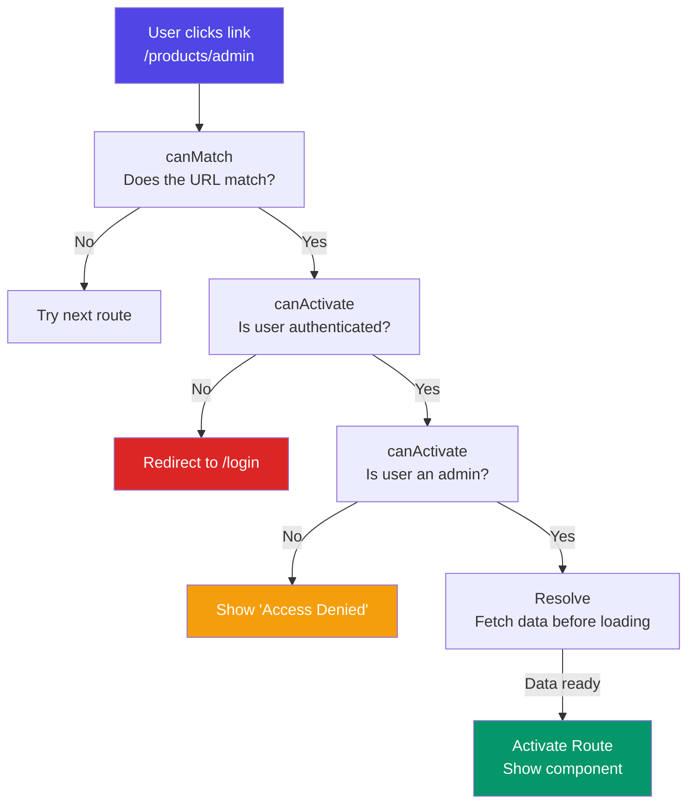

## 6. Route Guards & Resolvers

### Simple Words First 🟡
A **route guard** is like a **security guard** at a building entrance. The guard checks your ID before letting you in. Similarly, a guard checks conditions before allowing navigation to a route.

A **resolver** is like a **butler who prepares your room** before you arrive. When you navigate to a page, the resolver fetches data first, and only when the data is ready does the page appear.

### Guard Flow



### `canActivate` — Is the User Allowed?

```typescript
// auth.guard.ts
import { CanActivateFn, Router } from '@angular/router';
import { inject } from '@angular/core';
import { AuthService } from './auth.service';

export const authGuard: CanActivateFn = (route, state) => {
  const authService = inject(AuthService);
  const router = inject(Router);

  if (authService.isLoggedIn()) {
    return true; // ✅ Let them in
  }

  // Save the URL they tried to visit, then redirect to login
  router.navigate(['/login'], {
    queryParams: { returnUrl: state.url },
  });
  return false; // 🚫 Block navigation
};

// Role-based guard
export const adminGuard: CanActivateFn = () => {
  const authService = inject(AuthService);
  return authService.hasRole('admin')
    ? true
    : inject(Router).createUrlTree(['/unauthorized']);
};
```

### `canMatch` — Does This Route Match?

```typescript
// feature-flag.guard.ts
export const featureFlagGuard: CanMatchFn = (route) => {
  const featureFlags = inject(FeatureFlagService);

  if (featureFlags.isEnabled(route.path ?? '')) {
    return true;
  }

  return false; // Skip this route, try the next one
};

// Usage: two routes with same path, one guarded
const routes: Routes = [
  {
    path: 'dashboard',
    canMatch: [featureFlagGuard],
    loadComponent: () => import('./new-dashboard/new-dashboard.component'),
  },
  {
    path: 'dashboard', // Fallback if feature flag is off
    loadComponent: () => import('./old-dashboard/old-dashboard.component'),
  },
];
```

### `canDeactivate` — Prevent Leaving with Unsaved Changes

```typescript
// unsaved-changes.guard.ts
import { CanDeactivateFn } from '@angular/router';

export interface CanComponentDeactivate {
  canDeactivate: () => boolean;
}

export const unsavedChangesGuard: CanDeactivateFn<CanComponentDeactivate> = (
  component
) => {
  return component.canDeactivate
    ? component.canDeactivate()
    : true;
};

// In the component:
@Component({ ... })
export class EditProductComponent implements CanComponentDeactivate {
  isDirty = false;

  canDeactivate(): boolean {
    if (this.isDirty) {
      return confirm('You have unsaved changes. Leave anyway?');
    }
    return true;
  }
}
```

### Resolvers — Pre-fetch Data

```typescript
// product.resolver.ts
import { ResolveFn } from '@angular/router';
import { inject } from '@angular/core';
import { ProductService } from './product.service';

export const productResolver: ResolveFn<Product> = (route) => {
  const productId = route.paramMap.get('id')!;
  return inject(ProductService).getProduct(productId);
  // Angular waits for this Observable to complete before showing the route
};

// Route config
const routes: Routes = [
  {
    path: 'products/:id',
    component: ProductDetailComponent,
    resolve: { product: productResolver },
  },
];

// Component reads the pre-fetched data
@Component({ ... })
export class ProductDetailComponent implements OnInit {
  product?: Product;

  constructor(private route: ActivatedRoute) {}

  ngOnInit(): void {
    // Data is ALREADY loaded — no loading spinner needed!
    this.product = this.route.snapshot.data['product'];
  }
}
```

### In Simple Words 🧠

- **`canActivate`** checks if user can enter a route (auth check) — returns true/false
- **`canMatch`** checks if a route pattern should match at all — useful for A/B testing, feature flags
- **`canDeactivate`** checks if user can LEAVE a route — prevents losing unsaved form data
- **Resolvers** fetch data BEFORE the route activates — no loading spinners in the component
- Guards are **functions** (not classes) in Angular 15+ — simpler and tree-shakeable
- Return `false` to block, `true` to allow, or a `UrlTree` to redirect
