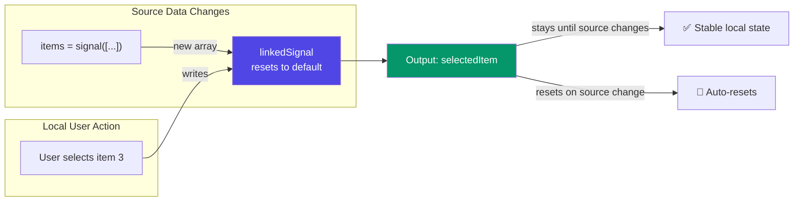

## Introduction
`linkedSignal()` (Angular 19, developer preview) creates a **writable signal that automatically resets to a computed default when its source signal changes**. It solves the common pattern of having local, mutable state that should reset when external data changes.

## Why do we need this?
A common pattern in Angular is: load a list of items, let the user select one, and reset the selection when the list changes. Without `linkedSignal()`, this requires manually tracking the source in `ngOnChanges` or using an `effect()` — both error-prone. `linkedSignal()` makes this declarative.

## Real-world analogy
Think of a radio in a rental car. When you rent a different car (source changes), the radio resets to the first station in the new car's preset list. But while driving the same car, you can freely change stations (local mutation).

## How linkedSignal Works



## Basic Usage

```typescript
import { linkedSignal } from '@angular/core';

@Component({
  selector: 'app-product-list',
  template: `
    <select [(ngModel)]="selectedProduct">
      @for (product of products(); track product.id) {
        <option [value]="product.id">{{ product.name }}</option>
      }
    </select>
    <p>Selected: {{ selectedProduct() }}</p>
  `
})
export class ProductListComponent {
  products = input.required<Product[]>();

  // When products input changes, selection resets to first product's id
  selectedProduct = linkedSignal(() => this.products()[0]?.id ?? '');
}
```

## With Previous Value Preservation

```typescript
@Component({ ... })
export class EditorComponent {
  items = input.required<Item[]>();

  // Preserve the previous selection if it still exists in the new items
  selectedItem = linkedSignal<Item[], string>({
    source: this.items,
    computation: (newItems, previous) => {
      // Try to keep the same item selected
      const stillExists = newItems.find(i => i.id === previous?.value?.id);
      return stillExists ? previous.value!.id : newItems[0]?.id;
    },
  });
}
```

## Before vs After

```typescript
// ❌ Before linkedSignal — error-prone manual approach
@Component({ ... })
export class BadComponent implements OnChanges {
  @Input() items: Item[] = [];
  selectedId: string | null = null;

  ngOnChanges(changes: SimpleChanges) {
    if (changes['items'] && this.selectedId) {
      const stillExists = this.items.find(i => i.id === this.selectedId);
      if (!stillExists) {
        this.selectedId = this.items[0]?.id ?? null; // reset
      }
    }
  }
  selectItem(id: string) { this.selectedId = id; }
}

// ✅ After linkedSignal — clean and declarative
@Component({ ... })
export class GoodComponent {
  items = input<Item[]>([]);
  selectedId = linkedSignal(() => this.items()[0]?.id ?? null);
  selectItem(id: string) { this.selectedId.set(id); }
}
```

## Common Use Cases

- **Tab selection** — reset to first tab when the tab list changes
- **Dropdown selection** — reset to default option when options refresh
- **Pagination** — reset to page 1 when the search query changes
- **Form defaults** — reset a form's default values when the data context changes
- **Filter selections** — reset filters when the data category changes

```typescript
@Component({ ... })
export class PaginatedTableComponent {
  query = input.required<string>();       // search query
  pageSize = input(20);

  // Reset to page 1 when query or pageSize changes
  currentPage = linkedSignal(() => 1);
}
```

## Best Practices
- Use `linkedSignal()` whenever local mutable state should reset when external data changes
- Prefer the two-argument form (`source` + `computation`) when you need to preserve previous selection
- Use the single-function form for simple default values
- The source signal can be any signal — `input()`, `computed()`, or another `signal()`
- Don't use `linkedSignal()` for state that should never auto-reset (use regular `signal()` instead)

## Common Mistakes
- Using `linkedSignal()` when the value should never auto-reset (use `signal()`)
- Forgetting that `linkedSignal()` is writable — treat it like any other `WritableSignal`
- Using a stale closure in the computation function (always access signals via `()` calls)
- Not providing a default when the source array is empty
- Confusing `linkedSignal()` with `computed()` — `computed()` is read-only, `linkedSignal()` is writable

## Interview Questions
1. What problem does `linkedSignal()` solve?
2. How does `linkedSignal()` differ from `computed()`?
3. When would you use the two-argument form of `linkedSignal()`?
4. Can you write to a `linkedSignal()`? What happens to the value?
5. How does `linkedSignal()` reset its value?

## Summary
`linkedSignal()` creates a writable signal that auto-resets to a default when its source changes — eliminating manual reset logic in `ngOnChanges` or `effect()`. Perfect for selections, tabs, pagination, and filter state.
