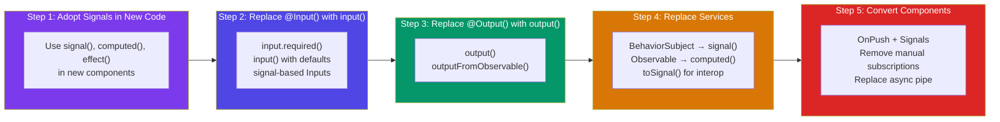

## Introduction
Angular apps built before Signals relied on RxJS Observables, BehaviorSubjects, and subscriptions for state management. Signals provide a simpler, synchronous reactivity model that integrates directly with Angular's change detection.

## Why do we need this?
Migrating an existing codebase from Observables to Signals should be incremental — not a rewrite. This guide provides a step-by-step approach to adopt Signals without breaking your application.

## Migration Strategy



## Interop Utilities

Angular provides utilities to bridge Observables and Signals:

```typescript
import { toSignal, toObservable } from '@angular/core/rxjs-interop';

// Observable → Signal
@Component({ ... })
export class ProductListComponent {
  private products$ = this.productService.getAll();
  products = toSignal(this.products$, { initialValue: [] });

  // Signal → Observable
  private searchTerm = signal('');
  searchTerm$ = toObservable(this.searchTerm);
}
```

## Step-by-Step Migration Examples

### Service: BehaviorSubject → signal

```typescript
// Before: RxJS-based service
@Injectable({ providedIn: 'root' })
export class CartService {
  private items = new BehaviorSubject<CartItem[]>([]);
  items$ = this.items.asObservable();

  addItem(item: CartItem) {
    this.items.next([...this.items.value, item]);
  }
}

// After: Signal-based service
@Injectable({ providedIn: 'root' })
export class CartService {
  private items = signal<CartItem[]>([]);
  readonly items = this.items.asReadonly(); // expose as readonly

  addItem(item: CartItem) {
    this.items.update(current => [...current, item]);
  }
}
```

### Component: Manual Subscription → Signal

```typescript
// Before: manual subscription + OnDestroy
@Component({ ... })
export class ProfileComponent implements OnDestroy {
  private destroy$ = new Subject<void>();
  user: User | null = null;

  constructor(private userService: UserService) {
    this.userService.getUser().pipe(
      takeUntil(this.destroy$)
    ).subscribe(user => this.user = user);
  }

  ngOnDestroy() {
    this.destroy$.next();
    this.destroy$.complete();
  }
}

// After: Signal with toSignal
@Component({ ... })
export class ProfileComponent {
  user = toSignal(this.userService.getUser(), { initialValue: null });
}
```

### Template: async pipe → Signal

```html
<!-- Before: async pipe -->
<div *ngIf="products$ | async as products">
  <li *ngFor="let p of products">{{ p.name }}</li>
</div>

<!-- After: Signal -->
@let products = products();
@if (products.length) {
  @for (p of products; track p.id) {
    <li>{{ p.name }}</li>
  }
}
```

### Component Inputs: @Input() → input()

```typescript
// Before
@Input() userId!: string;
@Input() showDetails = false;

// After
userId = input.required<string>();
showDetails = input(false);
```

### Component Outputs: @Output() → output()

```typescript
// Before
@Output() selected = new EventEmitter<User>();
@Output() closed = new EventEmitter<void>();

// After
selected = output<User>();
closed = output<void>();
```

## Migration Checklist

- [ ] Install Angular 17+ (minimum 17.1 for signal inputs)
- [ ] Add `provideExperimentalZonelessChangeDetection` if targeting zoneless
- [ ] Convert new components to Signals from the start
- [ ] Replace BehaviorSubject → signal in services
- [ ] Replace @Input() → input() (one component at a time)
- [ ] Replace @Output() → output()
- [ ] Replace manual subscriptions with toSignal
- [ ] Replace async pipe with Signal-based template access
- [ ] Add OnPush change detection to signal-based components
- [ ] Remove NgZone and Zone.js when fully migrated

## Best Practices
- Migrate leaf components first (no children), then work up
- Use `toSignal()` and `toObservable()` for gradual migration
- Don't convert everything at once — co-existence is well-supported
- Prefer `input.required()` over `input()` to enforce required inputs
- Use `asReadonly()` to expose signals from services (prevent external mutation)
- Add OnPush change detection alongside Signal adoption

## Common Mistakes
- Trying to migrate the entire app in one go
- Mixing `.subscribe()` and `.set()` in the same component (creates confusion)
- Using `effect()` to synchronize state (use `computed()` instead)
- Forgetting to provide `initialValue` to `toSignal()` (returns undefined)
- Not using `asReadonly()` on public service signals

## Interview Questions
1. How do you convert an Observable-based service to Signals?
2. What is `toSignal()` and when do you use it?
3. What is the recommended migration order from RxJS to Signals?
4. Can you use Signals and Observables in the same component?
5. What are the benefits of Signals over BehaviorSubjects?

## Summary
Signal migration is incremental. Use interop utilities (`toSignal`, `toObservable`) during transition. Start with new code, then migrate services (BehaviorSubject → signal), then components (inputs/outputs), and finally templates.
