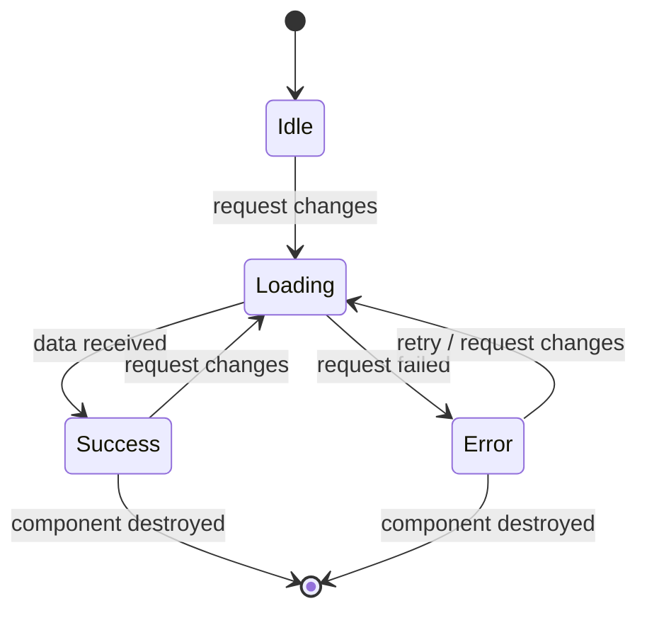
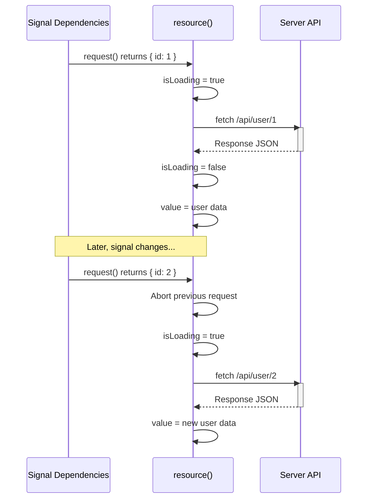

## Introduction
`resource()` (Angular 19, developer preview) is a signal-based primitive for fetching async data. It automatically re-fetches when its reactive dependencies (signals) change — handling loading, error, and success states natively.

## Why do we need this?
Traditional data fetching in Angular requires manual Observable subscriptions, `async` pipes, loading/error state management, and cleanup in `ngOnDestroy`. `resource()` wraps all of this into a single reactive primitive — no subscriptions, no boilerplate, automatic cancellation.

## Real-world analogy
A `resource()` is like a smart delivery tracker: when your order (request) changes, it automatically re-orders from the API. While waiting, it shows "loading." If something goes wrong, it shows the error. When the package arrives, it shows the data — all without you manually tracking each state.

## Data Flow





## Basic Usage

```typescript
import { resource } from '@angular/core';

@Component({
  selector: 'app-user-profile',
  template: `
    @if (userResource.isLoading()) {
      <app-spinner />
    } @else if (userResource.error()) {
      <p class="error">Error: {{ userResource.error() }}</p>
      <button (click)="userResource.reload()">Retry</button>
    } @else {
      <h2>{{ userResource.value()?.name }}</h2>
      <p>{{ userResource.value()?.email }}</p>
    }
  `
})
export class UserProfileComponent {
  userId = input.required<string>();

  userResource = resource({
    request: () => ({ id: this.userId() }), // reactive — re-fetches when userId changes
    loader: async ({ request, abortSignal }) => {
      const res = await fetch(`/api/users/${request.id}`, { signal: abortSignal });
      if (!res.ok) throw new Error('Failed to load user');
      return res.json() as User;
    },
  });
}
```

## Using rxResource (Observable-based loader)

```typescript
import { rxResource } from '@angular/core/rxjs-interop';

@Component({ ... })
export class ProductComponent {
  productId = input.required<string>();

  productResource = rxResource({
    request: () => ({ id: this.productId() }),
    loader: ({ request }) => this.productService.getProduct(request.id),
  });
}
```

## Reloading and Mutating

```typescript
@Component({ ... })
export class TodoListComponent {
  private todoService = inject(TodoService);

  todosResource = resource({
    loader: () => this.todoService.getAll(),
  });

  async addTodo(title: string) {
    await this.todoService.create({ title });
    this.todosResource.reload(); // re-fetch the list
  }
}
```

## Resource State Properties

| Property | Type | Description |
|---|---|---|
| `value()` | `T \| undefined` | The loaded data, or `undefined` before first load |
| `isLoading()` | `boolean` | `true` while a load is in progress |
| `error()` | `unknown \| undefined` | The error from the last failed load |
| `status()` | `ResourceStatus` | Current status enum |
| `reload()` | `() => void` | Trigger a re-fetch manually |

`ResourceStatus` enum values: `Idle`, `Loading`, `Resolved`, `Rejected`, `Reloading`, `Local`.

## Best Practices
- Use `resource()` for any data that should auto-refetch when its dependencies change
- Always pass `abortSignal` to `fetch()` for automatic cancellation
- Use `rxResource()` when your data layer uses Observables (HttpClient)
- Call `reload()` after mutations to refresh data
- Don't call `reload()` inside a `computed()` or `effect()` — use reactive `request` instead
- Handle the error state in the template — show error messages and retry buttons

## Common Mistakes
- Not providing an `abortSignal` when using `fetch()` (causes race conditions)
- Manually managing loading/error state alongside `resource()` (let it handle it)
- Calling `reload()` inside an `effect()` that depends on the resource's own value (infinite loop)
- Using `resource()` for fire-and-forget mutations — it's designed for reads
- Not using `rxResource` with HttpClient (HttpClient returns cold Observables, not Promises)

## Interview Questions
1. What is `resource()` and what problem does it solve?
2. How does `resource()` automatically cancel stale requests?
3. What is the difference between `resource()` and `rxResource()`?
4. How do you handle loading, error, and success states with `resource()`?
5. How do you trigger a re-fetch after a mutation?

## Summary
`resource()` and `rxResource()` provide declarative, signal-based async data fetching with automatic loading/error state, reactive re-fetching, and request cancellation — replacing manual subscription management.
