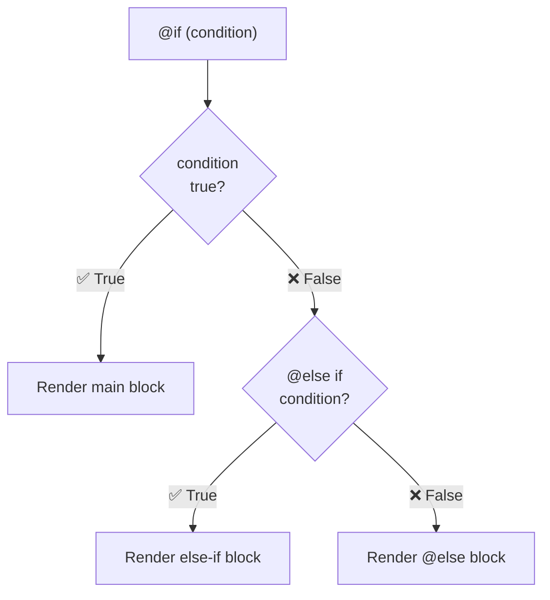
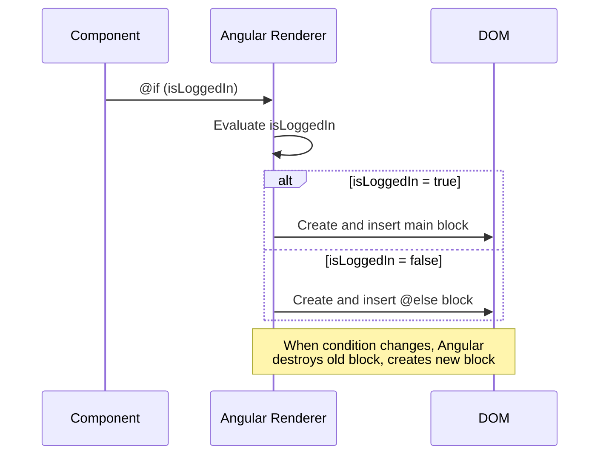

## Introduction
`@if` (Angular 17+) replaces `*ngIf` with a cleaner, more readable syntax that natively supports `@else if` and `@else` branches — no more `<ng-template>` hacks for else blocks.

## Why do we need this?
`*ngIf` required the `else` template to be defined elsewhere in the template, breaking readability. With `@if`, all branches are co-located, type narrowing works natively, and the syntax is familiar from any programming language.

## Real-world analogy
Think of `@if` like a **three-way traffic light**. When green (condition true), go. When yellow (else if), prepare to stop. When red (else), stop. All three states are right there on the same pole — you don't need to look at a separate sign elsewhere.

## @if Syntax





## Basic Usage

```html
<!-- Single condition -->
@if (isLoggedIn) {
  <p>Welcome, {{ username }}!</p>
}

<!-- With else -->
@if (isLoggedIn) {
  <p>Welcome, {{ username }}!</p>
} @else {
  <p>Please log in.</p>
}

<!-- Multiple conditions (replaces nested *ngIf) -->
@if (role === 'admin') {
  <app-admin-panel />
} @else if (role === 'editor') {
  <app-editor-panel />
} @else {
  <app-user-panel />
}
```

## Type Narrowing

`@if` provides better TypeScript type narrowing — the type of the condition's subject is narrowed inside the block:

```typescript
@Component({ ... })
export class ProfileComponent {
  user = signal<User | null>(null);

  loadUser() {
    this.http.get<User>('/api/user').subscribe(u => this.user.set(u));
  }
}
```

```html
@if (user(); as u) {
  <!-- ✅ u is User (not User | null) inside this block -->
  <h2>{{ u.name }}</h2>
  <p>{{ u.email }}</p>
}
```

## Before vs After

```html
<!-- ❌ Before (Angular 16 and earlier) -->
<div *ngIf="isLoggedIn; else loginPrompt">
  <p>Welcome, {{ username }}!</p>
</div>
<ng-template #loginPrompt>
  <p>Please log in.</p>
</ng-template>

<!-- ✅ After (Angular 17+) — everything in one place -->
@if (isLoggedIn) {
  <p>Welcome, {{ username }}!</p>
} @else {
  <p>Please log in.</p>
}
```

## Best Practices
- Use `@if` over `*ngIf` in Angular 17+ projects — it's more readable and type-safe
- Use the `as` alias (`@if (obs$ | async; as data)`) for async data
- Prefer `@else if` chains over nested `@if` blocks for multiple conditions
- Keep conditions simple — move complex logic to component methods
- Use `@if` for conditional rendering, `[hidden]` for visibility toggling

## Common Mistakes
- Mixing `@if` and `*ngIf` in the same template — pick one style and stick with it
- Forgetting that `@if` **creates/destroys** DOM elements (like `*ngIf`), not just hides them
- Using `@if` for simple visibility toggles — use `[hidden]` or `[class.hidden]` instead
- Not handling the **loading state** — show a spinner while async data loads
- Putting **too many conditions** in one `@if` — extract into a component method

## Interview Questions
1. What is the `@if` syntax and how does it improve upon `*ngIf`?
2. How does `@else if` work in Angular 17+ templates?
3. Does `@if` provide better TypeScript type narrowing than `*ngIf`? How?
4. How do you handle async data with `@if`?
5. What happens to the DOM when an `@if` condition becomes false?

## Summary
`@if` provides cleaner conditional rendering with native `@else if` and `@else` support, better type narrowing, and co-located branch logic. Use it instead of `*ngIf` in Angular 17+ projects.
