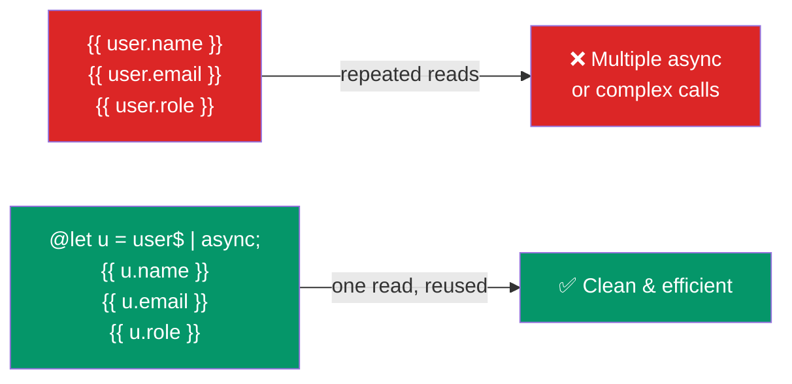

## Introduction
`@let` (Angular 18+) lets you declare local variables directly in your templates — similar to a `const` in TypeScript, but scoped to the template block.

## Why do we need this?
Before `@let`, reusing a computed value or an `async` pipe result in templates required awkward workarounds like `*ngIf="expr$ | async as result"` or nesting `<ng-container>` elements. `@let` gives you a clean, readable way to define template-scoped variables.

## Real-world analogy
Think of `@let` like a sticky note you put on your monitor — a one-time calculation result that you want to reference multiple times without re-calculating or re-subscribing every time.

## @let Flow



## Basic Syntax

```html
@let user = currentUser$ | async;

@if (user) {
  <h1>Welcome, {{ user.name }}!</h1>
  <p>Email: {{ user.email }}</p>
  <p>Role: {{ user.role }}</p>
}
```

## Use with async pipe

The most common use case — subscribe to an observable once and reuse the result:

```html
@let products = productService.products$ | async;
@let total = products?.reduce((sum, p) => sum + p.price, 0) ?? 0;

@if (products && products.length) {
  <h2>Cart ({{ products.length }} items)</h2>
  <p>Total: {{ total | currency }}</p>
  @for (product of products; track product.id) {
    <div>{{ product.name }} — {{ product.price | currency }}</div>
  }
} @else {
  <p>Your cart is empty</p>
}
```

## Combine with @if / @for

```html
@let isAdmin = user.roles.includes('admin');
@let canEdit = isAdmin || user.permissions.includes('edit');

@if (canEdit) {
  <button (click)="edit()">Edit</button>
}
@if (isAdmin) {
  <button (click)="delete()">Delete</button>
}
```

## Scoping Rules

```html
<!-- @let is block-scoped — accessible only within its block -->
@let x = 10;

@if (condition) {
  @let y = x * 2;  <!-- ✅ can access parent scopes -->
  {{ y }}
}

<!-- {{ y }} -->  <!-- ❌ y is not available outside the if block -->

<!-- @for provides implicit variables -->
@for (item of items; track item.id; let i = $index) {
  @let isFirst = i === 0;
  <div [class.first]="isFirst">{{ item.name }}</div>
}
```

## Best Practices
- Use `@let` with `async` pipe to avoid multiple subscriptions to the same observable
- Keep `@let` declarations close to where they're used (near the top of the block)
- Prefer `@let` over `*ngIf="obs$ | async as var"` for clarity and type safety
- Use descriptive names: `@let formattedDate`, `@let userProfile`, etc.
- `@let` variables are read-only (like `const`) — don't try to reassign them

## Common Mistakes
- Trying to reassign a `@let` variable (it's read-only — use a signal instead)
- Declaring `@let` outside a template block where it won't be accessible
- Using `@let` for state that changes over time (use `signal()` in the component instead)
- Confusing `@let` with `@for`'s implicit `let` syntax — they're different features

## Interview Questions
1. What is `@let` and what problem does it solve in Angular templates?
2. How does `@let` improve readability compared to `*ngIf="obs$ | async as var"`?
3. What is the scoping behavior of `@let` — can it be accessed outside its block?
4. Can you reassign a `@let` variable?
5. When would you choose `@let` over `computed()` in the component class?

## Summary
`@let` provides clean, scoped template variable declarations — eliminating the need for `as` workarounds and `ng-container` nesting. Use it to store `async` pipe results and computed expressions.
