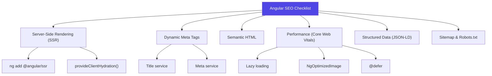

## Introduction
Search Engine Optimization (SEO) for Angular apps requires server-side rendering (SSR) so crawlers can read your content, plus metadata management for proper indexing.

## Why do we need this?
Single-page Angular apps rendered entirely in the browser send crawlers an empty HTML shell — no content, no meta tags. Search engines can't index your pages properly without SSR.

## SEO Checklist for Angular SSR



## Dynamic Metadata with Angular

```typescript
import { Title, Meta } from '@angular/platform-browser';

@Injectable({ providedIn: 'root' })
export class SeoService {
  constructor(private title: Title, private meta: Meta) {}

  updatePage(config: { title: string; description: string; image?: string }) {
    this.title.setTitle(`${config.title} | MyApp`);

    // Standard meta tags
    this.meta.updateTag({ name: 'description', content: config.description });

    // Open Graph (Facebook, LinkedIn)
    this.meta.updateTag({ property: 'og:title', content: config.title });
    this.meta.updateTag({ property: 'og:description', content: config.description });
    if (config.image) {
      this.meta.updateTag({ property: 'og:image', content: config.image });
    }

    // Twitter Cards
    this.meta.updateTag({ name: 'twitter:card', content: 'summary_large_image' });
    this.meta.updateTag({ name: 'twitter:title', content: config.title });
    this.meta.updateTag({ name: 'twitter:description', content: config.description });
  }
}
```

## Per-Route Metadata with Resolvers

```typescript
// Route definition
{
  path: 'product/:slug',
  component: ProductComponent,
  resolve: { seo: productSeoResolver },
}

// Resolver
export const productSeoResolver: ResolveFn<void> = (route) => {
  const seo = inject(SeoService);
  const productService = inject(ProductService);

  return productService.getProduct(route.paramMap.get('slug')!).pipe(
    tap(product => seo.updatePage({
      title: product.name,
      description: product.description.slice(0, 160),
      image: product.imageUrl,
    })),
    map(() => void 0) // return void
  );
};
```

## Structured Data (JSON-LD)

```typescript
@Injectable({ providedIn: 'root' })
export class JsonLdService {
  private injector = inject(Injector);

  setStructuredData(data: Record<string, any>) {
    // Remove existing JSON-LD script
    document.querySelector('script[type="application/ld+json"]')?.remove();

    const script = document.createElement('script');
    script.type = 'application/ld+json';
    script.text = JSON.stringify({
      '@context': 'https://schema.org',
      ...data,
    });
    document.head.appendChild(script);
  }
}

// Usage for a product page
this.jsonLd.setStructuredData({
  '@type': 'Product',
  name: 'Angular Pro Course',
  description: 'Complete Angular course.',
  offers: {
    '@type': 'Offer',
    price: '49.99',
    priceCurrency: 'USD',
  },
});
```

## SSR Considerations for SEO

```typescript
import { isPlatformServer } from '@angular/common';

@Component({ ... })
export class ProductDetailComponent {
  private platformId = inject(PLATFORM_ID);

  ngOnInit() {
    // Meta tags should be set on server (for crawlers)
    this.seo.updatePage({
      title: this.product().name,
      description: this.product().description,
    });

    // Client-only features (analytics, etc.)
    if (isPlatformServer(this.platformId)) {
      // Set HTTP headers for crawlers (status codes, redirects)
    }
  }
}
```

## Core Web Vitals Optimization

- **LCP**: Use `NgOptimizedImage` with `priority` for hero images
- **FID/INP**: Defer non-critical scripts with `@defer`
- **CLS**: Set explicit width/height on all images and embeds
- **TTFB**: Use SSR + preloading with `PreloadAllModules`

## Best Practices
- Every page must have unique title (≤60 chars) and meta description (≤160 chars)
- Use Open Graph and Twitter Card tags for social sharing
- Add JSON-LD structured data for products, articles, FAQs, etc.
- Generate a sitemap.xml and submit to Google Search Console
- Set canonical URLs to prevent duplicate content issues
- Use SSR for content pages, blogs, product pages
- Ensure 404 pages return actual HTTP 404 status from server
- Avoid client-only rendering for critical landing pages

## Common Mistakes
- Relying on client-side `<title>` changes (crawlers may not execute JS)
- Missing canonical URLs for pages accessible via multiple paths
- Not setting proper HTTP status codes in SSR (all pages return 200)
- Forgetting alt text on images
- Blocking CSS/JS in robots.txt (Angular apps need JS rendering)
- Not measuring SEO impact with Google Search Console

## Interview Questions
1. Why does Angular need SSR for SEO?
2. How do you set dynamic meta tags in Angular?
3. What is JSON-LD and how do you implement it in Angular?
4. How does Angular Universal handle HTTP status codes for SEO?
5. What are the most important Core Web Vitals for SEO?

## Summary
Angular SSR + dynamic metadata management + structured data = good SEO. Use `Title` and `Meta` services dynamically, add JSON-LD, generate sitemaps, and monitor with Search Console.
