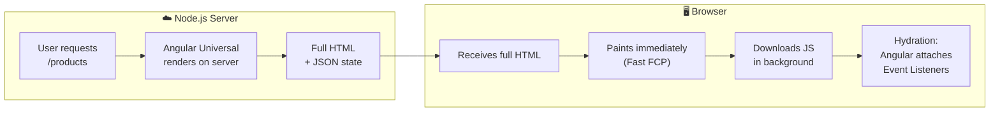
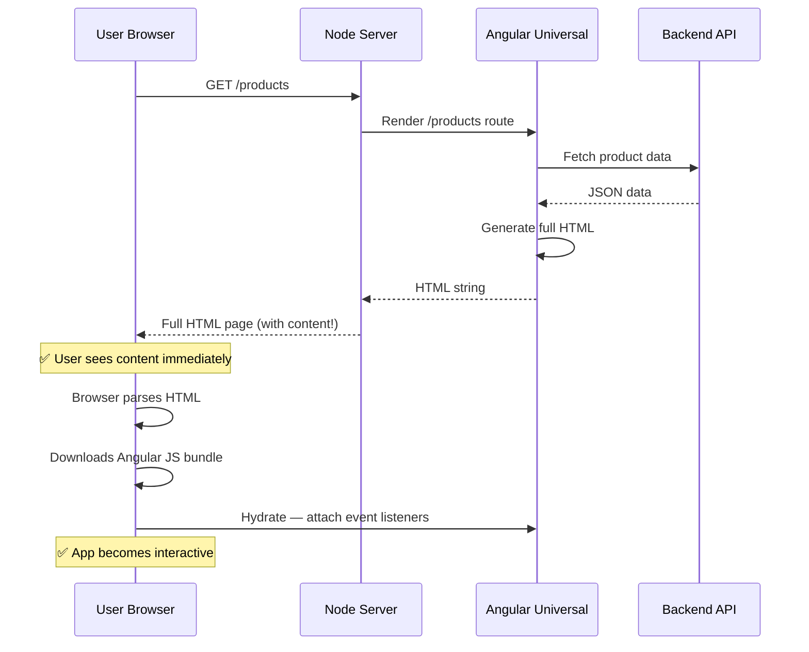
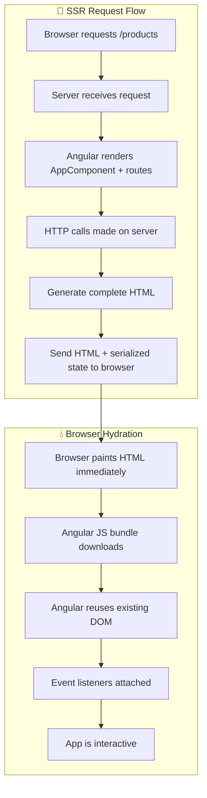

## Introduction
Server-Side Rendering (SSR) renders your Angular application on the **server** first — the user receives fully-rendered HTML, CSS is painted immediately, and JavaScript hydrates the page in the background.

## Why do we need this?
Client-side only Angular apps send an empty HTML shell to the browser — crawlers see nothing, users see a blank flash, and initial load times are slow. SSR solves all three: **fast First Contentful Paint**, **better SEO**, and **social media previews**.

## Real-world analogy
SSR is like a **restaurant that pre-plates your meal** before you sit down. Client-side rendering is like a **cooking class** where you get raw ingredients and a recipe — you have to cook everything yourself before eating. SSR serves the finished dish immediately.

## SSR Architecture







## Setup

```bash
# Add SSR to an existing Angular project (Angular 17+)
ng add @angular/ssr

# This creates:
# - server.ts — Express server
# - src/main.server.ts — Server entry point
# - src/app/app.config.server.ts — Server config

# Build and serve
ng build
node dist/project-name/server/server.mjs
```

## Benefits

| Metric | Without SSR | With SSR |
|--------|-------------|----------|
| First Contentful Paint (FCP) | Slow (wait for JS) | Fast (full HTML) |
| SEO | Poor (empty shell) | Excellent (full content) |
| Social previews | ❌ No metadata | ✅ OG tags rendered |
| Time to Interactive | Fast (no SSR overhead) | Same or slightly slower |
| JavaScript bundle | Full size | Full size (lazy-load helps) |
| Server cost | None | Requires Node.js server |

## SSR + Hydration (Angular 17+)

```typescript
// app.config.ts (client)
import { provideClientHydration } from '@angular/platform-browser';

export const appConfig: ApplicationConfig = {
  providers: [
    provideRouter(routes),
    provideClientHydration(),  // ✅ Enables hydration
    // withEventReplay() — replay events that fire before hydration
    // withIncrementalHydration() — hydrate progressively (Angular 18+)
  ],
};
```

## Best Practices
- Use `ng add @angular/ssr` for the quickest setup — it handles all the boilerplate
- Always enable `provideClientHydration()` for non-destructive hydration
- Guard browser-only APIs (`window`, `document`, `localStorage`) with `isPlatformBrowser()`
- Use `TransferState` to prevent double HTTP calls (server + client)
- Combine SSR with lazy-loading for optimal bundle sizes
- Use `@defer` for non-critical content that doesn't need SSR
- Set up proper caching headers on the server for SSR'd pages

## Common Mistakes
- Using `window` or `document` directly — crashes on the server (use `isPlatformBrowser()` check)
- Not enabling **hydration** — the client re-renders everything, wasting SSR's effort
- Making HTTP calls that don't use `TransferState` — server and client both fetch the same data
- Forgetting to handle **404s** properly — SSR should return 404 status for not-found routes
- Not **optimizing images** — `NgOptimizedImage` is even more critical with SSR for LCP
- Overlooking **CDN caching** — SSR'd pages should be cached at the CDN level for performance

## Interview Questions
1. What problem does SSR solve for Angular applications?
2. How does SSR differ from static site generation (SSG/prerendering)?
3. What is hydration and why is it important?
4. How do you guard against browser-only APIs in SSR?
5. How does TransferState prevent double HTTP requests (server + client)?

## Summary
SSR renders Angular on the server, sending ready-to-display HTML to the browser. It improves SEO, First Contentful Paint, and social media previews. Enable hydration with `provideClientHydration()`, guard browser APIs, and use `TransferState` to prevent duplicate requests.
