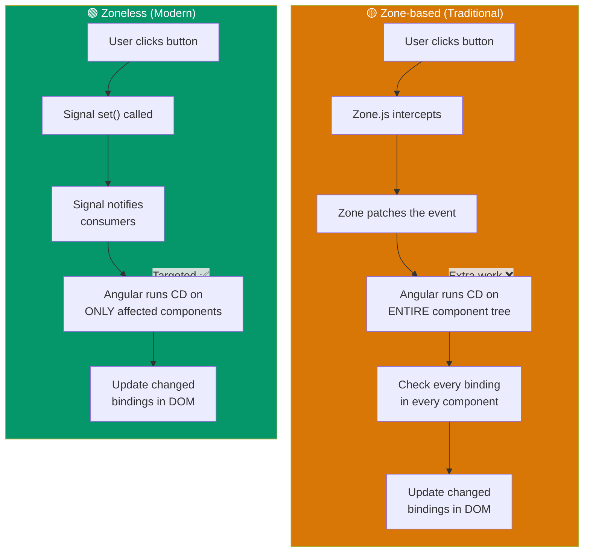
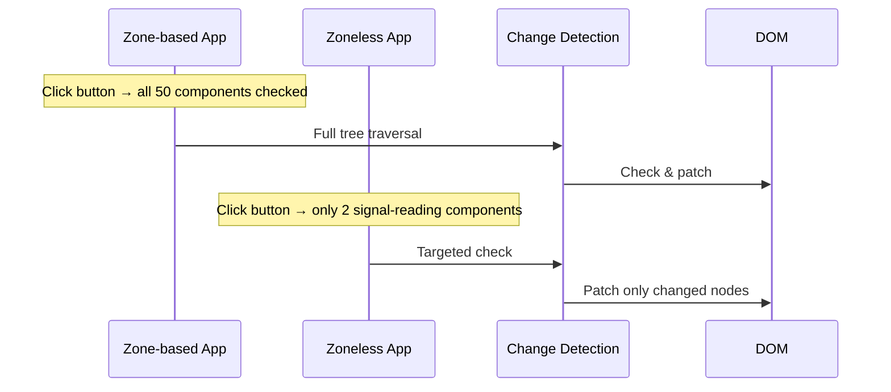
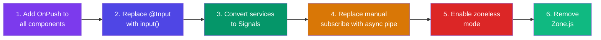

## Introduction
Zoneless Angular removes Zone.js — the library that currently triggers change detection by monkey-patching browser APIs. Instead, change detection runs only when Signals change, or when explicitly triggered with `markForCheck()`.

## Why do we need this?
Zone.js adds ~50KB to your bundle, runs change detection on every async operation (even irrelevant ones like `setTimeout` for analytics), and complicates debugging with its patched stack traces. Zoneless mode eliminates all of this.

## Zone-based vs Zoneless





## Enabling Zoneless Mode

### Angular 18+ (experimental)

```typescript
// app.config.ts
import { provideExperimentalZonelessChangeDetection } from '@angular/core';

export const appConfig: ApplicationConfig = {
  providers: [
    provideExperimentalZonelessChangeDetection(),
    // Remove: provideZoneChangeDetection()
  ],
};
```

### Remove Zone.js dependency

```bash
# Remove zone.js from polyfills in angular.json
# "polyfills": ["zone.js", "zone.js/testing"]  ← remove these
```

```typescript
// Remove zone.js import from main.ts
// import 'zone.js';  ← remove or guard this
```

## Zoneless-Compatible Patterns

### ✅ Use Signals

```typescript
// ✅ Works great with zoneless
@Component({ ... })
export class CounterComponent {
  count = signal(0);
  increment() { this.count.update(c => c + 1); }
}
```

### ✅ Use OnPush + Signals

```typescript
@Component({
  changeDetection: ChangeDetectionStrategy.OnPush, // works perfectly with signals
  template: `{{ count() }}`,
})
export class SignalComponent {
  count = signal(0);
}
```

### ✅ Use async pipe

```typescript
// ✅ async pipe calls markForCheck() internally
@Component({ template: `{{ data$ | async }}` })
export class AsyncPipeComponent {
  data$ = this.http.get('/api/data');
}
```

### ❌ Avoid manual subscribe

```typescript
// ❌ Won't trigger CD in zoneless mode
@Component({ ... })
export class BadComponent {
  data: Data | null = null;
  constructor() {
    this.http.get('/api/data').subscribe(d => this.data = d); // CD won't fire!
  }
}

// ✅ Fix: use async pipe or toSignal()
data = toSignal(this.http.get<Data>('/api/data'));
```

## Migration Steps



```typescript
// 1. Add OnPush to components
@Component({ changeDetection: ChangeDetectionStrategy.OnPush })

// 2. Replace @Input with input()
// Before
@Input() user: User;
// After
user = input.required<User>();

// 3. Convert services to Signals
// Before
private userSubject = new BehaviorSubject<User | null>(null);
user$ = this.userSubject.asObservable();
// After
private userSignal = signal<User | null>(null);
readonly user = this.userSignal.asReadonly();

// 4. Replace manual subscribe with toSignal
// Before
ngOnInit() { this.svc.getData().subscribe(d => this.data = d); }
// After
data = toSignal(this.svc.getData());
```

## MarkForCheck for Non-Zone Events

For callbacks that run outside Angular (WebSocket messages, third-party libs):

```typescript
@Component({ ... })
export class WebSocketComponent {
  private cdr = inject(ChangeDetectorRef);
  private ws = inject(WebSocketService);

  constructor() {
    this.ws.onMessage((data) => {
      this.data = data;
      this.cdr.markForCheck(); // ✅ required in zoneless mode
    });
  }
}
```

## Debugging Zoneless

Use Angular DevTools to inspect change detection cycles in zoneless mode. Check that components are only re-rendered when their Signals change, not on every browser event.

For debugging, you can log change detection cycles manually:

```typescript
@Component({ ... })
export class DebugComponent {
  private cdr = inject(ChangeDetectorRef);
  private zone = inject(NgZone);

  constructor() {
    // Log when change detection runs on this component
    (this.cdr as any).ɵdetectChanges?.(); // Angular internal — dev only
  }
}
```

> **Note:** The Angular team provides `ng.profiler.timeChangeDetection()` via Angular DevTools for profiling CD performance.

## Best Practices
- Enable zoneless mode in **new apps** from day one (no migration needed)
- Use `toSignal()` for all Observable → Signal conversion
- Use `ChangeDetectionStrategy.OnPush` on all components (it's free with signals)
- Keep all state in Signals — no plain properties that change over time
- Use `markForCheck()` for third-party library callbacks
- Test heavily with zoneless mode before removing Zone.js
- If you hit issues, keep Zone.js as a fallback and migrate gradually

## Common Mistakes
- Forgetting to use `async` pipe or `toSignal()` — plain property assignments won't trigger CD
- Using `NgZone.run()` in zoneless mode (it won't do anything useful)
- Leaving `zone.js` imports in `angular.json` and `main.ts` after migration
- Not using `markForCheck()` for callbacks from non-Angular events (WebSocket, etc.)
- Expecting `ngDoCheck` to work the same way — it fires less frequently without Zone.js

## Interview Questions
1. What problem does zoneless mode solve?
2. How do Signals enable zoneless change detection?
3. How do you enable zoneless mode in Angular 18+?
4. Why does `async` pipe work in zoneless mode but manual `.subscribe()` doesn't?
5. What migration steps are needed to make an app zoneless-ready?
6. How do you handle callbacks from non-Angular events (WebSocket, etc.) in zoneless mode?

## Summary
Zoneless mode removes Zone.js, using Signals to trigger targeted change detection only for affected components. It reduces bundle size, improves performance, and simplifies debugging. Migrate gradually: OnPush → Signals → async pipe → enable zoneless → remove Zone.js.
