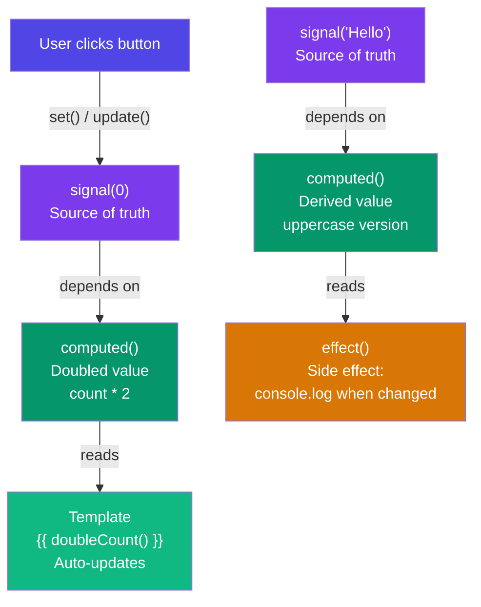

## 1. Signals

### Simple Words First 🟡
Think of a **Signal** like a **whiteboard** in an office. When someone writes a new value on the whiteboard (signal.set()), anyone looking at the whiteboard (computed or template) sees the new value instantly. You don't need to "subscribe" or "notify" anyone — the board updates, and everyone who's watching automatically knows.

Before signals, Angular used Zone.js to check EVERY component for changes. Signals are smarter — they know EXACTLY what changed and only update what's needed.

### Signals Reactivity Graph



### Creating and Using Signals

```typescript
import { Component, signal, computed, effect } from '@angular/core';

@Component({
  selector: 'app-counter',
  template: `
    <h2>Count: {{ count() }}</h2>          <!-- Call signal like a function -->
    <p>Double: {{ doubleCount() }}</p>     <!-- computed signal -->
    <button (click)="increment()">+1</button>
    <button (click)="decrement()">-1</button>
    <button (click)="reset()">Reset</button>
  `
})
export class CounterComponent {
  // Create a signal with an initial value
  count = signal(0);

  // Computed signal — depends on count(), auto-recalculates
  doubleCount = computed(() => this.count() * 2);

  // Effect — runs whenever its dependencies change
  constructor() {
    effect(() => {
      console.log(`Count changed to: ${this.count()}`);
      // This runs automatically when count() changes
    });
  }

  increment(): void {
    // Method 1: set() — set a new value
    this.count.set(this.count() + 1);

    // Method 2: update() — update based on current value
    // this.count.update(current => current + 1);
  }

  decrement(): void {
    this.count.update(c => c - 1);
  }

  reset(): void {
    this.count.set(0);
  }
}
```

### `signal()` — Mutable State

```typescript
const name = signal('Alice');

// Read
console.log(name());     // 'Alice'

// Write
name.set('Bob');          // Replace value
name.update(n => n.toUpperCase()); // 'BOB' — update based on current

// With objects — signals track by reference
const user = signal({ name: 'Alice', age: 30 });

// ✅ Correct: create new object reference
user.set({ name: 'Bob', age: user().age });

// ❌ Wrong: mutating the object won't trigger updates
// user().name = 'Bob'; // No signal update!
```

### `computed()` — Derived State

```typescript
const firstName = signal('John');
const lastName = signal('Doe');

// Computed is READ-ONLY — you cannot set it
const fullName = computed(() => `${firstName()} ${lastName()}`);
console.log(fullName()); // 'John Doe'

firstName.set('Jane');
console.log(fullName()); // 'Jane Doe' — automatically updated!
```

### `effect()` — Side Effects

```typescript
@Component({ ... })
export class LoggerComponent {
  items = signal<string[]>([]);

  constructor() {
    // Runs when items changes
    effect(() => {
      console.log(`Items updated: ${this.items().length} items`);
    });

    // Cleanup — return a function
    effect((onCleanup) => {
      const subscription = someObservable$.subscribe(val => {
        console.log('Got:', val);
      });

      onCleanup(() => {
        subscription.unsubscribe(); // Runs when effect is destroyed
      });
    });
  }
}
```

### Signal Inputs & Outputs (Angular 17.1+)

```typescript
import { Component, input, output, model } from '@angular/core';

@Component({
  selector: 'app-user-input',
  template: `
    <h3>{{ name() }}</h3>
    <button (click)="like.emit()">❤️ {{ likes() }}</button>
    <input [value]="search()" (input)="search.set($any($event.target).value)">
  `
})
export class UserInputComponent {
  // Signal input — like @Input but reactive
  name = input.required<string>();     // Required input
  likes = input(0);                    // Optional with default

  // Signal output — like @Output
  like = output<void>();

  // Model — two-way binding with signal (Angular 17.2+)
  search = model('');  // Parent can do [(search)]="parentValue"
}

// Parent usage
@Component({ ... })
export class ParentComponent {
  searchValue = signal('');

  // With model(), parent can do two-way binding:
  // <app-user-input [(search)]="searchValue" />
}
```

### Signals vs RxJS

| Feature | Signals | RxJS Observables |
|---|---|---|
| Eager/Lazy | Eager (reads compute immediately) | Lazy (nothing happens until subscribe) |
| Values over time | Current value + push | Stream of values |
| Multi-casting | Always multi-cast | Unicast by default (multicast with Subjects) |
| Async | Sync (no microtask queue) | Async (microtask / macrotask) |
| Cleanup | Automatic with Angular | Manual unsubscribe |
| Best for | Component state, UI state | Async streams, HTTP, events |

**When to use what:**
- **Signals** for component state, UI state, form state
- **RxJS** for API calls, debounced input, complex async streams
- **They work together!** Convert signal → Observable with `toObservable()` and Observable → signal with `toSignal()`

```typescript
import { toObservable, toSignal } from '@angular/core/rxjs-interop';

@Component({ ... })
export class HybridComponent {
  // Signal → Observable
  count = signal(0);
  count$ = toObservable(this.count);

  // Observable → Signal
  products$ = this.http.get<Product[]>('/api/products');
  products = toSignal(this.products$, { initialValue: [] });
}
```

### In Simple Words 🧠

- **`signal()`** wraps a value and notifies Angular when it changes — no Zone.js needed
- **`computed()`** auto-calculates based on other signals — updates only when dependencies change
- **`effect()`** runs side effects when signals change — like console.log or localStorage
- Signal inputs (`input()`) and model (`model()`) replace `@Input`/`@Output` for reactive data flow
- Signals are **synchronous and predictable** — great for component state
- Use **RxJS** for async operations (HTTP, timers, streams)
- Convert between signals and Observables with `toSignal()` / `toObservable()`
