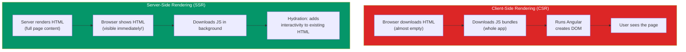

## 5. SSR & Hydration

### Simple Words First 🟡
Normally, Angular apps are **Client-Side Rendered (CSR)** — the browser downloads JavaScript, runs it, and then the page appears. That's like a restaurant cooking your meal AFTER you sit down — you wait.

**Server-Side Rendering (SSR)** cooks the meal BEFORE you arrive. The server renders your Angular app into HTML and sends it to the browser ready-to-see. Then **hydration** adds interactivity (like a microwave heating up the pre-cooked meal).

### CSR vs SSR Flow



---

### Why SSR?

| Benefit | CSR (No SSR) | SSR |
|---|---|---|
| First paint | Slow (wait for JS) | Fast (HTML arrives ready) |
| SEO | Bad (crawlers see empty page) | Great (crawlers see full content) |
| Social preview | No preview | Rich link previews |
| JavaScript needed? | Yes, must be enabled | Content visible even without JS |

### Enabling SSR

```bash
# Add SSR to a new Angular app
ng new my-app --ssr

# Add SSR to an existing app
ng add @angular/ssr
```

```typescript
// app.config.ts — SSR setup
import { ApplicationConfig } from '@angular/core';
import { provideRouter } from '@angular/router';
import { provideClientHydration } from '@angular/platform-browser';

export const appConfig: ApplicationConfig = {
  providers: [
    provideRouter(routes),
    provideClientHydration(),  // 👈 Enables hydration
  ]
};
```

```typescript
// main.ts — Works for both server and client
import { bootstrapApplication } from '@angular/platform-browser';
import { AppComponent } from './app/app.component';
import { appConfig } from './app/app.config';

bootstrapApplication(AppComponent, appConfig);
```

### What Hydration Does

1. Server sends **full HTML** — user sees the page immediately
2. Browser downloads Angular JavaScript in the background
3. Angular's hydration **reuses existing DOM** — it doesn't re-render!
4. All event listeners and interactivity attach to the existing elements
5. The app becomes fully interactive

### Full vs Incremental Hydration

```typescript
// Full hydration (default)
// All components hydrate at once
import { provideClientHydration } from '@angular/platform-browser';

// Incremental hydration (Angular 18+)
// Only hydrate components that are visible/interacted with
import { provideClientHydration, withIncrementalHydration } from '@angular/platform-browser';

export const appConfig: ApplicationConfig = {
  providers: [
    provideRouter(routes),
    provideClientHydration(withIncrementalHydration()),
  ]
};
```

### What Changes in SSR

```typescript
// ❌ These don't work in SSR (browser-only APIs)
import { Component, Inject, PLATFORM_ID } from '@angular/core';
import { isPlatformBrowser, isPlatformServer } from '@angular/common';

@Component({
  selector: 'app-browser-only',
  template: `<p>{{ message }}</p>`
})
export class BrowserOnlyComponent {
  message = '';

  constructor(@Inject(PLATFORM_ID) private platformId: Object) {
    if (isPlatformBrowser(this.platformId)) {
      // ⚡ Only runs in the browser
      this.message = 'You are in the browser!';
      window.addEventListener('scroll', () => {});
    }

    if (isPlatformServer(this.platformId)) {
      // 🖥️ Only runs on the server
      this.message = 'Rendered on the server';
    }
  }
}
```

### 🚨 Common Gotchas

```typescript
// ❌ Direct DOM access crashes SSR
@Component({ ... })
export class BadComponent implements OnInit {
  ngOnInit(): void {
    document.title = 'My App'; // 💥 Error: document is not defined on server!
  }
}

// ✅ Use Angular's Renderer2 or platform checks
import { Renderer2, Inject } from '@angular/core';

export class GoodComponent {
  constructor(
    private renderer: Renderer2,
    @Inject(DOCUMENT) private document: Document
  ) {
    this.renderer.setProperty(this.document, 'title', 'My App');
  }
}
```

### In Simple Words 🧠

- **SSR** renders your app on the server first — user sees content FASTER
- **Hydration** connects the pre-rendered HTML to Angular's JavaScript — no blank flash
- **Benefits**: Better SEO, faster first paint, social media previews
- Enable with `provideClientHydration()` and add `@angular/ssr`
- **Incremental hydration** (Angular 18+) hydrates only visible parts — even faster
- Be careful with browser-only APIs (`window`, `document`) — check platform or use Angular APIs
