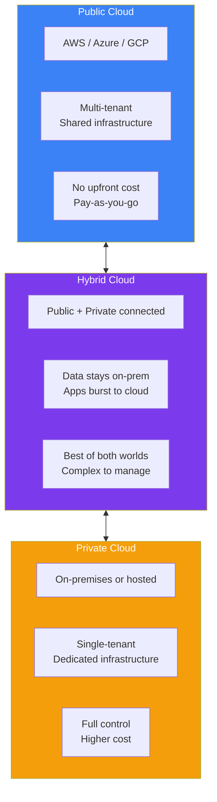
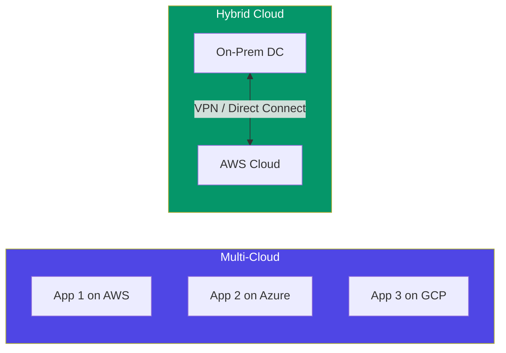
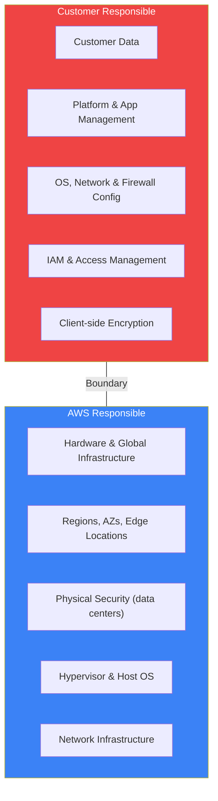
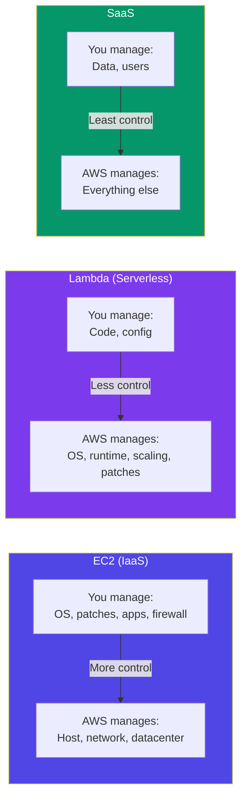

## Cloud Deployment Models & Shared Responsibility

Beyond the service models (IaaS/PaaS/SaaS), there are different **deployment models** — how you choose to run your cloud infrastructure. And critically, the **shared responsibility model** defines who secures what.

> **Analogy:** Deployment models are like different housing arrangements — public cloud is a rental apartment, private cloud is owning your own house, hybrid is having a house with a rented office space. The shared responsibility model is like deciding who locks which doors.

---

### Cloud Deployment Models

| Model | Description | Use When |
|-------|-------------|----------|
| **Public Cloud** | Resources owned by cloud provider, shared across customers | Startups, variable workloads, cost-sensitive |
| **Private Cloud** | Resources dedicated to one organization | Compliance-heavy (finance, healthcare), full control needed |
| **Hybrid Cloud** | Public + private connected (often via VPN/Direct Connect) | Sensitive data on-prem, burst to cloud for compute |

---

### Multi-Cloud vs Hybrid Cloud

| Term | Meaning |
|------|---------|
| **Multi-Cloud** | Using multiple cloud providers (AWS + Azure) for different workloads |
| **Hybrid Cloud** | Connecting on-premises + cloud (same or different providers) |
| **Community Cloud** | Shared infrastructure for organizations with common concerns |

---

### The Shared Responsibility Model

**How responsibility shifts by service type:**

---

### Shared Responsibility Quick Reference

| Security Area | IaaS (EC2) | PaaS (Beanstalk) | Serverless (Lambda) | SaaS (RDS) |
|--------------|------------|-------------------|-------------------|------------|
| **Customer Data** | You | You | You | You |
| **IAM & Access** | You | You | You | You |
| **OS & Patches** | **You** | AWS | AWS | AWS |
| **App Runtime** | You | **You** | AWS | AWS |
| **Network Config** | **You** | AWS | AWS | AWS |
| **Hypervisor** | AWS | AWS | AWS | AWS |
| **Physical Security** | AWS | AWS | AWS | AWS |

---

### In Simple Words

- **Public cloud** = shared infrastructure, pay-as-you-go — best for most workloads
- **Private cloud** = dedicated infrastructure — best for compliance-heavy industries
- **Hybrid cloud** = on-prem + cloud connected — best for gradual migration
- **Shared responsibility model**: AWS secures **the cloud**; you secure **what's in the cloud**
- With **IaaS**, you manage more (OS, patches). With **serverless**, AWS manages more
- The **boundary shifts** based on the service you choose — less control = less responsibility
