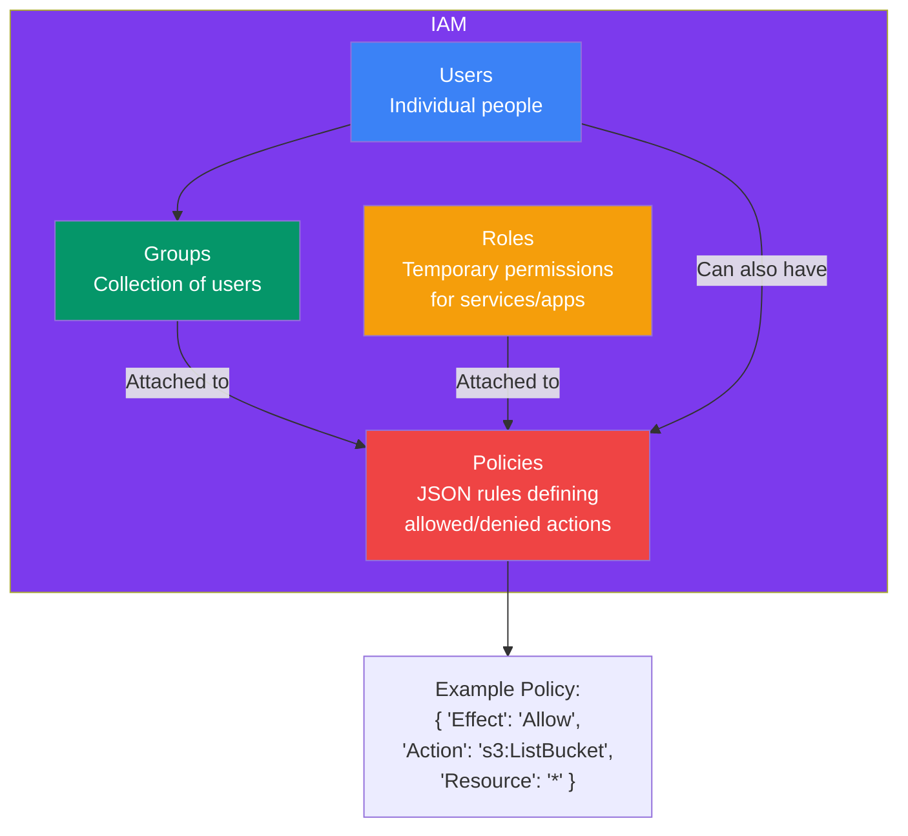
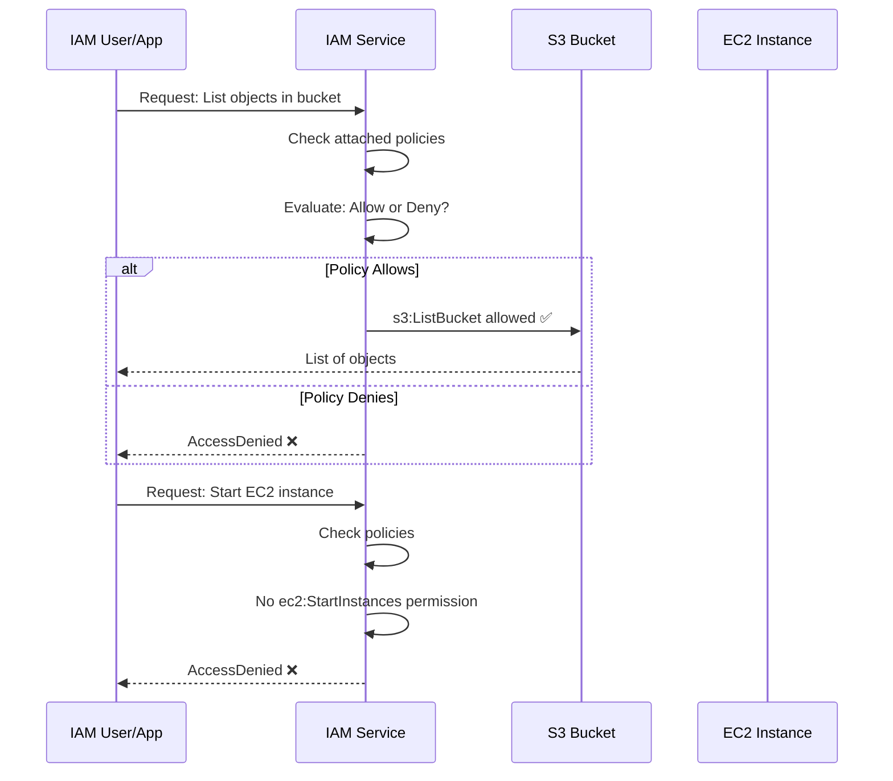
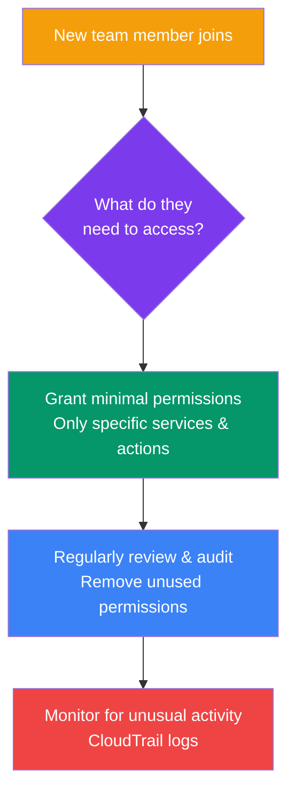

## IAM Basics

**AWS Identity and Access Management (IAM)** is a service that lets you control who can access your AWS resources and what they can do with them. It's the **security foundation** of any AWS account.

> **Analogy:** IAM is like a building's security system. Users are people with ID badges, groups are departments with common access needs, roles are temporary visitor passes, and policies are the rules that say "this badge opens these doors."

---

### IAM Core Components



### IAM — User/Policy → Actions Flow



---

### IAM Policy Example

Policies are JSON documents that define permissions:

```json
{
  "Version": "2012-10-17",
  "Statement": [
    {
      "Effect": "Allow",
      "Action": [
        "s3:ListBucket",
        "s3:GetObject"
      ],
      "Resource": [
        "arn:aws:s3:::my-app-bucket",
        "arn:aws:s3:::my-app-bucket/*"
      ]
    },
    {
      "Effect": "Deny",
      "Action": "s3:DeleteObject",
      "Resource": "arn:aws:s3:::my-app-bucket/*"
    }
  ]
}
```

| Policy Element | What It Does |
|----------------|-------------|
| `Effect` | `Allow` or `Deny` |
| `Action` | Which API actions (e.g., `s3:ListBucket`) |
| `Resource` | Which resources (e.g., specific S3 bucket) |
| `Condition` | When the policy applies (optional) |

---

### Principle of Least Privilege

> **Give only the permissions needed to do the job — nothing more.**



---

### IAM Best Practices

| Best Practice | Why |
|--------------|-----|
| **Delete root user access keys** | Root has full access — use IAM users instead |
| **Use IAM roles for EC2** | Don't store keys on EC2; assign a role |
| **Enable MFA** | Multi-factor authentication for all users |
| **Use groups, not individual policies** | Easier to manage permissions at scale |
| **Apply least privilege** | Start with minimal access and add as needed |
| **Use IAM Access Analyzer** | Find resources shared outside your account |
| **Rotate keys regularly** | Change access keys every 90 days |

---

### In Simple Words

- **IAM** controls who can access your AWS account and what they can do
- **Users** = people, **Groups** = collections, **Roles** = permissions for services
- **Policies** = JSON rules that allow or deny specific actions
- **Least privilege** = give only the minimum permissions needed
- Never use the **root account** — create IAM users with MFA enabled
