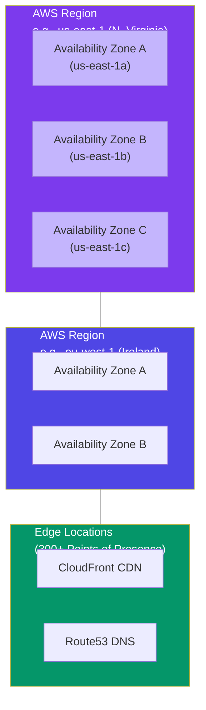
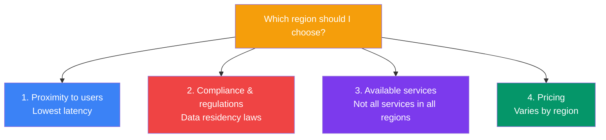

## What is AWS?

**Amazon Web Services (AWS)** is a cloud platform launched by Amazon in 2006. It offers over 200 services across compute, storage, databases, networking, machine learning, and more. AWS is the most widely adopted cloud platform, serving millions of customers.

> **Analogy:** AWS is like a massive global warehouse network. Instead of building your own warehouses (data centers), you rent space and tools from AWS's existing facilities around the world.

---

### AWS Global Infrastructure



| Component | What It Is | Example |
|-----------|-----------|---------|
| **Region** | A geographic area with 2-6 Availability Zones | `us-east-1` (Virginia), `eu-west-1` (Ireland) |
| **Availability Zone (AZ)** | One or more data centers, isolated from other AZs | `us-east-1a`, `us-east-1b` |
| **Edge Location** | CDN endpoint for content delivery (300+ globally) | CloudFront, Route53 |

---

### Choosing a Region



---

### Accessing AWS

There are **three ways** to interact with AWS:

**1. AWS Management Console** — Web-based UI
- Go to [console.aws.amazon.com](https://console.aws.amazon.com)
- Sign in with root user or IAM user
- Browse and manage services visually

**2. AWS CLI** — Command-line access
```bash
# Install
pip install awscli

# Configure
aws configure
# → Enter AWS Access Key ID
# → Enter AWS Secret Access Key
# → Choose default region

# Use
aws s3 ls
aws ec2 describe-instances
aws lambda invoke --function-name my-function output.json
```

**3. AWS SDKs** — Programmatic access
```python
# Python (boto3)
import boto3
s3 = boto3.client('s3')
buckets = s3.list_buckets()
for bucket in buckets['Buckets']:
    print(bucket['Name'])
```

---

### AWS Free Tier (New Users)

AWS offers a **free tier** for 12 months after sign-up:

| Service | Free Tier Limit |
|---------|----------------|
| EC2 | 750 hours/month (t2.micro) |
| S3 | 5 GB storage |
| Lambda | 1 million requests/month |
| RDS | 750 hours (db.t2.micro) |
| DynamoDB | 25 GB storage |

> 💡 Always check current pricing at [aws.amazon.com/free](https://aws.amazon.com/free) before using any service.

---

### In Simple Words

- AWS has **Regions** (geographic areas) and **Availability Zones** (data centers within a region)
- Choose a region based on **proximity to users, compliance, service availability, and pricing**
- Access AWS via **Console** (web UI), **CLI** (command line), or **SDKs** (code)
- The **AWS Free Tier** lets you experiment with many services for 12 months
- Always use **IAM users** (not the root account) for daily work
