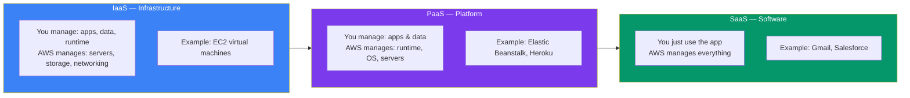

## What is Cloud Computing?

**Cloud computing** is the on-demand delivery of IT resources over the internet. Instead of buying, owning, and maintaining physical data centers, you access computing power, storage, and databases from a cloud provider like AWS, Azure, or Google Cloud.

> **Analogy:** On-premise IT is like buying a generator for your home. Cloud computing is like plugging into the city power grid — you pay for what you use, never worry about maintenance, and can scale up instantly.

---

### On-Premises vs Cloud

```mermaid
flowchart TB
    subgraph OnPrem["On-Premises"]
        Buy[Buy servers] --> Setup[Setup & configure]
        Setup --> Maintain[Maintain & repair]
        Maintain --> Scale["Scale (buy more)"]
        Scale --> Pay["Pay upfront<br/>High fixed cost"]
    end

    subgraph Cloud["Cloud Computing"]
        Choose["Choose resources<br/>(console/CLI)"] --> Provision["Provision in minutes"]
        Provision --> Use["Use & pay<br/>per hour/request"]
        Use --> Scale2["Auto-scale<br/>up or down"]
        Scale2 --> Pay2["Pay only for<br/>what you use"]
    end

    style OnPrem fill:#ef4444,color:#fff
    style Cloud fill:#059669,color:#fff
```

| Aspect | On-Premises | Cloud |
|--------|------------|-------|
| **Cost model** | Buy hardware upfront | Pay-as-you-go |
| **Scaling** | Buy & install new servers | Auto-scale with a click |
| **Maintenance** | Your team handles everything | Provider handles hardware |
| **Speed** | Weeks to provision | Minutes to provision |
| **Global reach** | Build your own data centers | Use provider's global network |

---

### IaaS vs PaaS vs SaaS

| Model | What You Manage | What Provider Manages | Example |
|-------|----------------|----------------------|---------|
| **IaaS** | Apps, data, runtime, OS | Servers, storage, networking, virtualization | AWS EC2, Google Compute Engine |
| **PaaS** | Apps, data | Runtime, OS, servers, storage, networking | Elastic Beanstalk, Heroku |
| **SaaS** | Nothing — just use it | Everything | Gmail, Slack, Salesforce |

---

### Key Cloud Benefits

| Benefit | What It Means |
|---------|---------------|
| **Pay-as-you-go** | Only pay for what you use, no upfront costs |
| **Auto-scaling** | Automatically add/remove resources based on demand |
| **Global reach** | Deploy in data centers around the world |
| **High availability** | Built-in redundancy and failover |
| **Security** | Providers invest billions in security |
| **Innovation speed** | Experiment with new services in minutes |

---

### The Three Major Providers

| Provider | Key Strength | Best For |
|----------|-------------|----------|
| **AWS** | Most services, mature ecosystem | Everything |
| **Azure** | Microsoft integration, enterprise | Enterprise .NET shops |
| **Google Cloud** | Data/AI, Kubernetes | Data-heavy apps, ML |

---

### In Simple Words

- **Cloud computing** = renting IT resources instead of buying them
- **IaaS** gives you raw servers; **PaaS** gives you a platform; **SaaS** gives you ready software
- Key benefits: **pay-as-you-go, auto-scaling, global reach, high availability**
- AWS is the **largest cloud provider** with the most services
- The cloud lets you **experiment cheaply** and **scale globally** — a game-changer for startups
