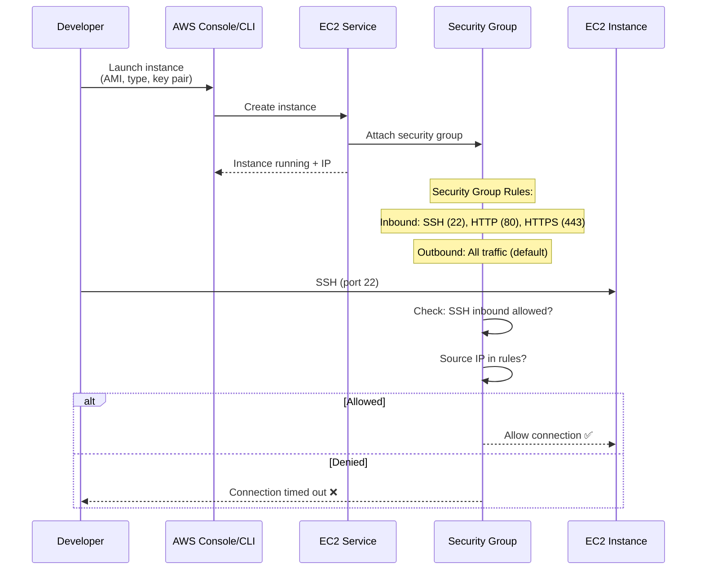
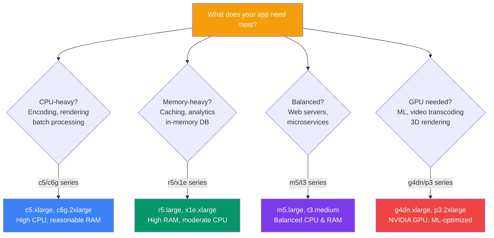
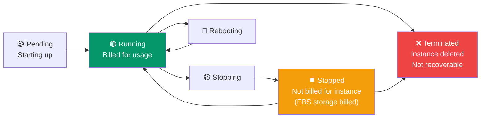
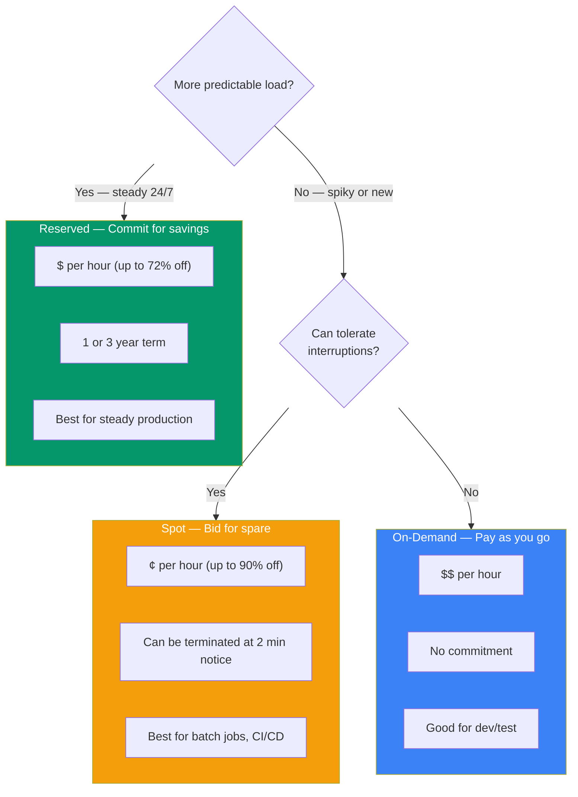

## EC2 — Virtual Servers

**Amazon Elastic Compute Cloud (EC2)** is a service that provides virtual servers (called **instances**) in the cloud. You can launch, stop, and terminate instances in minutes, and you pay only for what you use.

> **Analogy:** EC2 is like renting a pre-configured computer in a remote data center. You choose the specs (CPU, RAM, storage), turn it on when you need it, and turn it off when you're done — paying only for the time it's running.

---

### EC2 + Security Group Flow



---

### Key EC2 Concepts

**1. AMI (Amazon Machine Image)**
A pre-configured template for your instance — includes OS, software, and configuration.

```bash
# List available AMIs
aws ec2 describe-images --owners amazon --filters "Name=name,Values=amzn2-ami-*"
```

**2. Instance Types**
| Family | Use Case | Example |
|--------|----------|---------|
| **t** (burstable) | General purpose, low-cost | `t2.micro` (free tier), `t3.medium` |
| **m** (general) | Balanced compute/memory | `m5.large` |
| **c** (compute) | CPU-intensive | `c5.xlarge` |
| **r** (memory) | RAM-intensive | `r5.large` |
| **g** (GPU) | Machine learning, rendering | `g4dn.xlarge` |

**3. Key Pairs**
SSH keys for secure access to your instance:
```bash
# Create a key pair
aws ec2 create-key-pair --key-name my-key --query 'KeyMaterial' --output text > my-key.pem

# SSH into instance
chmod 400 my-key.pem
ssh -i my-key.pem ec2-user@<public-ip>
```

**4. Security Groups** — Virtual firewalls
```bash
# Create security group
aws ec2 create-security-group --group-name web-sg --description "Web server SG"

# Allow HTTP inbound
aws ec2 authorize-security-group-ingress \
    --group-name web-sg \
    --protocol tcp \
    --port 80 \
    --cidr 0.0.0.0/0

# Allow SSH only from your IP
aws ec2 authorize-security-group-ingress \
    --group-name web-sg \
    --protocol tcp \
    --port 22 \
    --cidr 203.0.113.0/32  # ← YOUR public IP
```

---

### Launching an EC2 Instance

```bash
# Via AWS CLI — launch a t2.micro (free tier eligible)
aws ec2 run-instances \
    --image-id ami-0c55b159cbfafe1f0 \
    --instance-type t2.micro \
    --key-name my-key \
    --security-groups web-sg \
    --user-data install-web.sh
```

```bash
# View running instances
aws ec2 describe-instances --filters "Name=instance-state-name,Values=running"

# Stop (still pay for storage)
aws ec2 stop-instances --instance-ids i-1234567890abcdef0

# Terminate (delete the instance)
aws ec2 terminate-instances --instance-ids i-1234567890abcdef0
```

---

### EC2 Instance Type Decision



---

### EC2 Lifecycle



---

### EC2 Pricing Models

| Model | Description | Use When |
|-------|------------|----------|
| **On-Demand** | Pay per hour/second, no commitment | Short-term, unpredictable workloads |
| **Reserved** | 1-3 year commitment, up to 72% discount | Steady-state production workloads |
| **Spot** | Bid for spare capacity, up to 90% discount | Fault-tolerant, flexible workloads |
| **Savings Plan** | Commit to $/hour usage, flexible across services | Mixed workloads |

### Pricing Model Comparison



---

### In Simple Words

- **EC2** = virtual servers in the cloud — launch, stop, terminate on demand
- **AMI** = the OS/template for your instance
- **Instance types** = different CPU/RAM/storage combos (t, m, c, r families)
- **Security groups** = virtual firewalls controlling inbound/outbound traffic
- **Key pairs** = SSH keys for secure access
- Pay **On-Demand** for flexibility, **Reserved** for savings, **Spot** for cheap batch jobs
