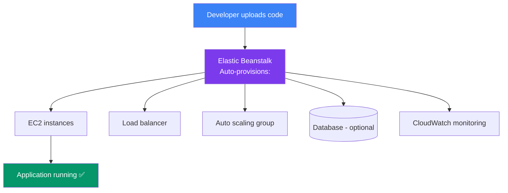
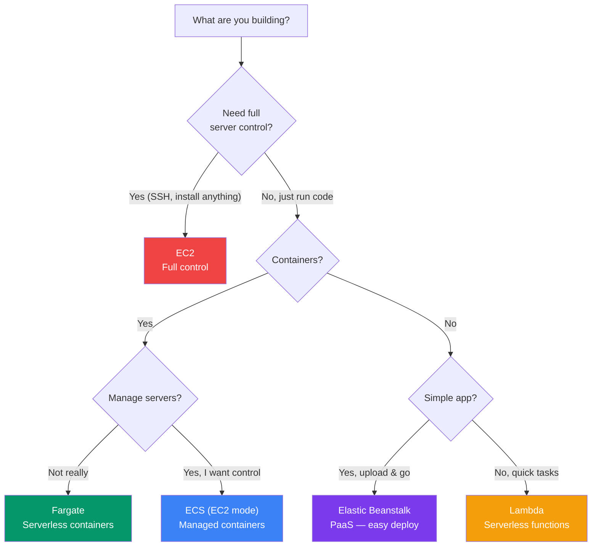

## Elastic Beanstalk & Containers

AWS offers multiple ways to deploy applications — from **fully managed platforms** (Elastic Beanstalk) to **container orchestration** (ECS, EKS, Fargate).

> **Analogy:** EC2 is like building a house from scratch. Elastic Beanstalk is like buying a pre-fab house kit. ECS/Fargate is like using shipping containers to build modular apartments.

---

### Elastic Beanstalk

**Elastic Beanstalk** is a **PaaS** (Platform as a Service) — you upload your code, and AWS handles provisioning, load balancing, scaling, and monitoring.



**Deploy a Node.js app:**
```bash
# Initialize Beanstalk
pip install awsebcli
eb init

# Create environment and deploy
eb create production
eb deploy

# Open the app in browser
eb open
```

| Feature | Detail |
|---------|--------|
| **Supported languages** | Node.js, Python, Java, .NET, PHP, Ruby, Go, Docker |
| **Deployment** | Zip upload, Git deploy, or CI/CD pipeline |
| **Scaling** | Auto-scaling based on CPU/memory/request count |
| **Updates** | Rolling, blue/green, or immutable deployments |

---

### ECS & Fargate — Containers on AWS

**ECS** (Elastic Container Service) runs Docker containers on AWS. **Fargate** is the serverless version — no EC2 instances to manage.

```mermaid
flowchart TB
    subgraph ECS Options
        EC2Mode["ECS with EC2<br/>You manage the cluster<br/>Pay for EC2 instances"]
        FargateMode["ECS with Fargate<br/>AWS manages servers<br/>Pay per container vCPU/memory"]
    end

    Both["Both support:"] --> Task[Task definitions<br/>(Docker compose for AWS)]
    Task --> Service[Services<br/>(keep N containers running)]
    Service --> ALB[Load balancer integration]
    Service --> Auto[Auto-scaling]

    style EC2Mode fill:#3b82f6,color:#fff
    style FargateMode fill:#059669,color:#fff
```

**Fargate task definition example:**
```json
{
  "family": "my-app",
  "containerDefinitions": [
    {
      "name": "app",
      "image": "nginx:latest",
      "memory": 512,
      "cpu": 256,
      "portMappings": [{ "containerPort": 80 }]
    }
  ]
}
```

---

### Choosing a Compute Service



---

### Quick Reference

| Service | Type | Best For |
|---------|------|----------|
| **EC2** | IaaS | Full control, any workload |
| **Lambda** | Serverless | Event-driven, short tasks |
| **Elastic Beanstalk** | PaaS | Simple app deployment |
| **ECS + Fargate** | Serverless containers | Docker apps without managing servers |
| **ECS + EC2** | Container orchestration | Large-scale Docker with full control |
| **EKS** | Kubernetes | Already using Kubernetes |

---

### In Simple Words

- **Elastic Beanstalk** = simplest way to deploy apps — upload code, it handles the rest
- **ECS** = run Docker containers on AWS; **Fargate** = serverless containers (no servers to manage)
- Use **EC2** when you need full control, **Lambda** for quick serverless tasks
- Use **Elastic Beanstalk** for "I just want my app running" scenarios
- Use **Fargate** for containerized apps without managing EC2 instances
