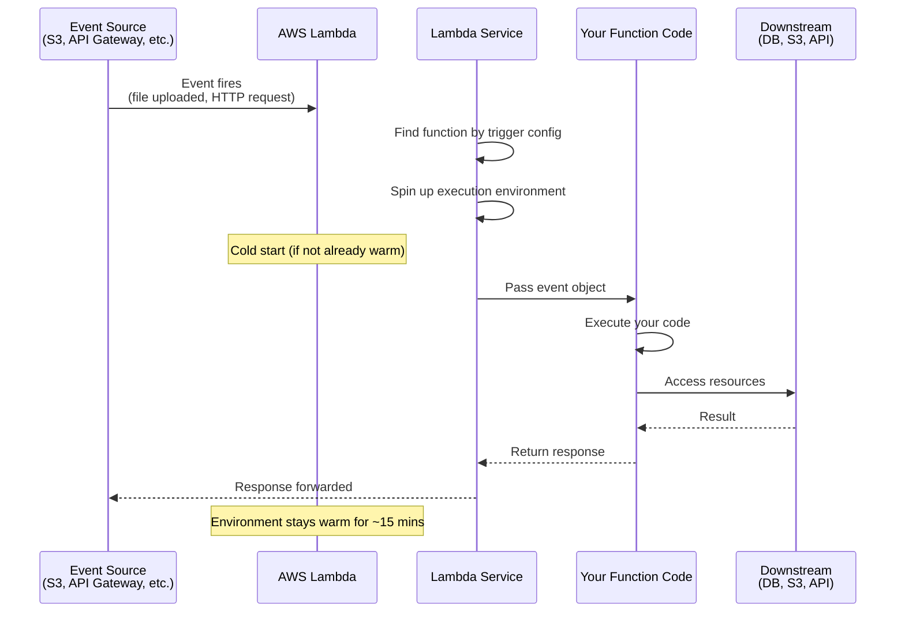
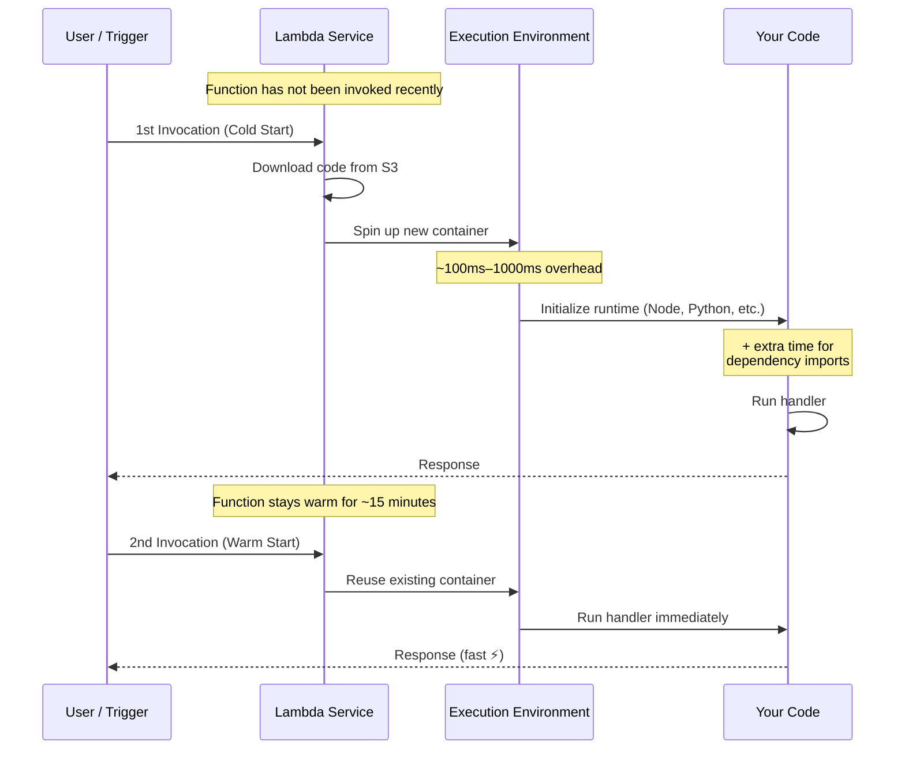
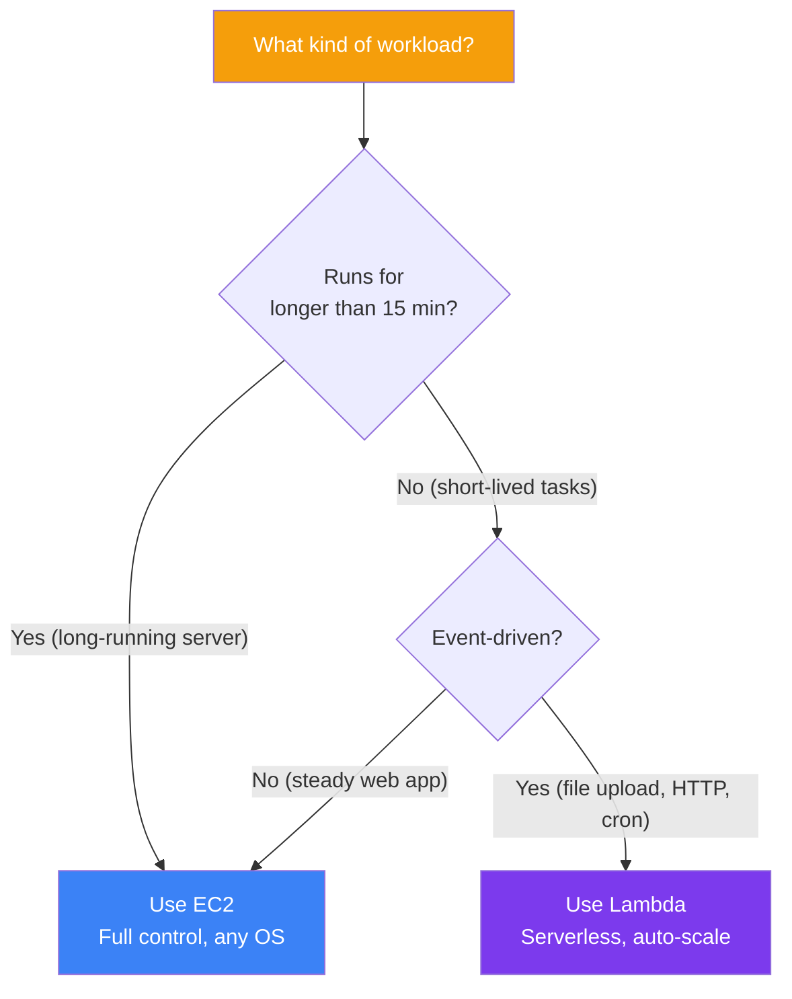

## Lambda — Serverless Functions

**AWS Lambda** is a **serverless compute** service that runs your code in response to events. You upload your code, configure a trigger, and Lambda handles everything else — provisioning servers, scaling, and patching.

> **Analogy:** Lambda is like a vending machine. You put your code in (like stocking the machine), and when someone presses the right buttons (events), the machine runs your code and gives a result. You don't care what's inside the machine — it just works.

---

### Lambda Event-Driven Flow



---

### Creating a Lambda Function

**1. Write the function code (Python example):**
```python
import json
import boto3

def lambda_handler(event, context):
    """Handle S3 upload event"""
    # Get bucket and key from event
    bucket = event['Records'][0]['s3']['bucket']['name']
    key = event['Records'][0]['s3']['object']['key']
    
    # Process the file
    print(f"New file uploaded: {bucket}/{key}")
    
    # Do something with the file
    # e.g., create thumbnail, analyze data, etc.
    
    return {
        'statusCode': 200,
        'body': json.dumps(f'Processed {key}')
    }
```

**2. Deploy via CLI:**
```bash
# Package code
zip function.zip lambda_function.py

# Create Lambda function
aws lambda create-function \
    --function-name process-uploads \
    --runtime python3.12 \
    --role arn:aws:iam::123456789:role/lambda-execution-role \
    --handler lambda_function.lambda_handler \
    --zip-file fileb://function.zip

# Add trigger (e.g., S3 bucket)
aws lambda create-event-source-mapping \
    --function-name process-uploads \
    --event-source arn:aws:s3:::my-bucket \
    --events s3:ObjectCreated:*
```

---

### Lambda Triggers Map

```mermaid
flowchart TB
    Lambda["⚡ AWS Lambda<br/>Your Function"]

    subgraph Compute["Compute Triggers"]
        API_GW["API Gateway<br/>HTTP / REST / WebSocket"]
        ALB["Application Load Balancer<br/>HTTP forwarding"]
    end

    subgraph Storage["Storage Triggers"]
        S3["S3<br/>Upload / Delete events"]
        DynamoDB["DynamoDB Streams<br/>Table changes"]
    end

    subgraph Messaging["Messaging Triggers"]
        SQS["SQS<br/>Queue messages"]
        SNS["SNS<br/>Push notifications"]
    end

    subgraph Schedule["Schedule Triggers"]
        CW_Events["CloudWatch Events<br/>Cron / Rate expressions"]
        EventBridge["EventBridge<br/>Event bus / SaaS events"]
    end

    subgraph Auth["Auth Triggers"]
        Cognito["Cognito<br/>Sign-up / Sign-in / Migrate"]
    end

    API_GW --> Lambda
    ALB --> Lambda
    S3 --> Lambda
    DynamoDB --> Lambda
    SQS --> Lambda
    SNS --> Lambda
    CW_Events --> Lambda
    EventBridge --> Lambda
    Cognito --> Lambda

    style Lambda fill:#7c3aed,color:#fff
    style Compute fill:#3b82f6,color:#fff
    style Storage fill:#059669,color:#fff
    style Messaging fill:#f59e0b,color:#fff
    style Schedule fill:#ef4444,color:#fff
    style Auth fill:#6366f1,color:#fff
```



---

### Cold Start vs Warm Start



| Aspect | Cold Start | Warm Start |
|--------|-----------|------------|
| **Latency** | ~100ms–5s (varies by runtime) | ~1ms–10ms |
| **Why slow** | Download code + spin up env + init runtime | Reuses existing environment |
| **Mitigation** | **Provisioned Concurrency** keeps N environments warm | N/A |
| **Java/.NET** | Slowest cold starts | — |
| **Python/Node** | Fastest cold starts (~100ms) | — |

---

### Lambda Triggers (Event Sources)

| Trigger | Fires When... |
|---------|---------------|
| **S3** | Object created/deleted in bucket |
| **API Gateway** | HTTP request received |
| **DynamoDB Streams** | Data changed in table |
| **SQS** | Message arrives in queue |
| **CloudWatch Events** | Scheduled time / cron job |
| **SNS** | Notification published |
| **Alexa Skills Kit** | User speaks to Alexa |

---

### EC2 vs Lambda — When to Use Which



| Aspect | EC2 | Lambda |
|--------|-----|--------|
| **Duration limit** | No limit | 15 minutes max |
| **Scaling** | Manual / auto-scaling group | Instant, automatic |
| **Cold start** | None | ~100ms-1s on first invocation |
| **Pricing** | Pay per hour | Pay per 1ms of execution |
| **State** | Persistent (local storage) | Stateless (use S3/DynamoDB) |
| **OS control** | Full (SSH, install anything) | None (just upload code) |
| **Best for** | Web servers, databases | Quick tasks, APIs, data processing |

---

### Lambda Best Practices

| Practice | Why |
|----------|-----|
| **Keep functions small** | One function = one job (single responsibility) |
| **Use environment variables** | For config, not hard-coded values |
| **Set memory wisely** | More memory = more CPU too |
| **Handle cold starts** | Use provisioned concurrency for latency-sensitive apps |
| **Use /tmp for temp files** | Max 512 MB, persists while function is warm |
| **Log everything** | CloudWatch logs = your debugging friend |

---

### In Simple Words

- **Lambda** = run code without managing servers — just upload and go
- Triggered by **events**: S3 uploads, API calls, scheduled cron jobs, and more
- **Auto-scales** instantly — from zero to thousands of concurrent executions
- **15-minute timeout** — not for long-running apps (use EC2 instead)
- **Pay per execution** — cheaper than EC2 for sporadic, stateless workloads
