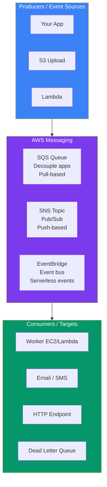
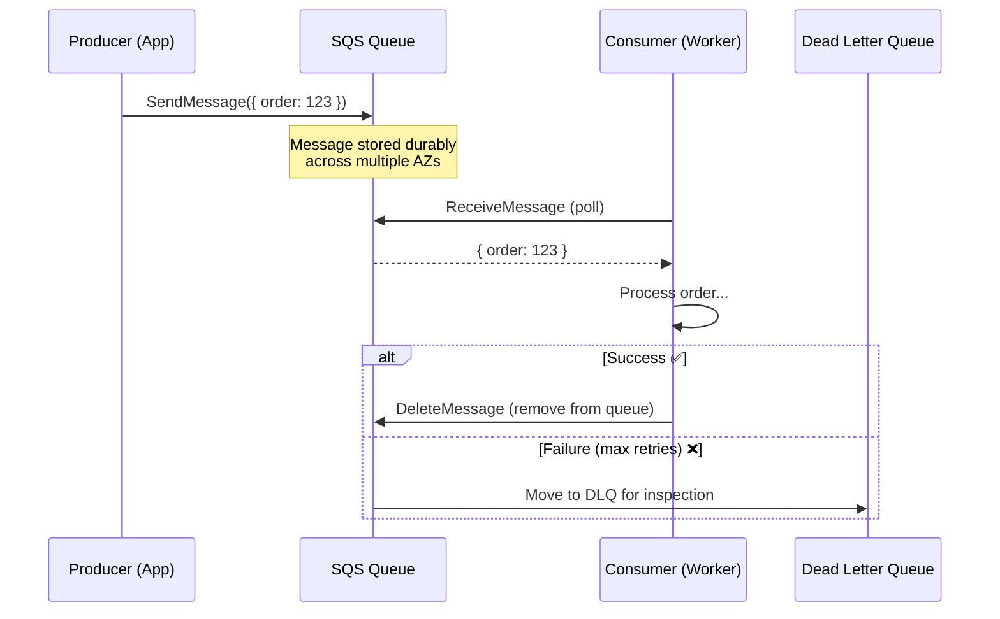
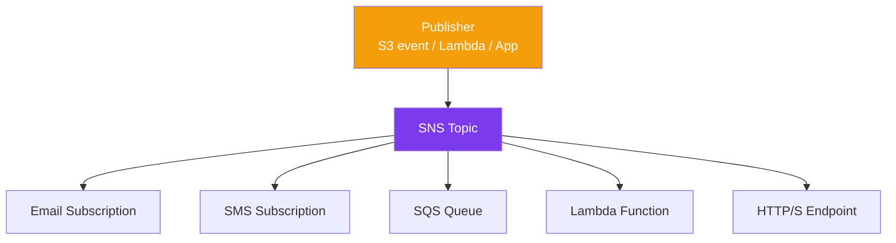
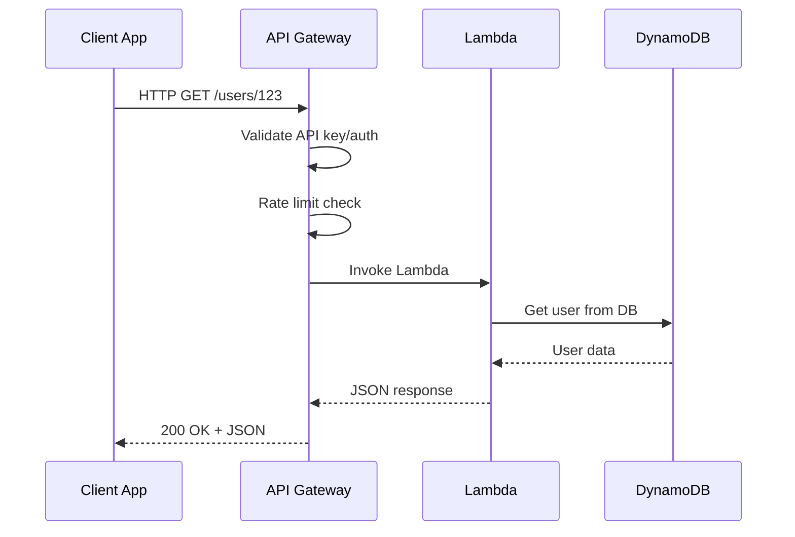
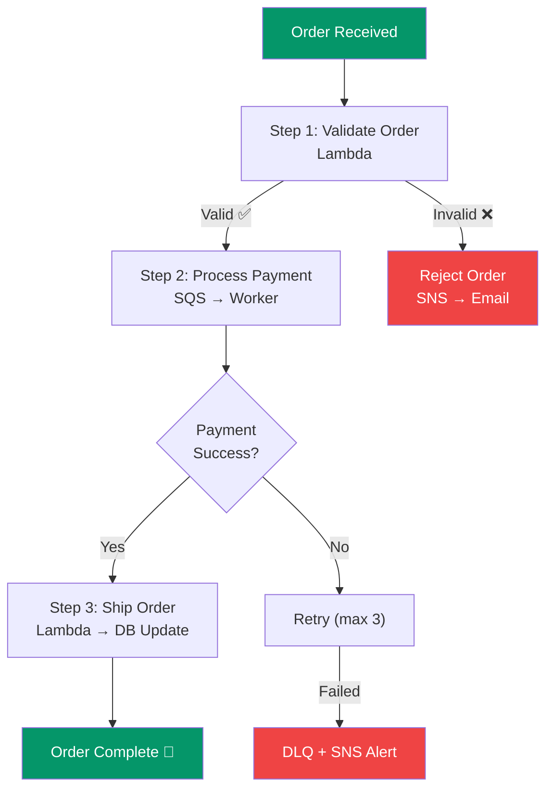

## Messaging, APIs & Workflows

Modern cloud apps are **distributed** — different services need to communicate. AWS provides **SQS** (message queues), **SNS** (notifications), **API Gateway** (HTTP APIs), and **Step Functions** (workflow orchestration).

> **Analogy:** SQS is like a mailbox — you leave messages, and someone picks them up when ready. SNS is like a megaphone — one shout, many listeners. API Gateway is like a receptionist who routes calls. Step Functions is like a project manager who coordinates the whole workflow.

---

### Messaging Services Overview



---

### SQS — Simple Queue Service

**SQS** is a fully managed message queue. Producers send messages to a queue, and consumers poll (pull) messages when they're ready.



```bash
# Create a queue
aws sqs create-queue --queue-name my-app-queue

# Send a message
aws sqs send-message --queue-url https://sqs.us-east-1.amazonaws.com/123/my-app-queue \
    --message-body '{"orderId": 123, "userId": 456}'

# Receive messages
aws sqs receive-message --queue-url https://sqs.us-east-1.amazonaws.com/123/my-app-queue
```

| SQS Feature | What It Does |
|-------------|-------------|
| **Standard Queue** | At-least-once delivery, best-effort ordering |
| **FIFO Queue** | Exactly-once, strict ordering (300 msg/s) |
| **DLQ (Dead Letter Queue)** | Messages that failed after max retries |
| **Visibility Timeout** | Hide message from other consumers while processing |
| **Long Polling** | Wait up to 20s for messages (reduces empty responses) |

---

### SNS — Simple Notification Service

**SNS** is a pub/sub messaging service — one message published to a topic is pushed to all subscribers.



```bash
# Create a topic
aws sns create-topic --name order-alerts

# Subscribe email
aws sns subscribe --topic-arn arn:aws:sns:us-east-1:123:order-alerts \
    --protocol email --notification-endpoint admin@example.com

# Publish
aws sns publish --topic-arn arn:aws:sns:us-east-1:123:order-alerts \
    --message "New order received: #12345"
```

---

### API Gateway

**API Gateway** lets you create RESTful and WebSocket APIs that front your Lambda functions or other AWS services.



```bash
# Create REST API
aws apigateway create-rest-api --name my-api --region us-east-1

# Deploy
aws apigateway create-deployment --rest-api-id abc123 --stage-name prod
```

**API Gateway features:**
- **REST APIs** — traditional RESTful endpoints
- **HTTP APIs** — cheaper, simpler, faster (for Lambda proxies)
- **WebSocket APIs** — real-time two-way communication
- **API keys** — usage plans, throttling
- **Request/response transformation** — map JSON shapes

---

### Step Functions — Workflow Orchestration

**Step Functions** coordinates multiple AWS services into a visual workflow.



```json
// Step Functions state machine definition (simplified)
{
  "Comment": "Order processing workflow",
  "StartAt": "ValidateOrder",
  "States": {
    "ValidateOrder": {
      "Type": "Task",
      "Resource": "arn:aws:lambda:validate-order",
      "Next": "ProcessPayment"
    },
    "ProcessPayment": {
      "Type": "Task",
      "Resource": "arn:aws:states:express-task",
      "Next": "CheckPayment",
      "Retry": [ { "ErrorEquals": ["States.ALL"], "MaxAttempts": 3 } ]
    }
  }
}
```

---

### When to Use Which

| Use Case | Service |
|----------|---------|
| Decouple two services (async processing) | **SQS** |
| Broadcast to multiple subscribers | **SNS** |
| Create HTTP/REST API for Lambda | **API Gateway** |
| Coordinate multi-step workflow | **Step Functions** |
| Event-driven between AWS services | **EventBridge** |
| Schedule/cron jobs | **EventBridge + Lambda** |

---

### In Simple Words

- **SQS** = message queue — decouple apps, buffer work, handle traffic spikes
- **SNS** = pub/sub — one message pushed to many subscribers (email, SMS, Lambda)
- **API Gateway** = managed HTTP API frontend — auth, throttling, request routing
- **Step Functions** = visual workflow orchestration across Lambda, SQS, DynamoDB
- Use **SQS** for async processing, **SNS** for broadcasts, **Step Functions** for multi-step workflows
