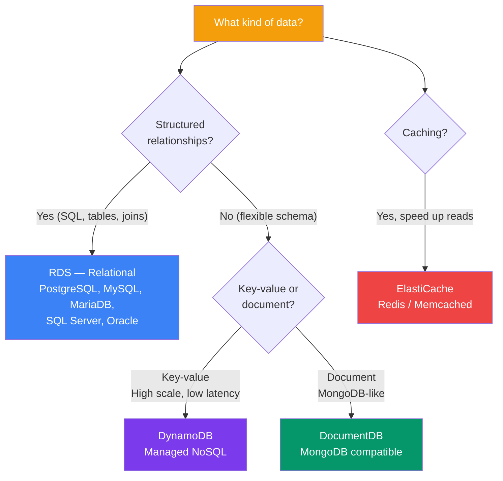

## Databases on AWS

AWS offers a wide range of managed database services: **relational** (RDS), **NoSQL** (DynamoDB), **caching** (ElastiCache), and more. The key advantage is that AWS handles backups, patching, replication, and scaling.

> **Analogy:** Managed databases are like hiring a professional chef instead of cooking yourself. AWS takes care of all the hard work — backups, updates, failovers — so you just use the database.

---

### Database Options Overview



---

### RDS — Relational Database Service

Supports **6 database engines** as managed services:

| Engine | Best For |
|--------|----------|
| **PostgreSQL** | Advanced relational apps, geospatial |
| **MySQL** | Web apps, WordPress, open-source stacks |
| **MariaDB** | MySQL-compatible, community-driven |
| **SQL Server** | Enterprise .NET apps |
| **Oracle** | Enterprise Oracle ecosystem |
| **Aurora** | AWS-native, 5x faster than MySQL, 3x faster than Postgres |

```bash
# Create a PostgreSQL RDS instance
aws rds create-db-instance \
    --db-instance-identifier my-db \
    --db-instance-class db.t3.micro \
    --engine postgres \
    --master-username admin \
    --master-user-password secret123 \
    --allocated-storage 20
```

**RDS features:**
- Automated backups (point-in-time recovery)
- Multi-AZ (synchronous standby replica)
- Read replicas (scale reads)
- Automated patching

---

### DynamoDB — NoSQL Database

**DynamoDB** is a fully managed, key-value + document database with **single-digit millisecond performance** at any scale.

```python
import boto3
dynamodb = boto3.resource('dynamodb')

# Create table
table = dynamodb.create_table(
    TableName='Users',
    KeySchema=[{'AttributeName': 'userId', 'KeyType': 'HASH'}],
    AttributeDefinitions=[{'AttributeName': 'userId', 'AttributeType': 'S'}],
    BillingMode='PAY_PER_REQUEST'
)

# Put item
table.put_item(Item={
    'userId': '123',
    'name': 'Alice',
    'email': 'alice@example.com',
    'age': 30
})

# Get item
response = table.get_item(Key={'userId': '123'})
print(response['Item'])
```

| Feature | Detail |
|---------|--------|
| **Performance** | Consistent single-digit ms latency |
| **Scaling** | Auto-scales — no limits |
| **Pricing** | Pay per read/write unit (on-demand or provisioned) |
| **Consistency** | Eventually consistent by default (strong optional) |
| **Backups** | Automated (PITR) and on-demand |

---

### DynamoDB vs RDS — Quick Decision

| Need This | Use |
|-----------|-----|
| SQL queries, joins, complex relationships | **RDS** (PostgreSQL/MySQL) |
| High-scale, low-latency key-value access | **DynamoDB** |
| Complex transactions across tables | **RDS** |
| Serverless, auto-scaling database | **DynamoDB** |
| Existing app needs MySQL/Postgres | **RDS** |
| Shopping cart, session data, user profiles | **DynamoDB** |

---

### ElastiCache — In-Memory Caching

**ElastiCache** provides managed **Redis** and **Memcached** — perfect for caching, session stores, and real-time data.

> See the [Redis track](/DSA-Notes-Problems/redis) for detailed Redis concepts.

```bash
# Create a Redis cluster
aws elasticache create-cache-cluster \
    --cache-cluster-id my-cache \
    --cache-node-type cache.t3.micro \
    --engine redis
```

---

### In Simple Words

- **RDS** = managed SQL databases (PostgreSQL, MySQL) — for structured relational data
- **DynamoDB** = managed NoSQL — for high-scale, low-latency key-value data
- **ElastiCache** = managed Redis — for caching and real-time data
- Use **RDS** for complex queries; **DynamoDB** for massive scale
- AWS handles **backups, patching, replication** — you just use the database
