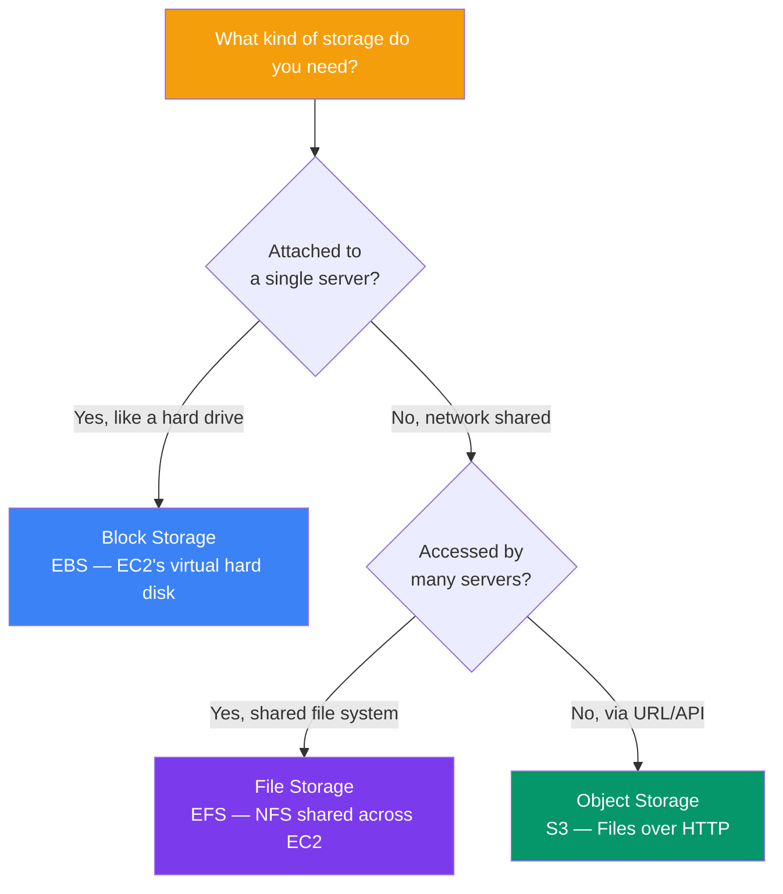

## EBS vs S3 vs EFS

AWS offers three main storage types: **block** (EBS), **object** (S3), and **file** (EFS). Each is designed for different use cases.

> **Analogy:** Block storage (EBS) is like an internal hard drive — directly attached to your computer. Object storage (S3) is like a cloud drive where files have unique URLs. File storage (EFS) is like a network shared drive that multiple computers can access simultaneously.

---

### Storage Choice Flowchart



---

### Side-by-Side Comparison

| Feature | **EBS** (Block) | **S3** (Object) | **EFS** (File) |
|---------|-----------------|-----------------|----------------|
| **Think of it as** | A virtual hard drive | A cloud filing cabinet | A network shared folder |
| **Access method** | Attached to one EC2 instance | HTTP/HTTPS (REST API) | NFS (mounted on EC2) |
| **Can multiple EC2 access?** | No (single attachment) | Yes (via API) | Yes (thousands) |
| **Max size per unit** | 16 TB per volume | 5 TB per object (unlimited total) | Unlimited (petascale) |
| **Persistence** | Same AZ only | Across AZs/regions | Across AZs in same region |
| **Use case** | OS disk, databases | Backups, static files, data lakes | Shared config, home dirs |
| **Performance** | SSD/HDD options | Scales automatically | Up to 10 GB/s throughput |

---

### When to Use Each

| Use Case | Best Storage | Why |
|----------|-------------|-----|
| **EC2 boot volume** | EBS | Needs to be attached as a block device |
| **Database (MySQL on EC2)** | EBS | Low latency, persistent block storage |
| **Backup files** | S3 | Durable, cheap, versioned |
| **Static website** | S3 | Host directly, no server needed |
| **Big data analytics** | S3 | Data lake, works with Athena/EMR |
| **Shared file system** | EFS | Multiple EC2 instances need same files |
| **Container shared storage** | EFS | ECS/EKS containers share data |
| **Archival / compliance** | S3 Glacier | Cheapest long-term storage |

---

### EBS — Elastic Block Store

- **Like a virtual SSD/HDD** for EC2 instances
- **One EBS volume = one EC2 instance** (most cases)
- Data persists even when the EC2 instance is stopped
- Snapshots to S3 for backup
- Types: `gp3` (general purpose), `io2` (high performance), `st1` (throughput)

```bash
# Create and attach a volume
aws ec2 create-volume --size 100 --availability-zone us-east-1a
aws ec2 attach-volume --volume-id vol-123 --instance-id i-456 --device /dev/sdf
```

---

### EFS — Elastic File System

- **Like a NAS drive** — NFS shared file system
- **Multiple EC2 instances** can mount the same EFS simultaneously
- Automatically scales storage (pay for what you use)
- Accessible across AZs in the same region

```bash
# Mount EFS on EC2 (install amazon-efs-utils first)
sudo mount -t efs fs-123456:/ /mnt/efs
```

---

### In Simple Words

- **EBS** = block storage → virtual hard drive attached to one EC2
- **S3** = object storage → files accessed via URL/API, unlimited scaling
- **EFS** = file storage → network shared drive for multiple EC2 instances
- Use **EBS** for databases and OS disks; **S3** for backups, static files, and data lakes; **EFS** for shared file systems
- EBS is **per volume**, S3 is **per object**, EFS is **per file**
