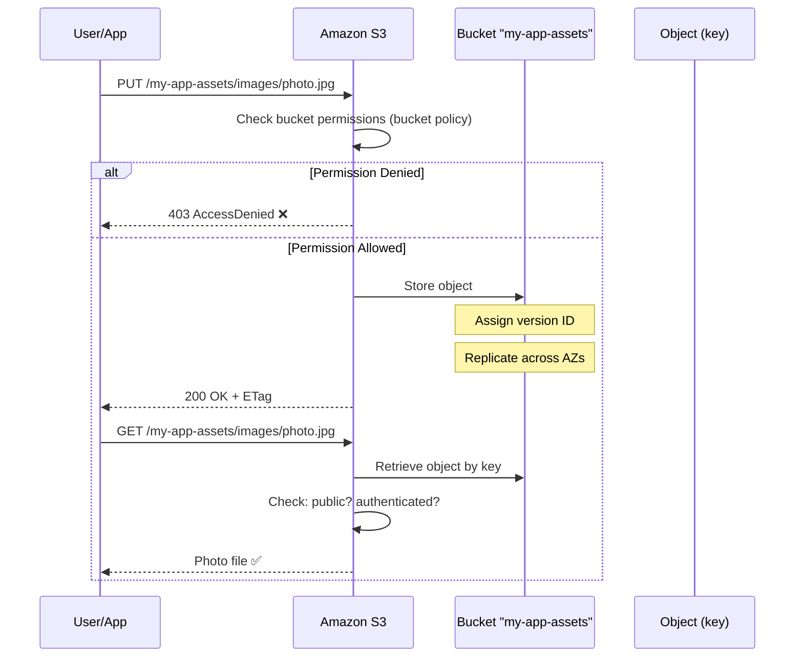
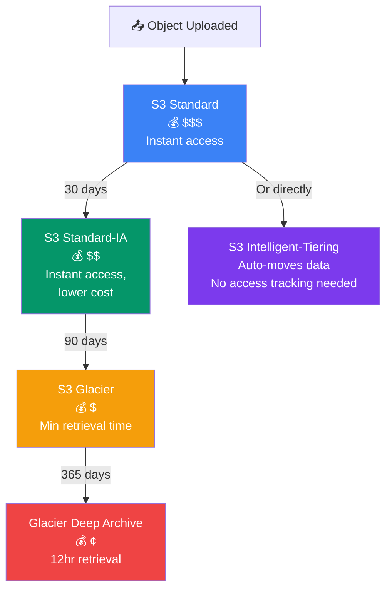
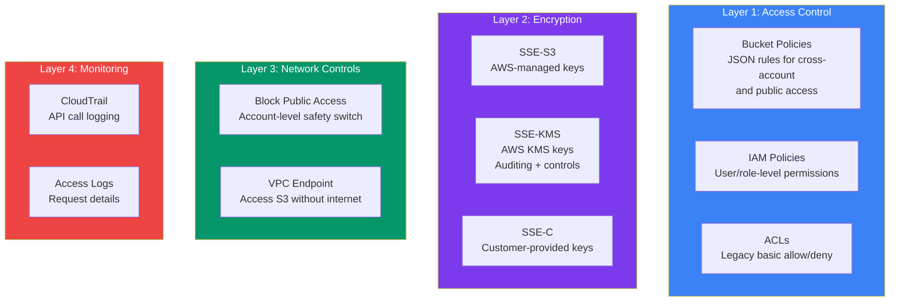

## S3 — Object Storage

**Amazon Simple Storage Service (S3)** is an **object storage** service. It stores data as objects (files) in buckets and is designed for **99.999999999% durability** (11 nines). It's used for backups, static websites, data lakes, and more.

> **Analogy:** S3 is like a massive, infinitely expanding filing cabinet in the sky. Each cabinet is a **bucket**, each file is an **object**, and every file has a unique **key** (path).

---

### S3 Bucket → Objects Flow



---

### Core Concepts

**1. Buckets** — Top-level containers (globally unique name)
```bash
# Create a bucket
aws s3 mb s3://my-app-assets --region us-east-1

# List buckets
aws s3 ls
```

**2. Objects** — Files stored in buckets
```bash
# Upload an object
aws s3 cp index.html s3://my-app-assets/

# Upload with public-read permission
aws s3 cp logo.png s3://my-app-assets/images/ --acl public-read

# Download
aws s3 cp s3://my-app-assets/index.html ./downloads/

# List objects
aws s3 ls s3://my-app-assets/images/
```

**3. Keys** — The full path to an object
```
Bucket: my-app-assets
Keys (object paths):
  images/photo.jpg        ← "folder" simulated by key prefix
  images/logo.png
  docs/report.pdf
  index.html
```

---

### S3 Storage Class Lifecycle

Data often starts in S3 Standard and moves to cheaper storage as it ages. This is called a **lifecycle policy**:



**Lifecycle Rule Example (expire after 30 days):**
```json
{
  "Rules": [{
    "Id": "Move-to-IA",
    "Status": "Enabled",
    "Filter": {"Prefix": "logs/"},
    "Transitions": [{
      "Days": 30,
      "StorageClass": "STANDARD_IA"
    }]
  }]
}
```

---

### S3 Security Layers

S3 security is **layered** — multiple protections stacked together:



**Best Practice Stack for Production:**
1. ✅ **Block Public Access** at account level (default on)
2. ✅ **Bucket policy** with explicit deny for sensitive paths
3. ✅ **IAM roles** for apps (never hard-code keys)
4. ✅ **SSE-KMS** encryption for all objects
5. ✅ **CloudTrail** + **Access Logs** enabled
6. ✅ **VPC Endpoint** to keep traffic within AWS network

---

### S3 Storage Classes

| Class | Durability | Availability | Use Case |
|-------|-----------|-------------|----------|
| **S3 Standard** | 11 9's | 99.99% | Frequently accessed, critical data |
| **S3 Intelligent-Tiering** | 11 9's | 99.9% | Unknown/fluctuating access patterns |
| **S3 Standard-IA** | 11 9's | 99.9% | Infrequent access, but rapid when needed |
| **S3 One Zone-IA** | 11 9's | 99.5% | Recreatable infrequent data |
| **S3 Glacier** | 11 9's | 99.99% | Archival (minutes to retrieve) |
| **S3 Glacier Deep Archive** | 11 9's | 99.99% | Long-term archive (hours to retrieve) |

---

### Static Website Hosting

S3 can host static websites (HTML, CSS, JS):

```bash
# Enable static hosting
aws s3 website s3://my-app-assets --index-document index.html --error-document error.html

# Set bucket policy for public read
# (JSON policy allowing s3:GetObject for everyone)
```

```json
{
  "Version": "2012-10-17",
  "Statement": [{
    "Effect": "Allow",
    "Principal": "*",
    "Action": "s3:GetObject",
    "Resource": "arn:aws:s3:::my-app-assets/*"
  }]
}
```

Your site is then available at: `http://my-app-assets.s3-website-us-east-1.amazonaws.com`

---

### S3 Security

| Feature | What It Does |
|---------|-------------|
| **Bucket policies** | JSON rules for who can access the bucket |
| **IAM policies** | Control user-level access to S3 |
| **ACLs** | Legacy access control (simpler but less flexible) |
| **Block public access** | Firewall-level block — turn on by default! |
| **Server-side encryption** | SSE-S3, SSE-KMS, or SSE-C |
| **Versioning** | Keep all versions of objects (protect against deletes) |

---

### In Simple Words

- **S3** = object storage — store any file, any size, in buckets
- **Buckets** have globally unique names; **objects** have keys (paths)
- **11 nines durability** — your data is incredibly safe
- Can host **static websites** (HTML/CSS/JS) directly from S3
- **Storage classes** let you save money by moving old data to Glacier
- Always **block public access** by default and explicitly grant access when needed
