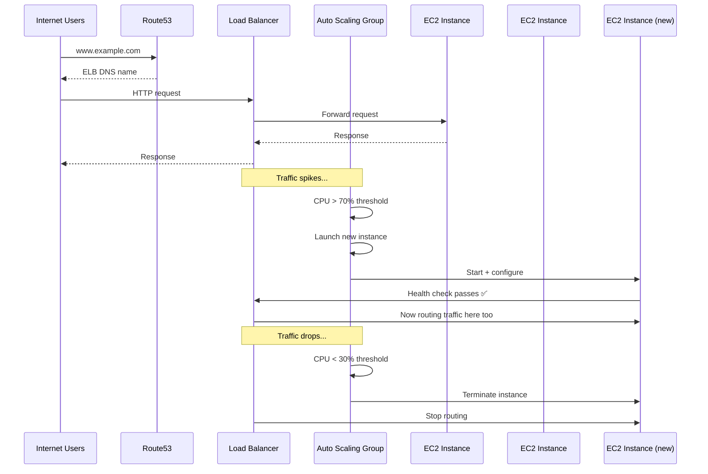
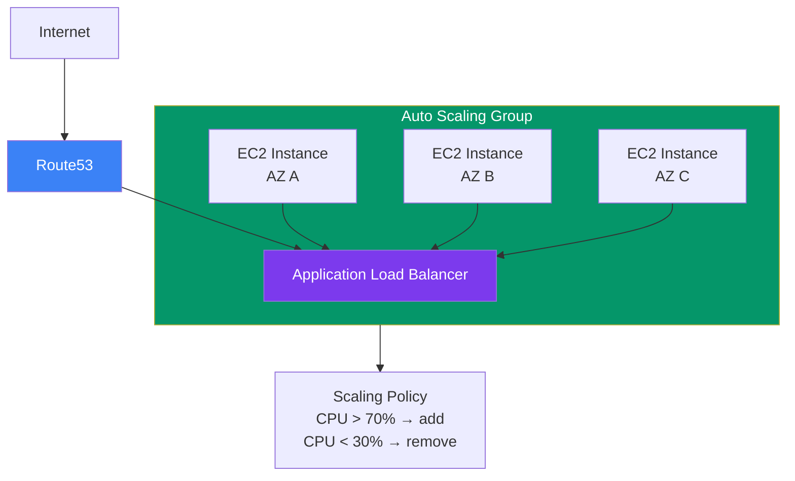

## Load Balancing & Auto Scaling

**Elastic Load Balancing (ELB)** distributes incoming traffic across multiple targets (EC2 instances, Lambda, containers). **Auto Scaling** automatically adjusts the number of instances based on demand.

> **Analogy:** A load balancer is like a smart receptionist at a busy office — they direct visitors to the right person. Auto scaling is like hiring or letting go of staff based on how busy the office is.

---

### Load Balancer + Auto Scaling Flow



---

### ELB — Elastic Load Balancer

**Three types of load balancers:**

| Type | Protocol | Best For |
|------|----------|----------|
| **ALB (Application LB)** | HTTP/HTTPS, WebSocket | Web apps, microservices |
| **NLB (Network LB)** | TCP/UDP | Ultra-high performance, static IP |
| **CLB (Classic LB)** | HTTP/HTTPS/TCP | Legacy apps (avoid for new projects) |

**ALB features:**
- Path-based routing (`/api/*` → one target group, `/web/*` → another)
- Host-based routing (`api.example.com` → one group, `app.example.com` → another)
- WebSocket and HTTP/2 support
- Integrated with AWS WAF (web application firewall)

```bash
# Create an ALB
aws elbv2 create-load-balancer \
    --name my-alb \
    --subnets subnet-123 subnet-456 \
    --security-groups sg-789

# Create target group
aws elbv2 create-target-group \
    --name my-targets \
    --protocol HTTP \
    --port 80 \
    --vpc-id vpc-123
```

---

### Auto Scaling Group

**Auto Scaling ensures:**
- **Min size** — always run at least N instances
- **Max size** — never exceed M instances (cost control)
- **Desired capacity** — start with N instances

```bash
# Create launch template (AMI, instance type, etc.)
aws ec2 create-launch-template \
    --launch-template-name my-template \
    --launch-template-data '{"ImageId":"ami-123","InstanceType":"t3.micro"}'

# Create auto scaling group
aws autoscaling create-auto-scaling-group \
    --auto-scaling-group-name my-asg \
    --launch-template LaunchTemplateName=my-template \
    --min-size 2 \
    --max-size 10 \
    --desired-capacity 3 \
    --vpc-zone-identifier subnet-123,subnet-456

# Add scaling policy (target tracking)
aws autoscaling put-scaling-policy \
    --auto-scaling-group-name my-asg \
    --policy-name cpu-target \
    --policy-type TargetTrackingScaling \
    --target-tracking-configuration '{"TargetValue":70.0,"PredefinedMetricSpecification":{"PredefinedMetricType":"ASGAverageCPUUtilization"}}'
```

---

### ELB + Auto Scaling Architecture



---

### Health Checks

- ELB health checks ping instances every N seconds
- If an instance fails 3 consecutive checks → it's marked **unhealthy**
- Auto Scaling replaces unhealthy instances automatically
- Always implement a `/health` endpoint in your app

```python
# Simple health check endpoint (Node.js Express example)
app.get('/health', (req, res) => {
  const dbConnected = checkDatabaseConnection();
  if (dbConnected) {
    res.status(200).json({ status: 'healthy' });
  } else {
    res.status(503).json({ status: 'unhealthy' });
  }
});
```

---

### In Simple Words

- **ELB** distributes traffic across instances — improves reliability and performance
- **ALB** is the modern standard for HTTP/HTTPS apps (path/host-based routing)
- **Auto Scaling** adds/removes instances automatically based on CPU, memory, or custom metrics
- Together they provide **high availability** and **cost efficiency**
- Always have **at least 2 instances across 2 AZs** for production
- Health checks ensure traffic only goes to **healthy** instances
