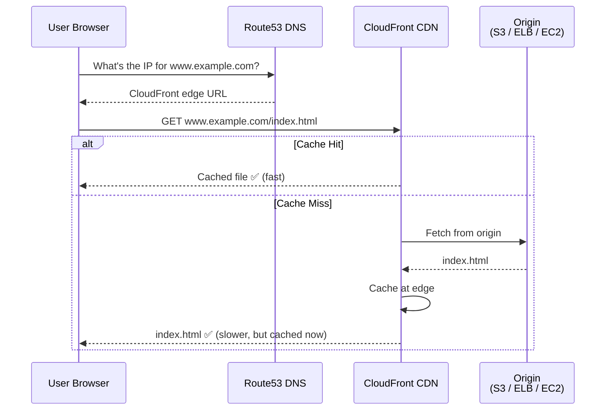
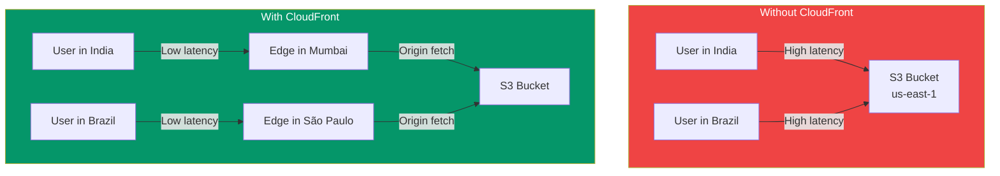

## Route53 & CloudFront

**Route53** is AWS's DNS service (Domain Name System) — it translates domain names like `example.com` into IP addresses. **CloudFront** is a **Content Delivery Network (CDN)** that delivers content from edge locations worldwide.

> **Analogy:** Route53 is like a phone book for the internet — it tells browsers how to find your website. CloudFront is like a chain of local warehouses — it stores copies of your content closer to users so they get it faster.

---

### How Route53 + CloudFront Work Together



---

### Route53 — DNS Service

**What Route53 does:**
- Registers domain names (or use existing domains)
- Routes users to your AWS resources
- Checks health of your endpoints (health checks)
- Supports failover routing (automatic disaster recovery)

**Common record types:**
```bash
# A record — maps domain to IPv4
aws route53 change-resource-record-sets \
    --hosted-zone-id Z123456 \
    --change-batch '{
        "Changes": [{
            "Action": "CREATE",
            "ResourceRecordSet": {
                "Name": "www.example.com",
                "Type": "A",
                "TTL": 300,
                "ResourceRecords": [{"Value": "203.0.113.10"}]
            }
        }]
    }'

# CNAME — maps domain to another domain
# Alias — maps to AWS resources (free, no TTL cost)
```

**Routing policies:**

| Policy | What It Does |
|--------|-------------|
| **Simple** | Route to a single resource (default) |
| **Weighted** | Split traffic (e.g., 10% to new version) |
| **Latency-based** | Route to lowest-latency region |
| **Failover** | Route to primary; fail to secondary |
| **Geolocation** | Route based on user location |

---

### CloudFront — Content Delivery Network

**What CloudFront does:**
- Caches content at **300+ edge locations** worldwide
- Reduces latency for users globally
- Protects against DDoS attacks (AWS Shield integration)
- Supports **static and dynamic content**

```bash
# Create a CloudFront distribution for an S3 bucket
aws cloudfront create-distribution \
    --origin-domain-name my-bucket.s3.amazonaws.com \
    --default-root-object index.html
```

**CloudFront vs S3 static hosting:**


---

### In Simple Words

- **Route53** = DNS service — maps domain names to your AWS resources
- **CloudFront** = CDN — caches content at edge locations for faster delivery
- Route53 has routing policies for **latency, failover, weighted, and geolocation** routing
- CloudFront sits **in front of your origin** (S3, ELB, EC2) and caches responses
- Together, they make your app **fast and reliable globally**
- CloudFront also provides **DDoS protection** via AWS Shield
