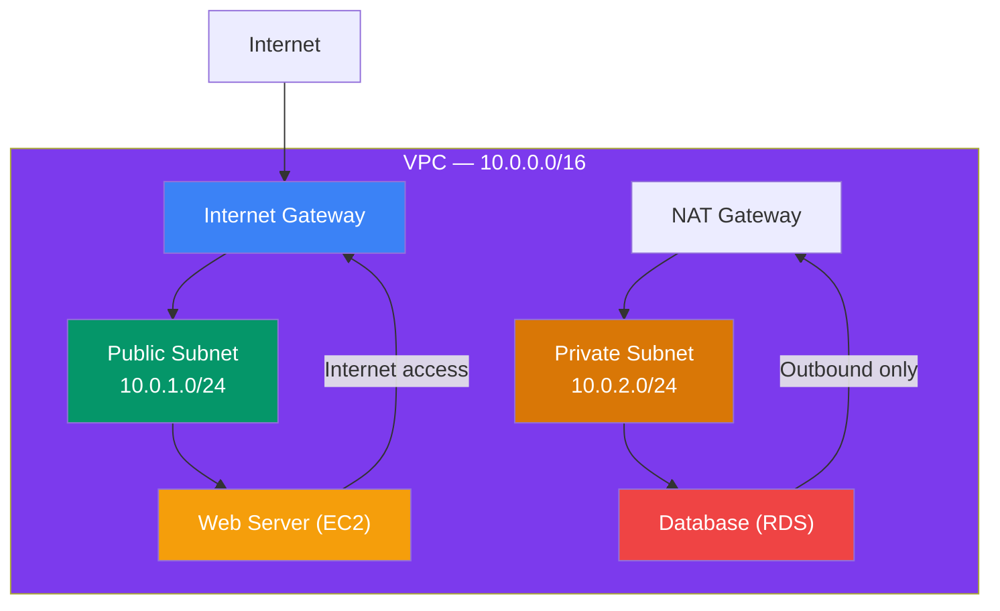
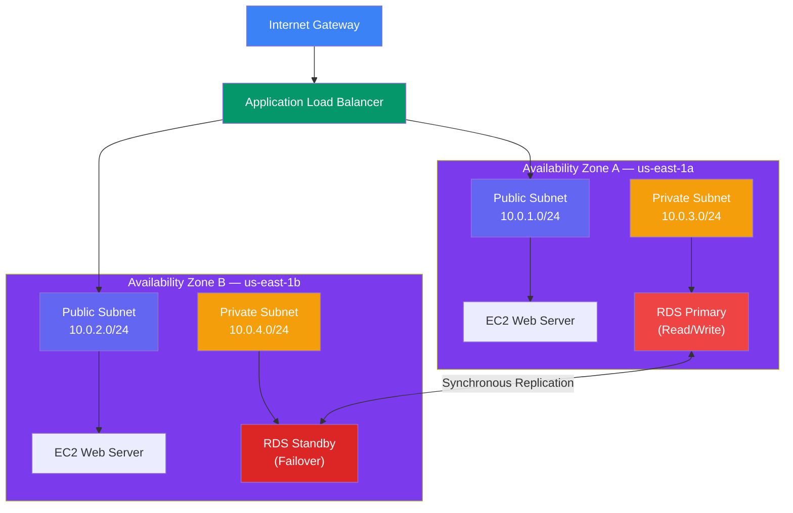
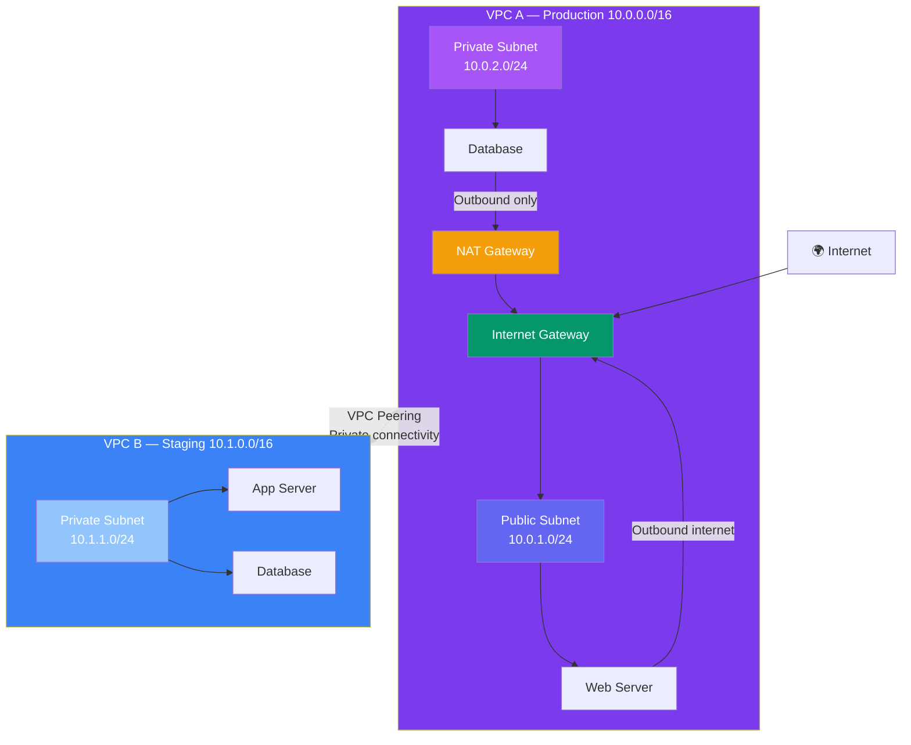
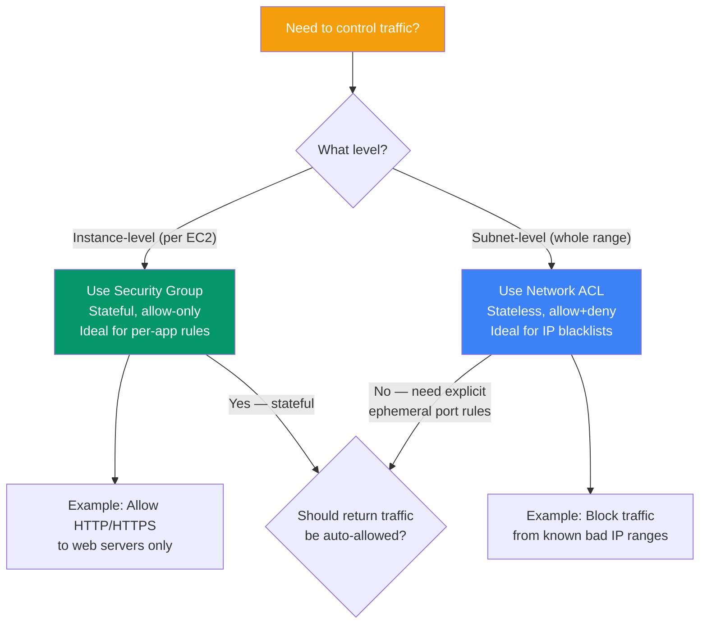

## VPC Basics

**Amazon Virtual Private Cloud (VPC)** lets you create a logically isolated private network within AWS. You control IP addressing, subnets, route tables, and gateways — just like a traditional network, but virtual.

> **Analogy:** A VPC is like your own private gated community in the cloud. Subnets are neighborhoods within that community. Security groups and NACLs are the gates that control who can enter each house.

---

### VPC Architecture



---

### Key VPC Components

| Component | What It Does |
|-----------|-------------|
| **VPC** | Isolated virtual network (CIDR block, e.g., `10.0.0.0/16`) |
| **Subnet** | A range of IPs within a VPC (public or private) |
| **Internet Gateway (IGW)** | Allows public internet access to a VPC |
| **NAT Gateway** | Allows private subnets to access internet (not inbound) |
| **Route Table** | Rules for where traffic goes |
| **Security Group** | Instance-level firewall (stateful) |
| **Network ACL (NACL)** | Subnet-level firewall (stateless) |

---

### Multi-AZ High Availability

A well-architected VPC spans **multiple Availability Zones** for fault tolerance:



---

### NAT Gateway & VPC Peering



---

### Security Groups vs NACLs

| Feature | Security Group | NACL |
|---------|---------------|------|
| **Level** | Instance-level | Subnet-level |
| **State** | Stateful (return traffic allowed) | Stateless (explicit allow for return) |
| **Rules** | Allow only | Allow and Deny |
| **Order** | All rules evaluated | Rules evaluated in order (lowest number first) |
| **Default** | Deny all inbound, allow all outbound | Allow all inbound and outbound (default NACL) |

**Security Group Example:**
```bash
# Allow HTTP from anywhere
aws ec2 authorize-security-group-ingress \
    --group-id sg-123456 \
    --protocol tcp \
    --port 80 \
    --cidr 0.0.0.0/0

# Allow SSH from office IP only
aws ec2 authorize-security-group-ingress \
    --group-id sg-123456 \
    --protocol tcp \
    --port 22 \
    --cidr 203.0.113.0/32
```

### Security Group vs NACL — Decision Flow



---

### Default VPC

Every AWS account has a **default VPC** in each region — it's pre-configured with:
- A VPC with a `/16` CIDR block
- A public subnet in each AZ
- An internet gateway
- A default route table

Most beginners start with the default VPC. It's ready to use immediately.

---

### Creating a Custom VPC

```bash
# Create VPC
aws ec2 create-vpc --cidr-block 10.0.0.0/16

# Create subnets
aws ec2 create-subnet --vpc-id vpc-123 --cidr-block 10.0.1.0/24
aws ec2 create-subnet --vpc-id vpc-123 --cidr-block 10.0.2.0/24

# Attach internet gateway
aws ec2 create-internet-gateway
aws ec2 attach-internet-gateway --vpc-id vpc-123 --internet-gateway-id igw-456

# Create route to internet
aws ec2 create-route --route-table-id rtb-789 \
    --destination-cidr-block 0.0.0.0/0 \
    --gateway-id igw-456
```

---

### In Simple Words

- A **VPC** is your own private network in the AWS cloud
- **Subnets** divide your VPC into public and private sections
- **Security groups** = instance-level firewalls; **NACLs** = subnet-level firewalls
- **Internet Gateway** connects public subnets to the internet
- Each region comes with a **default VPC** ready to use immediately
